<p align="center">
  <picture>
    <source media="(prefers-color-scheme: dark)" srcset="assets/images/banner_dark.svg">
    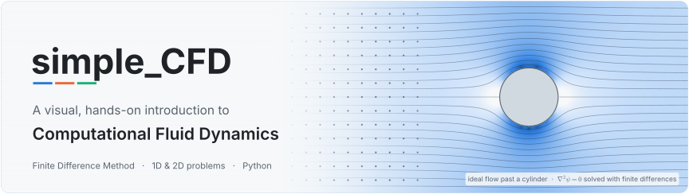
  </picture>
</p>

<p align="center">
  
  
  
  
  
  
  
</p>

<p align="center">
  <b>From a physical problem to a coloured plot: learn the complete CFD workflow, one pillar at a time.</b>
</p>

<p align="center">
  <a href="#-what-is-cfd">What is CFD?</a>&nbsp;&nbsp;·&nbsp;&nbsp;
  <a href="#-the-7-pillars-of-cfd">The 7 pillars</a>&nbsp;&nbsp;·&nbsp;&nbsp;
  <a href="#-course-problems">Course problems</a>&nbsp;&nbsp;·&nbsp;&nbsp;
  <a href="#-getting-started">Getting started</a>&nbsp;&nbsp;·&nbsp;&nbsp;
  <a href="#-further-reading">Further reading</a>
</p>

<br>

> [!NOTE]
> **Who is this for?** Students taking their very first steps in Computational Fluid Dynamics (CFD). You need basic calculus (derivatives, Taylor series), a little linear algebra and some Python. Everything else is built up on this page, one step at a time.
>
> **How to read it:** first we ask *what problem CFD solves*, then we walk through the **7 pillars** every CFD analysis is built on. One small problem, marked 🔥 **Running example**, follows us through all seven pillars so you can see each idea applied. Then you practise on [five worked problems](#-course-problems), each with a problem sheet, a step-by-step solution and a plain-Python notebook.

## 📖 Contents

1. [What is CFD?](#-what-is-cfd)
2. [The 7 pillars of CFD](#-the-7-pillars-of-cfd)
   1. [Geometry: model the domain](#pillar-1--geometry-model-the-domain)
   2. [Grid generation: divide the domain](#pillar-2--grid-generation-divide-the-domain)
   3. [Physics: governing equations](#pillar-3--physics-choose-the-governing-equations)
   4. [Numerical scheme: PDE → algebra](#pillar-4--numerical-scheme-from-pde-to-algebraic-equations)
   5. [Numerical solution setup](#pillar-5--numerical-solution-setup-choose-the-algorithm)
   6. [Compute: run the program](#pillar-6--compute-run-the-program)
   7. [Post-processing: visualize and verify](#pillar-7--post-processing-visualize-and-verify)
3. [Course problems](#-course-problems)
4. [Repository layout](#-repository-layout)
5. [Getting started](#-getting-started)
6. [Glossary](#-glossary)
7. [Further reading](#-further-reading)

<br>

## 🌊 What is CFD?

Every CFD study starts with a **physical problem**, not with a computer. Something happens in the real world, such as air flowing over a wing, heat spreading through an engine block, blood pumping through an artery or smoke rising from a chimney, and we want to **predict** it.

Every such problem has three ingredients:

| | Ingredient | The question it answers | In the example below |
|:-:|---|---|---|
| 📐 | **Geometry** (the domain) | *Where* does it happen? In a defined volume of space, the **control volume**, bounded by walls, inlets and outlets. | the inside of a duct with a cylinder in it |
| 🌀 | **Physics** | *What* happens inside that volume? | air flows in, speeds up around the cylinder and flows out |
| ✍️ | **Mathematical model** | *How* do we describe it? With conservation laws (mass, momentum, energy) written as **partial differential equations (PDEs)**, plus boundary and initial conditions. | the Navier–Stokes equations, or the simpler $`\nabla^2\psi = 0`$ |

<p align="center">
  <picture>
    <source media="(prefers-color-scheme: dark)" srcset="assets/images/cfd_problem_dark.svg">
    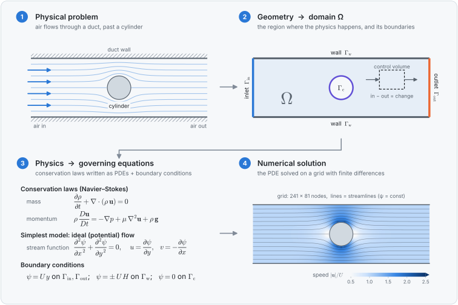
  </picture>
</p>

> [!IMPORTANT]
> **CFD in one sentence:** we take a *geometry* in which a *physical event* happens, describe that event with *mathematical equations* (PDEs), and, because those equations can almost never be solved by hand, we solve them *approximately, with numerical methods, on a computer*.

### Why do we need numerical methods?

The equations of fluid flow and heat transfer have exact (analytical) solutions only in very simple situations, like a flat plate, a straight pipe or a perfect sphere, and usually only after strong simplifications. Real problems combine complicated geometry with nonlinear, coupled equations, and no formula exists for their solution. Numerical methods trade the exact solution, known at *every* point, for an approximate one known at a *finite number* of points, which a computer can calculate.

| | ✍️ Analytical solution | 💻 Numerical solution (CFD) |
|---|---|---|
| **Geometry** | simple: plates, pipes, spheres | arbitrary: cars, aircraft, buildings, arteries |
| **Equations** | linear, heavily simplified | nonlinear, coupled, 3D, unsteady |
| **Result** | a formula, valid everywhere | numbers at a finite set of grid points |
| **Accuracy** | exact (for the chosen model) | approximate; the error shrinks as the grid is refined |
| **Cost** | pen and paper | computer time and memory |

> [!TIP]
> Analytical solutions are still precious: they are how we **check** a CFD code. Wherever an exact solution exists, the figures on this page compare the numerical result against it.

### One equation, many physics

Most governing equations in CFD are special cases of a single **generic transport equation** for a quantity $\phi$:

```math
\underbrace{\frac{\partial (\rho\phi)}{\partial t}}_{\text{rate of change}}
\;+\;
\underbrace{\nabla\cdot(\rho\,\mathbf{u}\,\phi)}_{\text{convection (carried by the flow)}}
\;=\;
\underbrace{\nabla\cdot(\Gamma\,\nabla\phi)}_{\text{diffusion (spreading)}}
\;+\;
\underbrace{S_\phi}_{\text{source}}
```

| Choose $\phi$ = | … and you get conservation of |
|---|---|
| $1$ | **mass** (the continuity equation) |
| $u$, $v$, $w$ (velocity components) | **momentum** (the Navier–Stokes equations) |
| $T$ (temperature) | **energy** (heat transfer) |
| $c$ (concentration) | a **chemical species** (pollution, mixing) |

<br>

## 🧭 The 7 pillars of CFD

Whatever the problem and whatever the software, every CFD analysis rests on the same seven pillars. They are traditionally grouped into **pre-processing**, **solving** and **post-processing**:

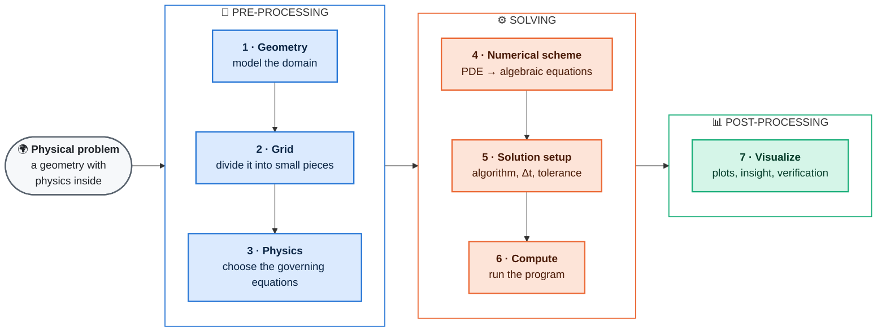

| # | Pillar | The question you answer | What you get |
|:-:|---|---|---|
| 1 | **Geometry** | What does the domain look like? | the shape and size of the domain $\Omega$ and its boundaries |
| 2 | **Grid** | How do I divide the domain into small pieces? | nodes, cells or elements |
| 3 | **Physics** | Which equations describe what happens? | PDEs + boundary and initial conditions |
| 4 | **Numerical scheme** | How do I turn derivatives into arithmetic? | a set of algebraic equations |
| 5 | **Solution setup** | Which algorithm solves them, and how? | a solver, time step, tolerances |
| 6 | **Compute** | Which tool runs the calculation? | numbers at every grid point |
| 7 | **Visualize** | What does it all mean? | plots, quantities of interest, verification |

> 🔥 **Running example: heating a rod.** To make the pillars concrete, we follow one small problem through all seven: a thin metal rod starts at 20 °C, then its left end is suddenly heated to 100 °C while its right end is kept at 20 °C. *How does the temperature inside the rod change with time?*

<br>

### Pillar 1 · Geometry: model the domain

First, define precisely **where** the physics happens: the **computational domain** $\Omega$ and its **boundaries** (inlets, outlets, walls, symmetry planes). Good geometry modelling is mostly about smart *simplification*:

- **Dimension:** can a 3D problem be reduced to 2D (long bodies with uniform cross-section) or even to 1D (thin rods, long pipes)? Every dimension you remove cuts the cost enormously.
- **Symmetry:** if both geometry and physics are symmetric, model only half (or a quarter) of the domain.
- **Defeaturing:** small bolts, fillets and logos rarely change the result; remove them.
- **Extent:** put inlets and outlets far enough away that they do not disturb the region you care about.

| Dimension | Example | Domain |
|:-:|---|---|
| **1D** | heat conduction along a thin rod | a line, $0 \le x \le L$ |
| **2D** | flow around a long cylinder, a heated plate | a plane region |
| **3D** | flow around a car | a volume |

In this course the geometries are simple enough to define directly in Python. Real projects use CAD tools such as FreeCAD, Onshape or SolidWorks, or the geometry modules of Gmsh and Salome.

> 🔥 **Rod:** the rod is long and thin, so its temperature varies only along its length. The domain is **1D**, $0 \le x \le L$, with one boundary at the hot end ($x = 0$) and one at the cold end ($x = L$).

### Pillar 2 · Grid generation: divide the domain

A computer cannot store a value at the infinitely many points of a continuous domain. So we **discretize** the domain: we replace it with a finite number of small pieces, a **grid** (or **mesh**), and compute the unknowns only there. There are three main families of methods. They differ in *what* the pieces are and *how* the equations are applied to them:

<p align="center">
  <picture>
    <source media="(prefers-color-scheme: dark)" srcset="assets/images/grid_methods_dark.svg">
    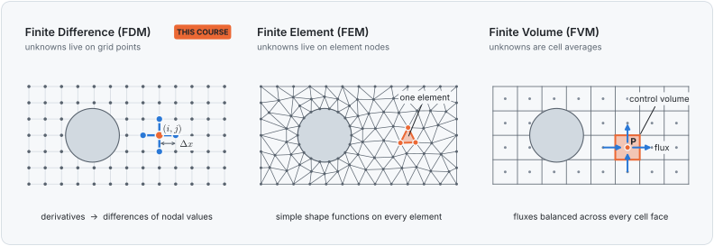
  </picture>
</p>

| | Finite Difference (FDM) | Finite Element (FEM) | Finite Volume (FVM) |
|---|---|---|---|
| **Unknowns stored at** | grid points (nodes) | element nodes | cell centres (cell averages) |
| **Form of the equations** | differential form | weak (weighted-integral) form | integral (conservation) form |
| **Key idea** | replace derivatives by differences, using Taylor series | approximate the solution by simple functions on each element | balance the fluxes through the faces of each cell |
| **Typical grid** | structured, usually Cartesian | unstructured, any shape | structured or unstructured |
| **Strengths** | simple, intuitive, easy to code | complex geometries, solid mechanics, rigorous theory | conserves mass, momentum and energy exactly; robust for fluids |
| **Typical software** | teaching and research codes | Abaqus, COMSOL, FEniCS | OpenFOAM, ANSYS Fluent, STAR-CCM+, SU2 |

> [!NOTE]
> **This course uses the Finite Difference Method.** It is the most direct translation of calculus into code, which makes it the best way to *learn* how CFD works. The core ideas (grids, discretization, stability, convergence) carry straight over to FEM and FVM.

A few words you will meet constantly:

- **Node:** a point where an unknown is stored, labelled by its index $i$ (1D) or $(i, j)$ (2D).
- **Grid spacing:** $\Delta x$, $\Delta y$, the distance between neighbouring nodes.
- **Structured / unstructured:** nodes in regular rows and columns, or connected arbitrarily.
- **Resolution:** a finer grid gives smaller errors but more unknowns and longer run times. A **grid-independence study**, where you refine until the answer stops changing, tells you when the grid is fine enough.

> 🔥 **Rod:** we place $N+1$ equally spaced nodes $`x_i = i\,\Delta x`$, $`i = 0, 1, \dots, N`$, with $`\Delta x = L/N`$. With $N = 20$, the whole rod is represented by just 21 temperatures.

### Pillar 3 · Physics: choose the governing equations

Now decide **which physics matters** and write down its equations. Ask yourself:

- Is the problem **steady** or **unsteady**?
- Is the flow **compressible** or **incompressible**? **Viscous** or **inviscid**? **Laminar** or **turbulent**?
- Does **heat transfer** matter? Are there other effects, such as buoyancy, chemical reactions or several phases?

Every "yes" adds terms or equations; every justified "no" makes the problem simpler. The model equations below are the classic building blocks of CFD, and the ones you will meet in this course:

| Equation | Form | Type | Describes |
|---|---|:-:|---|
| **Laplace** | $`\nabla^2 \phi = 0`$ | elliptic | steady heat conduction, ideal (potential) flow |
| **Poisson** | $`\nabla^2 \phi = f`$ | elliptic | conduction with heat sources, the pressure equation |
| **Heat / diffusion** | $`\partial T/\partial t = \alpha\,\nabla^2 T`$ | parabolic | unsteady conduction, diffusion |
| **Linear advection** | $`\partial u/\partial t + c\,\partial u/\partial x = 0`$ | hyperbolic | a quantity carried along by a flow |
| **Burgers** | $`\partial u/\partial t + u\,\partial u/\partial x = \nu\,\partial^2 u/\partial x^2`$ | mixed | nonlinear convection + diffusion: a 1D "toy" Navier–Stokes |
| **Navier–Stokes** | $`\rho\,D\mathbf{u}/Dt = -\nabla p + \mu\,\nabla^2 \mathbf{u}`$ | mixed | general viscous fluid flow |

The **type** tells you how information travels, and therefore which numerical methods are appropriate. In **elliptic** problems every point influences every other point, so the whole domain is solved at once. **Parabolic** problems march forward in time while smoothing out. **Hyperbolic** problems carry information along particular directions at a finite speed.

A PDE alone has infinitely many solutions. The **boundary conditions** (and, for unsteady problems, the **initial conditions**) pick out the one that matches your physical problem:

| Boundary condition | Prescribes | Example |
|---|---|---|
| **Dirichlet** | the value, $`T = T_w`$ | a wall held at a fixed temperature, a known inlet velocity |
| **Neumann** | the gradient, $`\partial T/\partial n = g`$ | an insulated wall ($`\partial T/\partial n = 0`$), a symmetry plane |
| **Robin** (mixed) | a combination, $`-k\,\partial T/\partial n = h\,(T - T_\infty)`$ | a surface cooled by the surrounding air |

> 🔥 **Rod:** pure heat conduction with constant material properties gives the **1D heat equation**, with two Dirichlet boundary conditions and one initial condition:
>
> ```math
> \frac{\partial T}{\partial t} = \alpha\,\frac{\partial^2 T}{\partial x^2},
> \qquad T(0,t) = 100\,^{\circ}\mathrm{C},\quad T(L,t) = 20\,^{\circ}\mathrm{C},\quad T(x,0) = 20\,^{\circ}\mathrm{C}
> ```
>
> where $`\alpha = k/(\rho c_p)`$ is the thermal diffusivity of the metal.

### Pillar 4 · Numerical scheme: from PDE to algebraic equations

This is the heart of the finite difference method. A derivative is the limit of a difference quotient as the spacing goes to zero. On a grid the spacing cannot go to zero, so we simply keep the **difference**. A Taylor series tells us exactly how good that approximation is:

```math
f(x_i+\Delta x) = f_i + \Delta x\, f'_i + \frac{\Delta x^2}{2}\, f''_i + \frac{\Delta x^3}{6}\, f'''_i + \cdots
```

Solving for $`f'_i`$ gives the **forward difference** plus the terms we throw away, called the **truncation error**:

```math
f'_i = \frac{f_{i+1}-f_i}{\Delta x} \;\underbrace{-\;\frac{\Delta x}{2}\, f''_i - \cdots}_{\text{truncation error, } \mathcal{O}(\Delta x)}
```

<p align="center">
  <picture>
    <source media="(prefers-color-scheme: dark)" srcset="assets/images/finite_differences_dark.svg">
    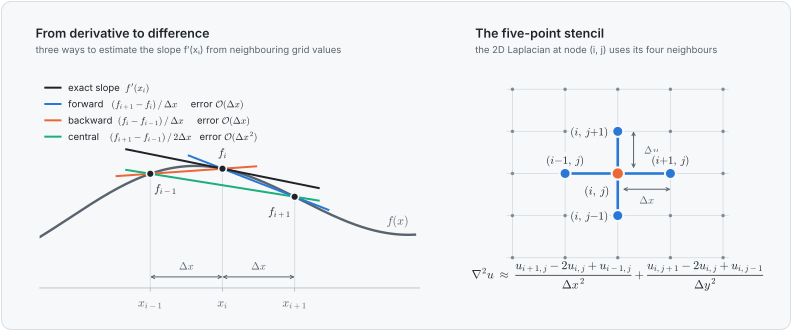
  </picture>
</p>

| Approximates | Formula | Name | Order of accuracy |
|---|---|---|:-:|
| $`f'_i`$ | $`(f_{i+1}-f_i)\,/\,\Delta x`$ | forward difference | 1st |
| $`f'_i`$ | $`(f_i-f_{i-1})\,/\,\Delta x`$ | backward difference | 1st |
| $`f'_i`$ | $`(f_{i+1}-f_{i-1})\,/\,(2\Delta x)`$ | central difference | 2nd |
| $`f''_i`$ | $`(f_{i+1}-2f_i+f_{i-1})\,/\,\Delta x^2`$ | central difference | 2nd |

**Order $p$** means the error behaves like $`\Delta x^p`$: halving the grid spacing divides the error of a 2nd-order scheme by 4. Writing such a formula at every node replaces the PDE with a set of **algebraic equations**, each linking a node to its neighbours (its **stencil**).

> 🔥 **Rod:** use a forward difference in time (time step $\Delta t$, time level $n$) and a central difference in space:
>
> ```math
> \frac{T_i^{\,n+1}-T_i^{\,n}}{\Delta t} = \alpha\,\frac{T_{i+1}^{\,n}-2T_i^{\,n}+T_{i-1}^{\,n}}{\Delta x^2}
> \quad\Longrightarrow\quad
> T_i^{\,n+1} = T_i^{\,n} + r\left(T_{i+1}^{\,n}-2T_i^{\,n}+T_{i-1}^{\,n}\right),
> \qquad r = \frac{\alpha\,\Delta t}{\Delta x^2}
> ```
>
> This is the **FTCS** scheme (Forward in Time, Centred in Space). The PDE has become plain arithmetic.

### Pillar 5 · Numerical solution setup: choose the algorithm

Once you have the algebraic equations, there are many ways to solve them, and each has its own pros and cons in speed, memory, accuracy and robustness. Three decisions come up in almost every problem.

#### ① Explicit or implicit?

<p align="center">
  <picture>
    <source media="(prefers-color-scheme: dark)" srcset="assets/images/explicit_implicit_dark.svg">
    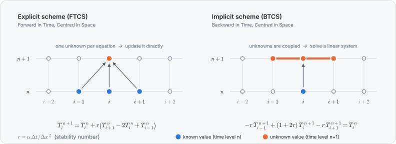
  </picture>
</p>

| | Explicit (e.g. FTCS) | Implicit (e.g. BTCS, Crank–Nicolson) |
|---|---|---|
| **New values come from** | old values only | old values *and* each other |
| **Work per time step** | ✅ tiny: just arithmetic | ❌ solve a linear system |
| **Coding effort** | ✅ a few lines | ⚠️ needs a matrix solver |
| **Time step** | ❌ limited by stability ($`r \le 1/2`$ for FTCS) | ✅ any $\Delta t$ is stable; choose it for accuracy |

#### ② Is the scheme stable?

A scheme is **stable** if small errors (round-off, sharp jumps in the initial data) die out instead of growing. Exceed the stability limit by just a few percent and the solution explodes:

<p align="center">
  <picture>
    <source media="(prefers-color-scheme: dark)" srcset="assets/images/stability_dark.svg">
    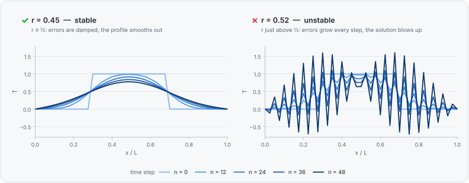
  </picture>
</p>

> [!WARNING]
> **Consistency + stability = convergence** (the Lax equivalence theorem). A scheme approaches the true solution as $\Delta x, \Delta t \to 0$ only if it is *consistent* (its truncation error vanishes) **and** *stable*. Always check your scheme's stability condition: for FTCS it is $`r = \alpha\,\Delta t/\Delta x^2 \le 1/2`$, and for explicit convection schemes it is the **CFL condition**, $`|c|\,\Delta t/\Delta x \le 1`$.

#### ③ Direct or iterative solver?

Implicit schemes and steady problems lead to a linear system $`A\,\mathbf{u} = \mathbf{b}`$. The matrix $A$ is huge but **sparse** (almost all zeros), because each equation involves only a node and its neighbours:

<p align="center">
  <picture>
    <source media="(prefers-color-scheme: dark)" srcset="assets/images/solvers_dark.svg">
    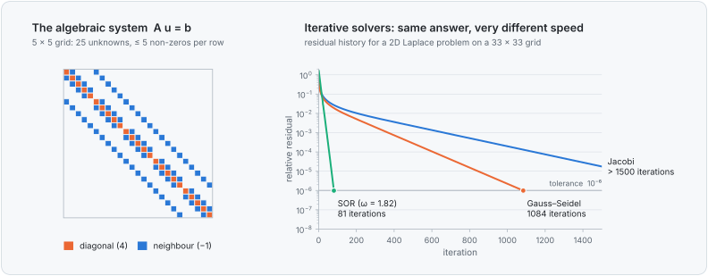
  </picture>
</p>

| Solver | Idea | 👍 Pros | 👎 Cons |
|---|---|---|---|
| **Direct** (Gaussian elimination, LU, **Thomas algorithm** for tridiagonal systems) | eliminate unknowns exactly | exact answer in one pass; Thomas costs only $O(N)$ | memory and cost explode on large 2D/3D grids |
| **Jacobi** | update every node from its neighbours' *old* values | very simple, easy to parallelise | very slow convergence |
| **Gauss–Seidel** | use *new* values as soon as they are available | about 2× faster than Jacobi, no extra memory | still slow on fine grids |
| **SOR** | over-correct each Gauss–Seidel update by a factor $1 < \omega < 2$ | often 10–100× faster than Gauss–Seidel | needs a good choice of $\omega$ |
| **Multigrid, Krylov methods** (CG, GMRES) | attack the error on several grids, or in clever search directions | state of the art for large problems | more complex to implement |

Iterative solvers also need a **convergence criterion**: stop when the residual (how badly the current guess fails to satisfy the equations) falls below a chosen **tolerance**, or when a maximum number of iterations is reached.

> 🔥 **Rod:** we choose the **explicit** FTCS scheme for its simplicity, with $`r = 0.4 \le 1/2`$, so it is stable. An implicit BTCS version would need the Thomas algorithm at every step, but would allow a much larger $\Delta t$.

### Pillar 6 · Compute: run the program

With everything set up, the computer does the arithmetic. The same algorithm can be written in many environments:

| Tool | Type | Good for |
|---|---|---|
| 🐍 **Python** (NumPy, SciPy, Matplotlib) | free, open source | learning, prototyping, **this course** |
| 📊 **Excel / LibreOffice Calc** | spreadsheet | seeing every number on a small 1D grid: one cell = one node |
| 🧮 **MATLAB / GNU Octave** | numerical computing | teaching and research, matrix-friendly syntax |
| ⚡ **C++ / Fortran / Julia** | compiled languages | large, fast production codes |
| 🌀 **OpenFOAM, SU2, code_saturne** | open-source CFD packages | real, industrial-scale problems |
| 🏭 **ANSYS Fluent, STAR-CCM+, COMSOL** | commercial CFD software | industry, with a graphical workflow |

> 🔥 **Rod:** the complete solver is about a dozen lines of Python:
>
> ```python
> import numpy as np
> import matplotlib.pyplot as plt
>
> L, N, alpha = 1.0, 20, 1e-4        # rod length [m], number of intervals, diffusivity [m²/s]
> dx = L / N                         # grid spacing           (pillar 2)
> r = 0.4                            # stability number, must be <= 0.5  (pillar 5)
> dt = r * dx**2 / alpha             # time step from r = alpha*dt/dx²
>
> x = np.linspace(0, L, N + 1)       # the grid: 21 nodes
> T = np.full(N + 1, 20.0)           # initial condition: 20 °C everywhere   (pillar 3)
> T[0] = 100.0                       # boundary condition: hot left end
>
> for n in range(600):               # march in time with FTCS               (pillars 4 + 6)
>     # NumPy evaluates the right-hand side with the old values before overwriting T
>     T[1:-1] = T[1:-1] + r * (T[2:] - 2 * T[1:-1] + T[:-2])
>
> plt.plot(x, T, "o-")               # look at the result                    (pillar 7)
> plt.xlabel("x [m]"); plt.ylabel("T [°C]"); plt.show()
> ```

### Pillar 7 · Post-processing: visualize and verify

The raw output is just a long list of numbers. Post-processing turns it into understanding, and into the **quantities of interest** that motivated the study in the first place: a maximum temperature, a heat flux, a drag force, a pressure drop.

<p align="center">
  <picture>
    <source media="(prefers-color-scheme: dark)" srcset="assets/images/postprocessing_dark.svg">
    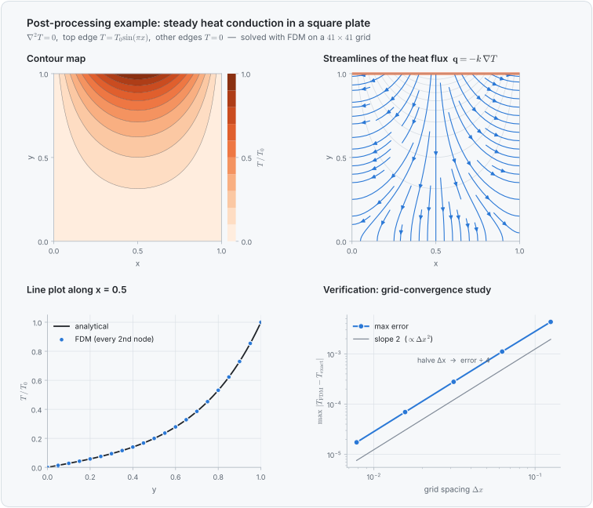
  </picture>
</p>

| Plot | Shows | Use it for |
|---|---|---|
| **Contour / colour map** | a scalar field over the whole domain | spotting hot spots, high- and low-pressure regions |
| **Vectors / streamlines** | direction and strength of a vector field | flow patterns, recirculation zones, heat paths |
| **Line plot** (profile) | values along a line | comparing with theory, experiments or other grids |
| **Animation** | how the solution changes in time | unsteady problems |
| **Convergence plot** | residuals or errors vs. iterations or grid spacing | showing that the solution can be trusted |

> [!TIP]
> **Never trust a colourful picture blindly.** *Verification* asks "are we solving the equations correctly?": compare with exact solutions and refine the grid. In the convergence plot above, the error falls exactly like $`\Delta x^2`$, as a 2nd-order scheme should. *Validation* asks "are we solving the right equations?": compare with experiments.

Popular tools: **Matplotlib** (used in this course), **ParaView** and **VisIt** (open source, made for large 2D/3D data sets), Tecplot, and the post-processors built into commercial packages.

> 🔥 **Rod:** plotting the temperature at every time step next to the exact solution gives the animation below. The 21-node FTCS solution sits right on the exact curve, and the rod settles to a straight-line temperature profile between 100 °C and 20 °C.

<p align="center">
  <picture>
    <source media="(prefers-color-scheme: dark)" srcset="assets/images/heat_rod_dark.gif">
    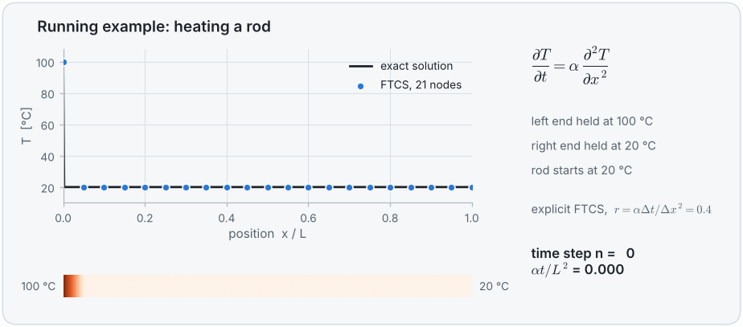
  </picture>
</p>

<br>

## 🧪 Course problems

Five worked problems take you from a 1D steady problem to a 2D problem with a convective boundary, and finally to a moving fluid that carries what it contains: convection. Each one walks through all 7 pillars, and each lives in its own folder with three files:

<p align="center">
  📄 <b>problem statement</b> (PDF) &nbsp;→&nbsp; 📘 <b>step-by-step solution</b> (PDF) &nbsp;→&nbsp; 💻 <b>Jupyter notebook</b> with the complete solver
</p>

> [!TIP]
> **The solvers use plain Python only:** lists and `for` loops, with no NumPy or SciPy. Every number is computed by code you can read line by line, so nothing about the numerical method is hidden inside a library. Plots are drawn by a small `plots.py` helper next to each notebook.

> [!NOTE]
> **For instructors:** Problems 1, 3 and 5 also have a **whiteboard guide** (`04_whiteboard_guide.pdf`). It solves the problem by hand on a coarse grid with a pocket calculator, board by board, with every intermediate number, so you can teach the method on the board before showing the code.

> [!TIP]
> **Cross-check with commercial software:** every problem also has a `comsol_solution/` folder with a COMSOL Multiphysics model and a step-by-step guide for students, comparing the finite element results with the finite difference notebook and the exact solution.

| # | Problem | Dimension | Time | Equation | New ideas |
|:-:|---|:-:|:-:|---|---|
| 1 | [Aluminium pin fin](problems/01_aluminium_fin) | 1D | steady | fin equation | ghost node for an insulated tip · Gauss–Seidel vs Thomas algorithm |
| 2 | [Phosphorus diffusion in silicon](problems/02_phosphorus_diffusion) | 1D | unsteady | diffusion (parabolic) | explicit time marching · stability $`r \le 1/2`$ · semi-infinite domain |
| 3 | [Plate with four interior nodes](problems/03_plate_four_nodes) | 2D | steady | Laplace (elliptic) | five-point stencil · Gaussian elimination vs Gauss–Seidel |
| 4 | [Brick column cooled by air](problems/04_brick_column_convection) | 2D | steady | Laplace (elliptic) | energy-balance node equations · convective boundary · symmetry |
| 5 | [Convection and diffusion](problems/05_convection_diffusion) | 1D | steady | convection–diffusion | Péclet number · central vs upwind differences · false diffusion |

<table>
  <tr>
    <td width="50%" valign="top">
      <a href="problems/01_aluminium_fin"></a>
      <p><b>1 · Aluminium pin fin</b><br><sub>Steady temperature along a fin with a hot base and an insulated tip.</sub></p>
      <p><a href="problems/01_aluminium_fin/01_problem_statement.pdf">📄 Problem</a> · <a href="problems/01_aluminium_fin/02_solution.pdf">📘 Solution</a> · <a href="problems/01_aluminium_fin/03_fdm_solver.ipynb">💻 Notebook</a> · <a href="problems/01_aluminium_fin/04_whiteboard_guide.pdf">🧮 Whiteboard</a></p>
    </td>
    <td width="50%" valign="top">
      <a href="problems/02_phosphorus_diffusion">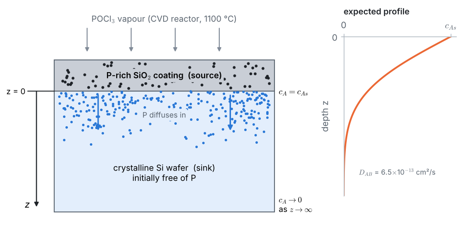</a>
      <p><b>2 · Phosphorus diffusion in silicon</b><br><sub>How deep do dopant atoms penetrate a wafer in one hour?</sub></p>
      <p><a href="problems/02_phosphorus_diffusion/01_problem_statement.pdf">📄 Problem</a> · <a href="problems/02_phosphorus_diffusion/02_solution.pdf">📘 Solution</a> · <a href="problems/02_phosphorus_diffusion/03_fdm_solver.ipynb">💻 Notebook</a></p>
    </td>
  </tr>
  <tr>
    <td width="50%" valign="top">
      <a href="problems/03_plate_four_nodes">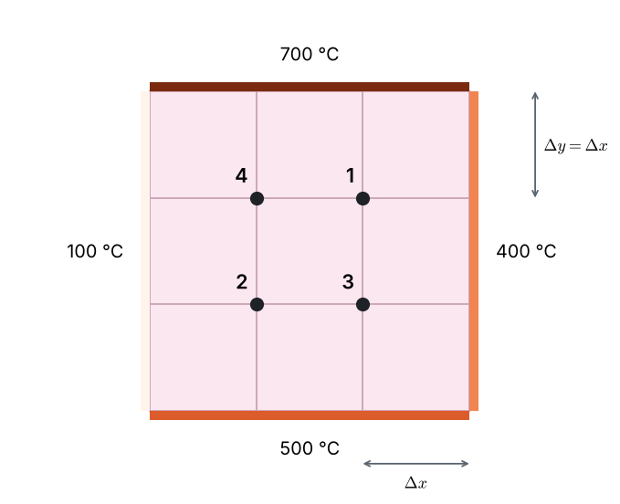</a>
      <p><b>3 · Plate with four interior nodes</b><br><sub>Temperatures inside a plate whose four edges are held at different temperatures.</sub></p>
      <p><a href="problems/03_plate_four_nodes/01_problem_statement.pdf">📄 Problem</a> · <a href="problems/03_plate_four_nodes/02_solution.pdf">📘 Solution</a> · <a href="problems/03_plate_four_nodes/03_fdm_solver.ipynb">💻 Notebook</a> · <a href="problems/03_plate_four_nodes/04_whiteboard_guide.pdf">🧮 Whiteboard</a></p>
    </td>
    <td width="50%" valign="top">
      <a href="problems/04_brick_column_convection">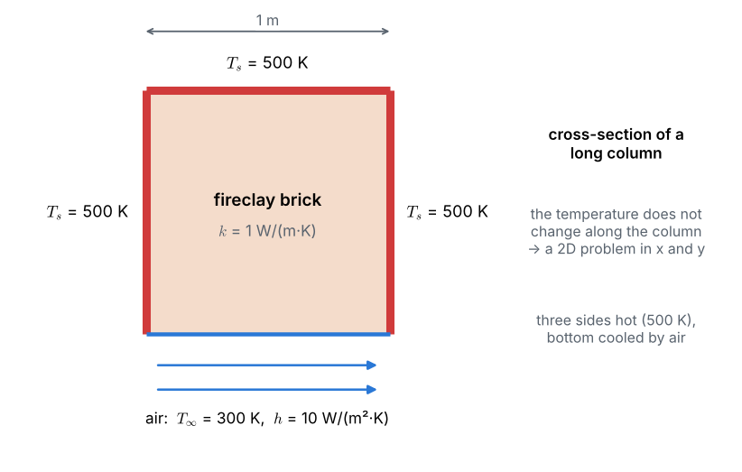</a>
      <p><b>4 · Brick column cooled by air</b><br><sub>A furnace support column with three hot faces and one face cooled by an air stream.</sub></p>
      <p><a href="problems/04_brick_column_convection/01_problem_statement.pdf">📄 Problem</a> · <a href="problems/04_brick_column_convection/02_solution.pdf">📘 Solution</a> · <a href="problems/04_brick_column_convection/03_fdm_solver.ipynb">💻 Notebook</a></p>
    </td>
  </tr>
  <tr>
    <td width="50%" valign="top">
      <a href="problems/05_convection_diffusion">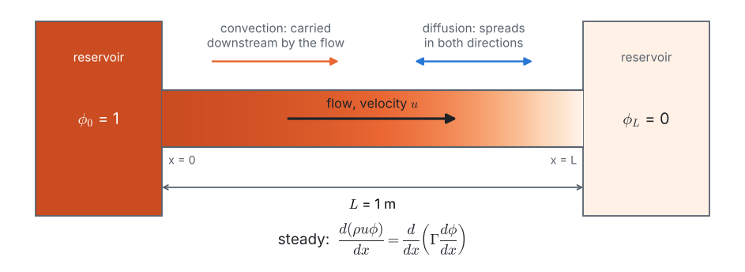</a>
      <p><b>5 · Convection and diffusion</b><br><sub>A flow carries heat or a dye between two reservoirs: central or upwind differences?</sub></p>
      <p><a href="problems/05_convection_diffusion/01_problem_statement.pdf">📄 Problem</a> · <a href="problems/05_convection_diffusion/02_solution.pdf">📘 Solution</a> · <a href="problems/05_convection_diffusion/03_fdm_solver.ipynb">💻 Notebook</a> · <a href="problems/05_convection_diffusion/04_whiteboard_guide.pdf">🧮 Whiteboard</a></p>
    </td>
    <td width="50%" valign="top">
      <a href="problems/05_convection_diffusion">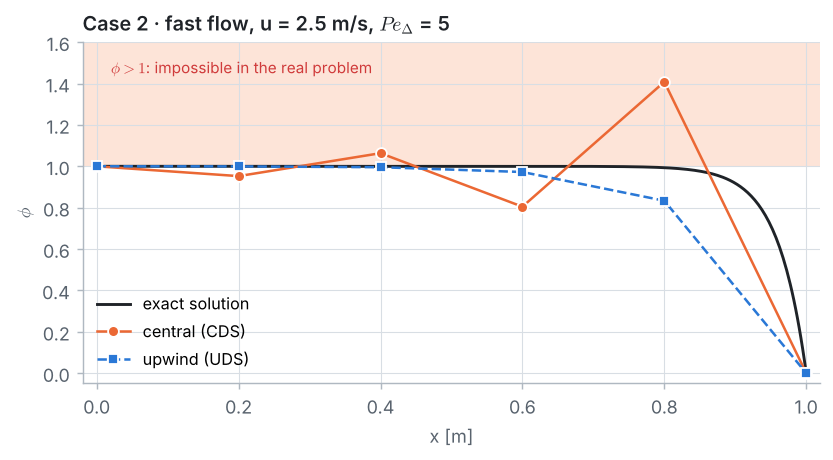</a>
      <p><b>5 · The result</b><br><sub>When the cell Péclet number exceeds 2, central differences wiggle outside the physical range; upwind stays bounded but smeared.</sub></p>
    </td>
  </tr>
</table>

<br>

## 📁 Repository layout

```text
simple_CFD/
├── README.md                    ← you are here: the CFD primer
├── requirements.txt             ← Python packages used in the course
├── problems/
│   ├── 01_aluminium_fin/
│   │   ├── 01_problem_statement.pdf
│   │   ├── 02_solution.pdf
│   │   ├── 03_fdm_solver.ipynb  ← plain-Python solver, step by step
│   │   ├── 04_whiteboard_guide.pdf ← hand calculation for the board (Problems 1, 3 and 5)
│   │   ├── plots.py             ← drawing helpers for the notebook
│   │   └── docs/                ← Markdown sources of the PDFs + figures
│   ├── 02_phosphorus_diffusion/ ← same layout in every problem folder
│   ├── 03_plate_four_nodes/
│   ├── 04_brick_column_convection/
│   └── 05_convection_diffusion/
├── tools/
│   └── build_docs.py            ← runs the notebooks and rebuilds the PDFs
└── assets/
    ├── make_figures.py          ← generates every figure on this page
    └── images/                  ← the figures, in light and dark versions
```

<br>

## 🚀 Getting started

```bash
git clone https://github.com/maryamomer2004/simple_CFD.git
cd simple_CFD
python -m venv .venv && source .venv/bin/activate   # optional, but recommended
pip install -r requirements.txt
jupyter lab problems/01_aluminium_fin/03_fdm_solver.ipynb   # open the first problem
```

No installation at all? Every notebook can also be read directly on GitHub, with its outputs and plots, or opened in [Google Colab](https://colab.research.google.com/) (upload the notebook together with the `plots.py` file next to it).

> [!TIP]
> Every figure on this page is computed by [`assets/make_figures.py`](assets/make_figures.py) (run `python assets/make_figures.py` to rebuild them) with the finite difference method. Open it to find more small FDM solvers: the Laplace equation solved directly, the heat equation marched with FTCS, and Jacobi, Gauss–Seidel and SOR iterations.

<details>
<summary><b>For instructors: editing the problems and rebuilding the PDFs</b></summary>
<br>

The PDFs are generated from the Markdown files in each problem's `docs/` folder, and pull their code, printed results and figures straight from the notebook, so the three files always agree. After editing a notebook or a Markdown source, run:

```bash
pip install nbclient ipykernel
python tools/build_docs.py                      # all problems, or e.g. 01_aluminium_fin for one
```

This needs [pandoc](https://pandoc.org/) and Google Chrome or Chromium (use `--chrome PATH` if it is not found automatically). The script re-runs each notebook, exports its tagged figures and prints the PDFs.

</details>

<br>

## 🔤 Glossary

<details>
<summary><b>Click to expand the key terms of this course</b></summary>
<br>

| Term | Meaning |
|---|---|
| **Domain (control volume)** | the region of space in which the problem is solved |
| **Boundary condition** | what is prescribed on the edges of the domain: a value (Dirichlet), a gradient (Neumann) or a mix (Robin) |
| **Initial condition** | the state of the system at time $t = 0$ (unsteady problems only) |
| **Grid / mesh** | the set of points or cells that replaces the continuous domain |
| **Node** | a point of the grid where an unknown is stored |
| **Discretization** | replacing continuous derivatives by algebraic approximations on a grid |
| **Stencil** | the group of neighbouring nodes used by a difference formula |
| **Truncation error** | the terms of the Taylor series dropped by a difference formula |
| **Order of accuracy** | how fast the truncation error shrinks with the grid spacing, $`\propto \Delta x^p`$ |
| **Consistency** | the discrete equations become the PDE as $\Delta x, \Delta t \to 0$ |
| **Stability** | errors do not grow as the computation proceeds |
| **Convergence** | the numerical solution approaches the exact one as the grid is refined |
| **CFL number** | $`c\,\Delta t/\Delta x`$: how many cells information crosses per time step |
| **Explicit / implicit** | new values computed directly from old ones / from a system of coupled equations |
| **Steady / unsteady** | solution independent of time / changing in time |
| **Residual** | how far the current iterate is from satisfying the discrete equations |
| **Grid independence** | the stage where refining the grid no longer changes the answer noticeably |
| **Verification / validation** | solving the equations right / solving the right equations |

</details>

<br>

## 📚 Further reading

- **J. D. Anderson**, *Computational Fluid Dynamics: The Basics with Applications*, McGraw-Hill, 1995. The classic, gentle first book on CFD.
- **H. K. Versteeg & W. Malalasekera**, *An Introduction to Computational Fluid Dynamics: The Finite Volume Method*, 2nd ed., Pearson, 2007.
- **S. V. Patankar**, *Numerical Heat Transfer and Fluid Flow*, Hemisphere, 1980.
- **J. H. Ferziger, M. Perić & R. L. Street**, *Computational Methods for Fluid Dynamics*, 4th ed., Springer, 2020.
- **R. J. LeVeque**, *Finite Difference Methods for Ordinary and Partial Differential Equations*, SIAM, 2007.
- **L. A. Barba & G. F. Forsyth**, *CFD Python: the 12 steps to Navier–Stokes equations*: free, interactive notebooks at [github.com/barbagroup/CFDPython](https://github.com/barbagroup/CFDPython).

<br>

<p align="center">
  <sub>Figures computed with NumPy & SciPy and drawn with Matplotlib · diagram by Mermaid · equations rendered by GitHub's MathJax · badges by Shields.io</sub>
</p>
