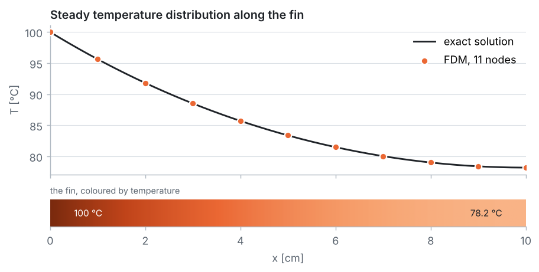

<p align="center">
  
</p>

# Problem 1 · Steady temperature distribution in an aluminium pin fin

**1D · steady · conduction + convection · Dirichlet and Neumann (insulated) boundary conditions**

> Determine the steady-state temperature distribution within an aluminium fin using the Finite Difference Method. Assume the base temperature of the fin is 100 °C and the tip of the fin is insulated. Initially the fin is at a temperature of 30 °C.

## 📦 What's in this folder

| File | What's inside |
|---|---|
| 📄 [`01_problem_statement.pdf`](01_problem_statement.pdf) | the problem, data, assumptions and tasks |
| 📘 [`02_solution.pdf`](02_solution.pdf) | the step-by-step solution: energy balance, FDM equations, code and results |
| 💻 [`03_fdm_solver.ipynb`](03_fdm_solver.ipynb) | the complete solver in **plain Python**, explained cell by cell, with plots |
| 🧮 [`04_whiteboard_guide.pdf`](04_whiteboard_guide.pdf) | **for instructors:** the problem solved by hand on the board, with 4 intervals and a pocket calculator, board by board with every intermediate number |
| 🎨 [`plots.py`](plots.py) | drawing helpers used by the notebook (matplotlib only, no numerics) |
| 🛠️ [`docs/`](docs) | Markdown sources of the PDFs and their figures |

## 🎯 What you will learn

- How an **energy balance** on a slice of the fin gives the fin equation $`T'' - m^2 (T - T_\infty) = 0`$.
- How the **central difference** turns it into one algebraic equation per node, giving a **tridiagonal system**.
- How to apply an **insulated (Neumann) boundary** with a **ghost node**, $`T_{N+1} = T_{N-1}`$.
- The difference between an **iterative** solver (Gauss–Seidel, starting from the initial 30 °C) and a **direct** one (the Thomas algorithm).
- How to **verify** the code with the exact solution and a grid-refinement study.

## 📊 Result

<p align="center">
  
</p>

| Quantity | FDM, 11 nodes | Exact |
|---|:-:|:-:|
| tip temperature | 78.205 °C | 78.194 °C |
| heat removed by the fin | 2.1721 W | 2.1702 W |

The error falls by a factor of 4 every time the grid spacing is halved: the scheme is second-order accurate.

> [!NOTE]
> The statement does not give the fin size, the conductivity or the convection coefficient. Typical values are used ($`L = 10`$ cm, $`d = 5`$ mm, $`k = 237`$ W/(m·K), $`h = 25`$ W/(m²·K), air at 30 °C). Change them in the first code cell of the notebook and re-run it to explore.

## 🔁 Cross-check with COMSOL

The same fin is also solved with the finite element method in COMSOL Multiphysics 4.3a: see [`comsol_solution/`](comsol_solution) for the model file and a step-by-step guide for students. COMSOL gives the same tip temperature (78.194 °C) and heat loss (2.1702 W) as the exact solution.

## ▶️ Run it

```bash
pip install -r ../../requirements.txt
jupyter lab 03_fdm_solver.ipynb
```

---

<p align="center"><a href="../../README.md#-course-problems">⬅ Back to the course home page</a></p>
