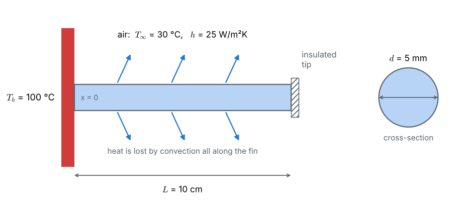

## The problem

::: given
Determine the **steady-state temperature distribution** within an **aluminium fin** using the **Finite Difference Method**. Assume the base temperature of the fin is **100 °C** and the tip of the fin is **insulated**. Initially the fin is at a temperature of **30 °C**.
:::

## Data

The statement fixes the base temperature, the tip condition and the initial temperature. The remaining data were not given and are taken as **typical values** (you may change them in the notebook):

| Quantity | Symbol | Value |
|---|:-:|---|
| fin length | $L$ | 10 cm |
| fin diameter (circular pin) | $d$ | 5 mm |
| thermal conductivity of aluminium | $k$ | 237 W/(m·K) |
| convection heat transfer coefficient | $h$ | 25 W/(m²·K) |
| temperature of the surrounding air | $T_\infty$ | 30 °C |
| base temperature | $T_b$ | 100 °C |
| initial temperature of the fin | $T_{init}$ | 30 °C |

## Assumptions

- Steady state: the temperature no longer changes with time.
- One-dimensional conduction along the fin axis $x$: the fin is thin, so the temperature is uniform over each cross-section.
- Constant thermal conductivity $k$ and convection coefficient $h$ along the whole fin.
- Radiation is neglected.
- The tip of the fin is insulated (no heat leaves through it).

## Tasks

1. **Physics.** Write an energy balance for a thin slice of the fin and derive the governing equation for $T(x)$. State the two boundary conditions.
2. **Grid.** Divide the fin into $N = 10$ equal intervals and number the nodes from the base ($i = 0$) to the tip ($i = N$).
3. **Discretization.** Replace the second derivative by a central finite difference and write one algebraic equation for every node. Use a *ghost node* to apply the insulated-tip condition.
4. **Solution.** Solve the system of equations
   a. with the **Gauss–Seidel** iterative method, starting from the initial temperature of 30 °C;
   b. with the **Thomas algorithm** (direct solver for tridiagonal systems).
5. **Results.** Plot the temperature distribution and find the **tip temperature** and the **heat lost by the fin**.
6. **Verification.** Compare with the exact solution and repeat the calculation on finer grids. How does the error change when $\Delta x$ is halved?

## What you will learn

- How an energy balance leads to a differential equation, and how boundary conditions complete it.
- How the finite difference method turns a differential equation into a system of algebraic equations.
- How to apply a derivative (Neumann) boundary condition with a ghost node.
- The difference between iterative and direct solvers.
- How to verify a numerical solution with an exact solution and a grid-refinement study.

::: tip
**Files for this problem:** `02_solution.pdf` explains the solution step by step. `03_fdm_solver.ipynb` contains the complete Python code (plain Python, no numerical libraries), with explanations and plots, to run cell by cell.
:::
