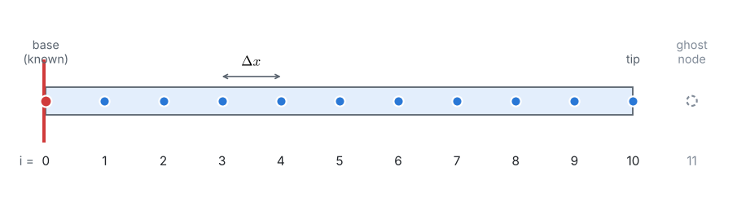
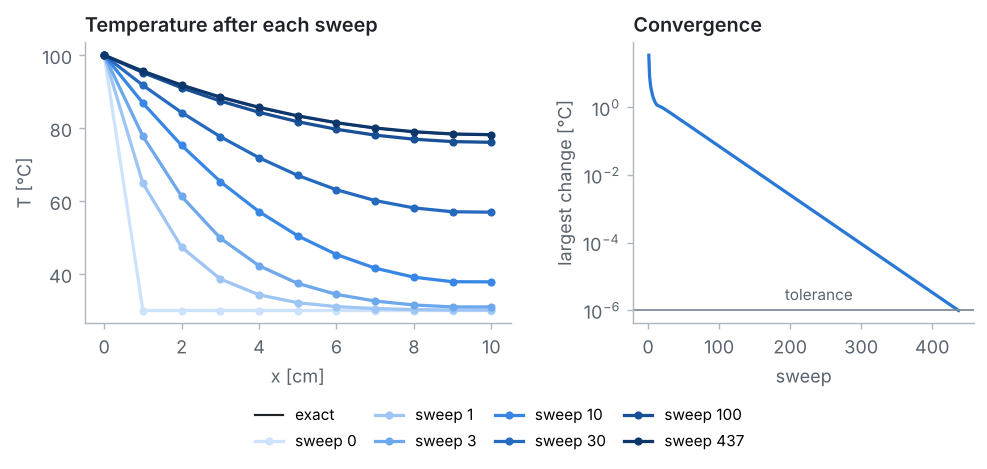
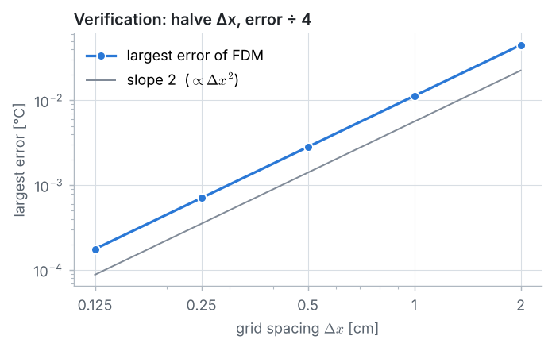

::: goal
**Plan.** We follow the 7 pillars of CFD: geometry → grid → physics → numerical scheme → solution setup → compute → post-processing. All code below is plain Python (lists and loops only; `math` for the exact solution). It is the code of the notebook `03_fdm_solver.ipynb`, where it can be run cell by cell.
:::

## Step 1 · Geometry and data

A thin aluminium pin of length $L = 10$ cm and diameter $d = 5$ mm sticks out of a wall at $T_b = 100$ °C into air at $T_\infty = 30$ °C, with $h = 25$ W/(m²·K) and $k = 237$ W/(m·K). The tip is insulated.

{{code:data}}

Heat is *conducted* through the cross-section area $A_c$ and *convected* from the perimeter $P$:

$$A_c = \frac{\pi d^2}{4}, \qquad P = \pi d.$$

{{code:geometry}}

{{out:geometry}}

## Step 2 · The grid

We keep $N + 1$ equally spaced nodes, $x_i = i\,\Delta x$ with $\Delta x = L/N$. With $N = 10$, there is one node per centimetre. Node 0 is the base (known temperature), node 10 is the tip.

{{code:grid}}

## Step 3 · Physics: the fin equation

**Energy balance** on a slice of the fin between $x$ and $x + dx$ in steady state:

$$q_x = q_{x+dx} + h\,(P\,dx)\,(T - T_\infty).$$

With Fourier's law $q_x = -kA_c\,dT/dx$ and $q_{x+dx} = q_x + (dq_x/dx)\,dx$:

$$kA_c\,\frac{d^2T}{dx^2} - hP\,(T - T_\infty) = 0
\quad\Longleftrightarrow\quad
\frac{d^2T}{dx^2} - m^2\,(T - T_\infty) = 0, \qquad m^2 = \frac{hP}{kA_c} = \frac{4h}{kd}.$$

**Boundary conditions:**

- base (Dirichlet): $T(0) = T_b = 100$ °C;
- insulated tip (Neumann): $\left.\dfrac{dT}{dx}\right|_{x = L} = 0$.

**Exact solution** (used only to check the numerical result):

$$\frac{T(x) - T_\infty}{T_b - T_\infty} = \frac{\cosh\big(m(L - x)\big)}{\cosh(mL)}.$$

{{code:exact}}

{{out:exact}}

## Step 4 · Numerical scheme: one algebraic equation per node

**Interior nodes** $i = 1, \dots, N-1$. The central difference

$$\left.\frac{d^2T}{dx^2}\right|_i \approx \frac{T_{i-1} - 2T_i + T_{i+1}}{\Delta x^2}$$

(truncation error $\mathcal{O}(\Delta x^2)$) turns the fin equation, after multiplying by $\Delta x^2$, into

$$T_{i-1} - (2 + \beta)\,T_i + T_{i+1} = -\beta\,T_\infty, \qquad \beta = m^2\,\Delta x^2.$$

**Base node** $i = 0$: $\;T_0 = T_b$.

**Tip node** $i = N$. The interior equation would need $T_{N+1}$, outside the fin. A central difference of the insulated-tip condition gives

$$\left.\frac{dT}{dx}\right|_N \approx \frac{T_{N+1} - T_{N-1}}{2\,\Delta x} = 0 \quad\Longrightarrow\quad T_{N+1} = T_{N-1},$$

so the **ghost node** mirrors node $N-1$, and the tip equation becomes

$$2\,T_{N-1} - (2 + \beta)\,T_N = -\beta\,T_\infty.$$

All $N + 1$ equations have the form $a_i T_{i-1} + b_i T_i + c_i T_{i+1} = r_i$: a **tridiagonal** system. We store the four coefficient lists:

{{code:system}}

For $N = 10$, the equations are:

{{code:show-system}}

{{out:show-system}}

## Step 5 · Solution setup: two algorithms

**A · Gauss–Seidel (iterative).** Solve each equation for its own node,
$T_i = (r_i - a_i T_{i-1} - c_i T_{i+1})/b_i$, and sweep through the nodes repeatedly, always using the newest values. The iteration starts from the **initial condition**, the fin at 30 °C, and stops when the largest change in a sweep is below a tolerance.

{{code:gauss-seidel}}

**B · Thomas algorithm (direct).** Gaussian elimination specialised to tridiagonal systems: a forward sweep removes $T_{i-1}$ from every equation, then back substitution gives the temperatures from the tip back to the base.

{{code:thomas}}

| | Gauss–Seidel | Thomas algorithm |
|---|---|---|
| type | iterative | direct |
| needs | initial guess, tolerance | a tridiagonal system |
| pros | very simple; also works in 2D and 3D | exact (up to round-off) in one pass; $\mathcal{O}(N)$ operations |
| cons | many sweeps on fine grids | only for tridiagonal (1D) systems |

## Step 6 · Compute

{{code:run}}

{{out:run}}

::: warning
**A small change per sweep is not a small error.** Gauss–Seidel approaches the answer in small steps, so the tolerance must be much smaller than the accuracy you need. With a tolerance of $10^{-4}$ °C, the result still differs from the direct solution by about 0.003 °C; with $10^{-6}$ °C the two agree.
:::

{{code:table}}

{{out:table}}

## Step 7 · Post-processing and verification

**Quantities of interest.** All the heat entering at the base leaves through the surface by convection. Adding the convection of every segment (trapezoidal rule) gives the heat removed by the fin:

$$q_{fin} \approx hP\,\Delta x\left[\tfrac{1}{2}(T_0 - T_\infty) + \sum_{i=1}^{N-1}(T_i - T_\infty) + \tfrac{1}{2}(T_N - T_\infty)\right],
\qquad q_{exact} = \sqrt{hPkA_c}\,(T_b - T_\infty)\tanh(mL).$$

{{code:qoi}}

{{out:qoi}}

**Grid refinement.** The central difference is second-order accurate, so halving $\Delta x$ should divide the error by 4:

{{code:refine}}

{{out:refine}}

::: answer
**Result.** The temperature falls from 100 °C at the base to about **78.2 °C at the insulated tip**. The fin removes about **2.17 W**. With 10 intervals, the FDM solution agrees with the exact solution to about 0.01 °C, and the error falls like $\Delta x^2$.
:::

## Key ideas

- An energy balance on a small slice gives the governing equation; boundary conditions complete it.
- The central difference turns the differential equation into a tridiagonal system of algebraic equations.
- A derivative (Neumann) boundary condition is applied with a ghost node.
- Iterative (Gauss–Seidel) and direct (Thomas) solvers give the same answer; the direct one is faster for 1D problems.
- A grid-refinement study against an exact solution verifies the code and its order of accuracy.
