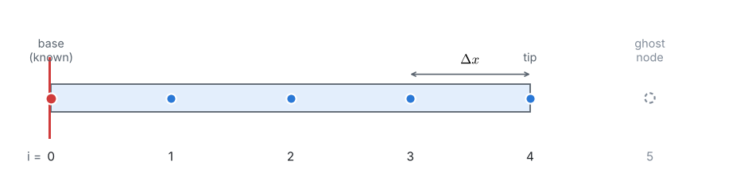
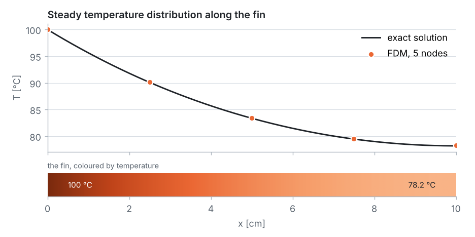

::: goal
**Aim of the lesson.** Students solve the fin problem completely by hand with **4 intervals** (4 unknown temperatures), so they see every step of the finite difference method before meeting the Python notebook, which repeats the same steps with 10 or more intervals. Every intermediate number is given below so you can check the class's calculator results line by line.
:::

## Lesson plan (about 55 minutes)

| Board | Content | Time |
|:-:|---|:-:|
| 1 | The physical problem and the data | 5 min |
| 2 | Energy balance → the fin equation | 10 min |
| 3 | The grid: 4 intervals, 5 nodes and a ghost node | 5 min |
| 4 | Finite differences → 4 algebraic equations | 10 min |
| 5 | Solving the equations by elimination (Thomas algorithm) | 15 min |
| 6 | Results, comparison with the exact solution, heat loss | 5 min |
| 7 | *Optional:* three Gauss–Seidel sweeps, and why we need computers | 5 min |

::: tip
**Calculator advice for the class.** Keep at least **4 decimals** in every intermediate result (especially in $B = 2.0527$). Rounding $B$ to 2.05 already changes the tip temperature by almost 1 °C.
:::

## Board 1 · The physical problem

Write the data on the board:

| | |
|---|---|
| length, diameter | $L = 0.10$ m, $d = 0.005$ m |
| aluminium | $k = 237$ W/(m·K) |
| air | $h = 25$ W/(m²·K), $T_\infty = 30$ °C |
| base, tip | $T_b = 100$ °C, insulated tip |

**Ask the class:** *Where is the fin hottest? Where is it coldest? Why does the tip not reach 30 °C?*

## Board 2 · Energy balance → the fin equation

Draw a thin slice $dx$ of the fin. In steady state: heat conducted in = heat conducted out + heat convected to the air:

$$q_x = q_{x+dx} + h\,(P\,dx)\,(T - T_\infty), \qquad q_x = -kA_c\frac{dT}{dx}.$$

$$\Longrightarrow\quad \frac{d^2T}{dx^2} - m^2\,(T - T_\infty) = 0, \qquad m^2 = \frac{hP}{kA_c} = \frac{4h}{kd}.$$

**Simplification for the board:** use the excess temperature $\theta = T - T_\infty$. The equation becomes $\theta'' - m^2\theta = 0$, with no constant term.

Boundary conditions: $\theta(0) = 100 - 30 = 70$ K at the base, and $d\theta/dx = 0$ at the insulated tip.

**Calculator:**

$$m^2 = \frac{4 \times 25}{237 \times 0.005} = \frac{100}{1.185} = 84.388\ \text{m}^{-2}.$$

## Board 3 · The grid

$$N = 4, \qquad \Delta x = \frac{L}{N} = 0.025\ \text{m}, \qquad x_i = 0,\ 2.5,\ 5,\ 7.5,\ 10\ \text{cm}.$$

Node 0 is known ($\theta_0 = 70$). Nodes 1 to 4 are the **four unknowns**.

## Board 4 · Finite differences → algebraic equations

At an interior node, replace the second derivative by the central difference:

$$\frac{\theta_{i-1} - 2\theta_i + \theta_{i+1}}{\Delta x^2} - m^2\theta_i = 0
\quad\Longrightarrow\quad
\theta_{i-1} - B\,\theta_i + \theta_{i+1} = 0, \qquad B = 2 + m^2\Delta x^2.$$

**Calculator:**

$$m^2\Delta x^2 = 84.388 \times 0.025^2 = 0.052743, \qquad B = 2.052743.$$

**Tip node (insulated).** The equation at node 4 needs the ghost node 5. The insulated tip gives $(\theta_5 - \theta_3)/(2\Delta x) = 0$, so $\theta_5 = \theta_3$, and the tip equation becomes $2\,\theta_3 - B\,\theta_4 = 0$.

Write the four equations, with the known $\theta_0 = 70$ moved to the right-hand side:

$$\begin{aligned}
(1)\quad & 2.052743\,\theta_1 - \theta_2 &= 70\\
(2)\quad & -\theta_1 + 2.052743\,\theta_2 - \theta_3 &= 0\\
(3)\quad & -\theta_2 + 2.052743\,\theta_3 - \theta_4 &= 0\\
(4)\quad & -2\,\theta_3 + 2.052743\,\theta_4 &= 0
\end{aligned}$$

**Ask the class:** *Why does each equation contain only neighbouring nodes? Why is there a 2 in equation (4)?*

## Board 5 · Solving by elimination (the Thomas algorithm by hand)

**Idea:** write every unknown in terms of the next one, $\theta_i = P_i\,\theta_{i+1} + Q_i$, going from the base to the tip; then come back from the tip to the base.

**Forward sweep.**

From (1): $\theta_1 = \dfrac{70 + \theta_2}{B}$, so

$$P_1 = \frac{1}{B} = 0.487153, \qquad Q_1 = \frac{70}{B} = 34.1007.$$

Put $\theta_1 = P_1\theta_2 + Q_1$ into (2): $(B - P_1)\,\theta_2 = \theta_3 + Q_1$ with $B - P_1 = 1.565590$, so

$$P_2 = \frac{1}{1.565590} = 0.638737, \qquad Q_2 = \frac{34.1007}{1.565590} = 21.7814.$$

Put $\theta_2 = P_2\theta_3 + Q_2$ into (3): $(B - P_2)\,\theta_3 = \theta_4 + Q_2$ with $B - P_2 = 1.414006$, so

$$P_3 = \frac{1}{1.414006} = 0.707211, \qquad Q_3 = \frac{21.7814}{1.414006} = 15.4040.$$

Put $\theta_3 = P_3\theta_4 + Q_3$ into the tip equation (4): $-2(P_3\theta_4 + Q_3) + B\theta_4 = 0$, so

$$\theta_4 = \frac{2\,Q_3}{B - 2P_3} = \frac{30.8081}{2.052743 - 1.414422} = \frac{30.8081}{0.638321} = 48.264.$$

**Back substitution** (from the tip to the base):

| node | calculation | $\theta_i$ [K] | $T_i = \theta_i + 30$ [°C] |
|:-:|---|:-:|:-:|
| 4 | (above) | 48.264 | **78.26** |
| 3 | $0.707211 \times 48.264 + 15.4040$ | 49.537 | **79.54** |
| 2 | $0.638737 \times 49.537 + 21.7814$ | 53.422 | **83.42** |
| 1 | $0.487153 \times 53.422 + 34.1007$ | 60.126 | **90.13** |

**Check one equation** with the class, e.g. (2): $-60.126 + 2.052743 \times 53.422 - 49.537 = -60.126 + 109.662 - 49.537 \approx 0$ ✓.

## Board 6 · Results and comparison

Exact solution: $\theta(x)/\theta_b = \cosh\big(m(L - x)\big)/\cosh(mL)$, with $m = 9.1863$ m⁻¹ and $mL = 0.9186$.

| node | $x$ [cm] | by hand, 4 intervals [°C] | exact [°C] | error [°C] |
|:-:|:-:|:-:|:-:|:-:|
| 0 | 0 | 100.00 | 100.00 | 0 |
| 1 | 2.5 | 90.13 | 90.09 | +0.03 |
| 2 | 5.0 | 83.42 | 83.37 | +0.05 |
| 3 | 7.5 | 79.54 | 79.47 | +0.07 |
| 4 | 10.0 | 78.26 | 78.19 | +0.07 |

**Heat lost by the fin** (each node represents $\Delta x$ of surface, the end nodes half of it), with $hP\Delta x = 25 \times 0.015708 \times 0.025 = 0.0098175$ W/K:

$$q_{fin} \approx 0.0098175 \times \left[\tfrac{70}{2} + 60.126 + 53.422 + 49.537 + \tfrac{48.264}{2}\right] = 0.0098175 \times 222.217 = 2.18\ \text{W}.$$

The exact value is $\sqrt{hPkA_c}\,\theta_b\tanh(mL) = 2.17$ W.

::: answer
**With only 4 unknowns and a calculator, every temperature is within 0.07 °C of the exact solution**, and the heat loss is within about 0.5 %. The central difference is a very good approximation for this smooth profile.
:::

::: note
**Even quicker (5 minutes): 2 intervals.** With $\Delta x = 0.05$ m, $B = 2 + 84.388 \times 0.05^2 = 2.210970$. The equations $B\theta_1 - \theta_2 = 70$ and $-2\theta_1 + B\theta_2 = 0$ give $\theta_1 = 70B/(B^2 - 2) = 53.58$ and $\theta_2 = 2\theta_1/B = 48.47$, i.e. $T_1 = 83.58$ °C and $T_{tip} = 78.47$ °C (exact 83.37 and 78.19 °C). Halving $\Delta x$ (from 2 to 4 intervals) reduces the tip error from 0.28 to 0.07 °C, a factor of 4: second-order accuracy, seen by hand!
:::

## Board 7 (optional) · Why we need computers: Gauss–Seidel by hand

Solve each equation for its own node and sweep from the base to the tip, starting from the initial temperature of the fin, 30 °C ($\theta = 0$):

$$\theta_1 \leftarrow \frac{70 + \theta_2}{B}, \quad \theta_2 \leftarrow \frac{\theta_1 + \theta_3}{B}, \quad \theta_3 \leftarrow \frac{\theta_2 + \theta_4}{B}, \quad \theta_4 \leftarrow \frac{2\theta_3}{B}.$$

| sweep | $T_1$ | $T_2$ | $T_3$ | $T_4$ [°C] |
|:-:|:-:|:-:|:-:|:-:|
| 0 | 30.00 | 30.00 | 30.00 | 30.00 |
| 1 | 64.10 | 46.61 | 38.09 | 37.88 |
| 2 | 72.19 | 54.50 | 45.77 | 45.37 |
| 3 | 76.03 | 60.11 | 52.16 | 51.59 |
| 10 | 86.92 | 78.08 | 73.26 | 72.15 |
| 20 | 89.73 | 82.77 | 78.77 | 77.52 |
| 40 | 90.12 | 83.41 | 79.53 | 78.25 |
| 60 | 90.13 | 83.42 | 79.54 | 78.26 |

Do the first sweep together, then show the rest of the table. The iteration is easy, but it needs about **60 sweeps** to agree with the elimination result: perfect for a computer, painful by hand. This motivates the notebook, where the same algorithm runs hundreds of sweeps in a fraction of a second.

## Common mistakes to watch for

- **Forgetting the factor 2** in the tip equation (the ghost node $\theta_5 = \theta_3$ appears twice).
- Using $\Delta x$ in **centimetres** in $m^2\Delta x^2$ ($\Delta x$ must be in metres, like $m$).
- Forgetting the $T_\infty$ term when working with $T$ instead of $\theta$; working in $\theta$ avoids it.
- Rounding $B$ too early.
- Writing an equation for the base node: its temperature is known.

## From the board to the notebook

Every board step has a matching cell in `03_fdm_solver.ipynb`: `build_system` is Board 4, `thomas` is Board 5, `gauss_seidel` is Board 7. Set `N = 4` in the grid cell of the notebook and the computer reproduces the numbers on this sheet; then set `N = 10` or `100`.
