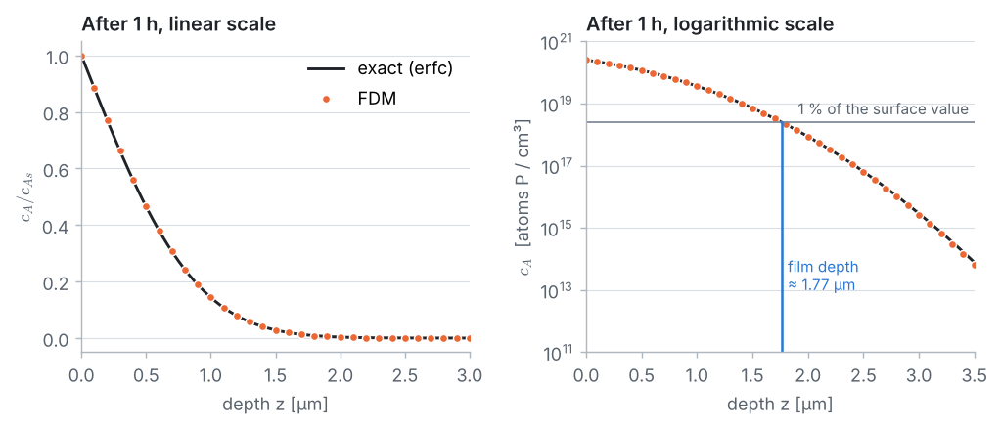

<p align="center">
  
</p>

# Problem 2 · Phosphorus diffusion into silicon

**1D · unsteady · mass diffusion · semi-infinite medium · explicit time marching**

> Consider the phosphorus doping of crystalline silicon at 1100 °C. The surface concentration of phosphorus is $`c_{As} = 2.5\times10^{20}`$ atoms P/cm³ and the diffusivity of P in Si is $`D_{AB} = 6.5\times10^{-13}`$ cm²/s. Predict the depth of the Si–P thin film after 1 h, if the target concentration is 1 % of the surface value, and the concentration profile of P atoms after 1 h.

## 📦 What's in this folder

| File | What's inside |
|---|---|
| 📄 [`01_problem_statement.pdf`](01_problem_statement.pdf) | the problem, data, assumptions and tasks |
| 📘 [`02_solution.pdf`](02_solution.pdf) | the step-by-step solution: Fick's law, FTCS scheme, stability, code and results |
| 💻 [`03_fdm_solver.ipynb`](03_fdm_solver.ipynb) | the complete solver in **plain Python**, explained cell by cell, with plots |
| 🎨 [`plots.py`](plots.py) | drawing helpers used by the notebook (matplotlib only, no numerics) |
| 🛠️ [`docs/`](docs) | Markdown sources of the two PDFs and their figures |

## 🎯 What you will learn

- How a mass balance and **Fick's law** give the unsteady diffusion equation $`\partial c_A/\partial t = D_{AB}\,\partial^2 c_A/\partial z^2`$.
- How to represent a **semi-infinite** wafer with a finite grid, and how to check that the cut is deep enough.
- How the explicit **FTCS** scheme marches the solution forward in time.
- Why explicit schemes need $`r = D\,\Delta t/\Delta z^2 \le 1/2`$, and what happens when you break it.
- How to find a quantity of interest between grid nodes (the film depth) by **interpolation**.

## 📊 Result

<p align="center">
  
</p>

| Quantity after 1 h | FDM (Δz = 0.1 µm, 100 steps) | Exact |
|---|:-:|:-:|
| film depth (1 % of the surface value) | 1.767 µm | 1.762 µm |

The film depth grows like $`\sqrt{t}`$: a film twice as deep takes four times as long. Halving $`\Delta z`$ at a fixed $`r`$ divides the error by 4.

## 🔁 Cross-check with COMSOL

The same diffusion problem is also solved with the finite element method in COMSOL Multiphysics 4.3a: see [`comsol_solution/`](comsol_solution) for the model file, the exported profiles and a step-by-step guide for students. COMSOL gives a film depth of 1.762 µm after 1 h, the same as the exact solution.

## ▶️ Run it

```bash
pip install -r ../../requirements.txt
jupyter lab 03_fdm_solver.ipynb
```

---

<p align="center"><a href="../../README.md#-course-problems">⬅ Back to the course home page</a></p>
