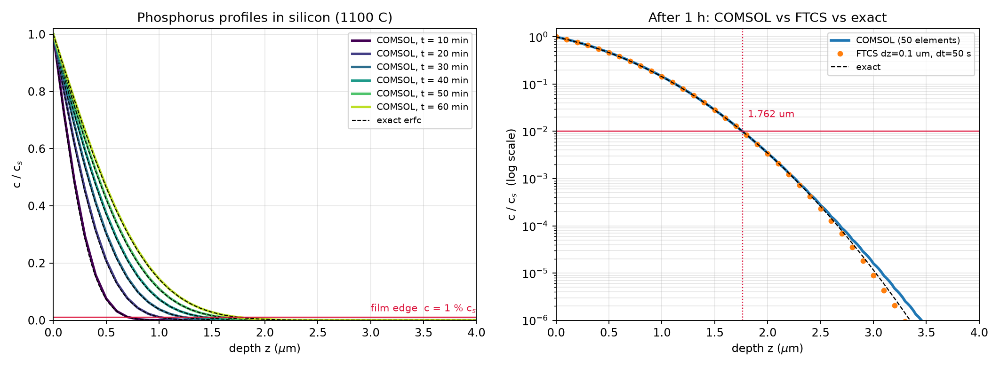

# Problem 2 · COMSOL Multiphysics solution

The same phosphorus diffusion problem, solved with the **finite element method** in **COMSOL Multiphysics 4.3a** (Transport of Diluted Species, 1D, time-dependent study). It is a cross-check of the finite difference solution, and an introduction to commercial simulation software.

  

| File | What's inside |
|---|---|
| 📘 [`COMSOL_Phosphorus_Diffusion_Guide.pdf`](COMSOL_Phosphorus_Diffusion_Guide.pdf) | step-by-step guide for students (25 pages, 14 annotated steps): building the model in COMSOL 4.3a, with theory, the FTCS stability analysis and verification |
| 🧩 [`phosphorus_diffusion.mph`](phosphorus_diffusion.mph) | the finished COMSOL model, ready to open in COMSOL 4.3a or newer |
| 📈 [`profiles_N50.txt`](profiles_N50.txt) | concentration profiles exported from COMSOL (50 elements) every 10 minutes |
| 🐍 [`fdm_and_comparison.py`](fdm_and_comparison.py) | script that runs an FTCS solution, compares it with COMSOL and the exact solution, and draws the figure above |
| 🔢 [`p2_numbers.json`](p2_numbers.json) | the numbers behind the comparison (film depths, errors, FTCS grid study) |

The model uses the same data as the notebook: $`c_{As} = 2.5\times10^{20}`$ atoms/cm³, $`D_{AB} = 6.5\times10^{-13}`$ cm²/s, wafer initially free of phosphorus, 1 h at 1100 °C.

**Film depth (1 % of the surface concentration):**

| time | COMSOL (50 elements) | exact (erf solution) |
|:-:|:-:|:-:|
| 10 min | 0.718 µm | 0.719 µm |
| 30 min | 1.247 µm | 1.246 µm |
| 60 min | **1.762 µm** | **1.762 µm** |

The finite difference notebook ($`\Delta z = 0.1`$ µm, $`\Delta t = 36`$ s) gives 1.767 µm after 1 h.

> [!NOTE]
> `fdm_and_comparison.py` reads and writes files in the folder where it was first run (`C:\Users\marya\Downloads\phosphorus_comsol`). To run it from this repository, change the `OUT` path at the top of the script to this folder. It uses NumPy and Matplotlib.

---

<a href="../README.md">⬅ Back to Problem 2</a>

