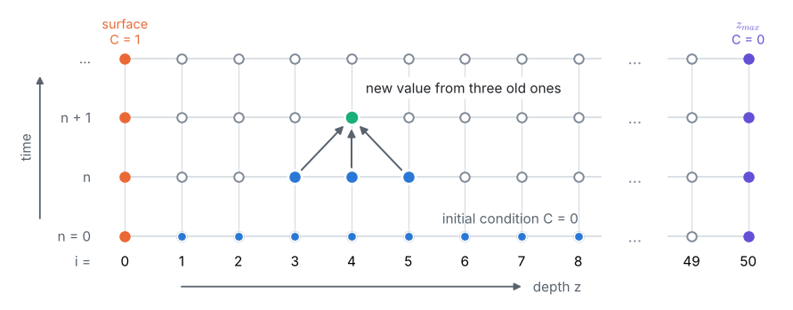
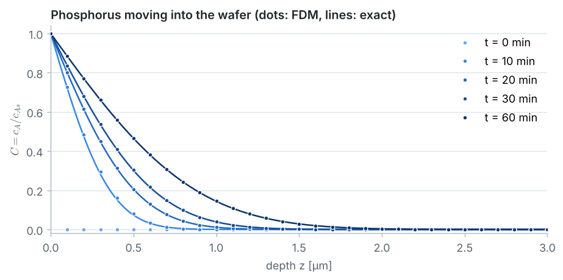
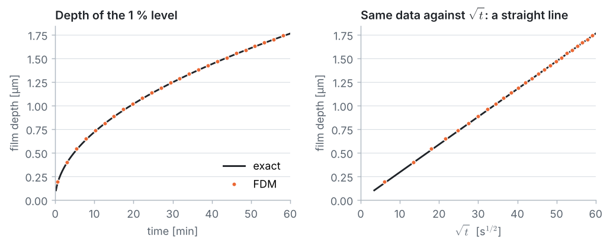
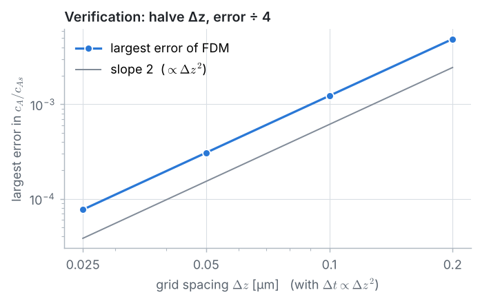
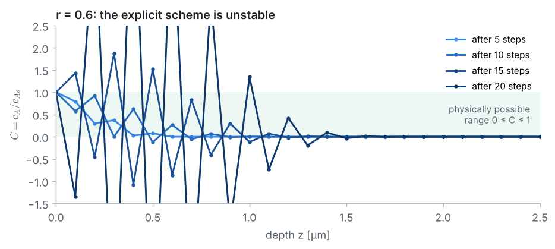

::: goal
**Plan.** Problem 1 was steady; this one is **unsteady**: the concentration depends on depth *and* time, so we march forward in time. We follow the 7 pillars of CFD: geometry → grid → physics → numerical scheme → solution setup → compute → post-processing. All code is plain Python (lists and loops only; `math` for the exact solution) and is the code of the notebook `03_fdm_solver.ipynb`.
:::

## Step 1 · Geometry and data

The P-rich SiO₂ coating on top of the wafer keeps the surface concentration at $c_{As} = 2.5\times10^{20}$ atoms/cm³. Phosphorus diffuses down into the silicon, which starts free of P. Because $D_{AB}$ is tiny, the phosphorus penetrates only micrometres into a wafer hundreds of micrometres thick, so the wafer is treated as **semi-infinite** ($0 \le z < \infty$).

{{code:data}}

**Convenient units.** Micrometres and seconds give friendly numbers: $1\ \text{cm}^2 = 10^8\ \text{µm}^2$, so $D = 6.5\times10^{-5}$ µm²/s. The **diffusion length** $\sqrt{Dt}$ tells roughly how far atoms travel in a time $t$:

{{code:units}}

{{out:units}}

## Step 2 · The grid in space and time

**Space.** A computer grid must end somewhere, so the semi-infinite wafer is cut at $z_{max} = 5$ µm, about ten diffusion lengths. The phosphorus cannot get that far in one hour, so replacing "$c_A \to 0$ as $z \to \infty$" by "$c_A = 0$ at $z_{max}$" changes nothing (this is checked in Step 7). Nodes: $z_i = i\,\Delta z$, $i = 0, \dots, N$.

**Time.** Time is cut into steps $\Delta t$; the unknowns are $C_i^n$, the concentration at node $i$ and time $t^n = n\,\Delta t$.

{{code:grid}}

{{out:grid}}

## Step 3 · Physics: the diffusion equation

**Mass balance** for phosphorus on a slice between $z$ and $z + dz$ (area $A$):

$$\frac{\partial c_A}{\partial t}\,A\,dz = J_z A - J_{z+dz} A = -\frac{\partial J_z}{\partial z}\,A\,dz.$$

With **Fick's first law**, $J_z = -D_{AB}\,\partial c_A/\partial z$, this gives **Fick's second law**:

$$\frac{\partial c_A}{\partial t} = D_{AB}\,\frac{\partial^2 c_A}{\partial z^2}.$$

| | condition | meaning |
|---|---|---|
| initial condition | $c_A(z, 0) = c_{A0} = 0$ | the wafer starts free of P |
| surface ($z = 0$) | $c_A(0, t) = c_{As}$ | the coating keeps the surface concentration constant |
| deep inside ($z \to \infty$) | $c_A(\infty, t) = 0$ | far away the wafer is untouched |

**Dimensionless concentration.** With $C = c_A/c_{As}$ the equation keeps its form, $\partial C/\partial t = D\,\partial^2 C/\partial z^2$, with $C(z,0) = 0$, $C(0,t) = 1$, $C(\infty, t) = 0$. The film edge is where $C = 0.01$.

**Exact solution.** For the semi-infinite medium,

$$\frac{c_{As} - c_A}{c_{As} - c_{A0}} = \mathrm{erf}\!\left(\frac{z}{2\sqrt{D_{AB}\,t}}\right)
\qquad\Longleftrightarrow\qquad C = 1 - \mathrm{erf}\!\left(\frac{z}{2\sqrt{Dt}}\right).$$

At the film edge, $\mathrm{erf}(\eta) = 0.99$ with $\eta = z/(2\sqrt{Dt})$, so $\eta \approx 1.82$ (erf tables). The code finds $\eta$ precisely by **bisection** (halving an interval that contains the answer):

{{code:exact}}

{{out:exact}}

## Step 4 · Numerical scheme: explicit FTCS

At node $i$ and time level $n$:

$$\left.\frac{\partial C}{\partial t}\right|_i^n \approx \frac{C_i^{n+1} - C_i^n}{\Delta t}\ \ \text{(forward, } \mathcal{O}(\Delta t)\text{)},
\qquad
\left.\frac{\partial^2 C}{\partial z^2}\right|_i^n \approx \frac{C_{i-1}^n - 2C_i^n + C_{i+1}^n}{\Delta z^2}\ \ \text{(central, } \mathcal{O}(\Delta z^2)\text{)}.$$

Substituting into the diffusion equation and solving for the only unknown:

$$C_i^{n+1} = C_i^n + r\left(C_{i-1}^n - 2C_i^n + C_{i+1}^n\right), \qquad r = \frac{D\,\Delta t}{\Delta z^2}.$$

The scheme is **explicit**: every new value comes directly from three known old values, so there is no system of equations to solve. The boundary values are imposed at every step: $C_0^{n+1} = 1$ and $C_N^{n+1} = 0$.

{{code:ftcs-step}}

::: warning
The new values go into a **new list**. Overwriting the old list during the loop would make node $i$ use the already-updated value of node $i - 1$, which is a different scheme.
:::

## Step 5 · Solution setup: a stable time step

Rewriting the update as

$$C_i^{n+1} = r\,C_{i-1}^n + (1 - 2r)\,C_i^n + r\,C_{i+1}^n$$

shows that the new value is a **weighted average** of three old values. While all weights are positive, the new value stays between its neighbours: no overshoot, no wiggles. The middle weight is positive only if

$$r = \frac{D\,\Delta t}{\Delta z^2} \le \frac{1}{2} \qquad\Longleftrightarrow\qquad \Delta t \le \frac{\Delta z^2}{2D}.$$

This is the **stability condition** of FTCS. We choose $\Delta t = 36$ s, well inside the limit and exactly 100 steps per hour:

{{code:setup}}

{{out:setup}}

## Step 6 · Compute: march through one hour

{{code:march}}

{{out:march}}

## Step 7 · Post-processing and verification

**Film depth.** The 1 % level rarely falls exactly on a node, so we interpolate linearly between the two nodes around it:

$$z_{film} = z_i + \frac{C_i - 0.01}{C_i - C_{i+1}}\,\Delta z, \qquad C_i \ge 0.01 > C_{i+1}.$$

{{code:depth}}

{{out:depth}}

**Growth of the film with time.**

{{code:depth-time}}

{{out:depth-time}}

**Was $z_{max}$ deep enough?** The concentration near the cut after one hour:

{{code:check-zmax}}

{{out:check-zmax}}

Next to the cut, the concentration is about $10^{-13}$ of the surface value: the phosphorus never felt the cut, so the finite grid represents the semi-infinite wafer.

**Grid refinement.** FTCS has error $\mathcal{O}(\Delta t) + \mathcal{O}(\Delta z^2)$. Halving $\Delta z$ at fixed $r$ divides $\Delta t$ by 4, so both error terms should fall by a factor of 4:

{{code:refine}}

{{out:refine}}

**Breaking the stability limit.** With $r = 0.6$ the middle weight $1 - 2r = -0.2$ is negative, and every step amplifies the differences between neighbours instead of smoothing them:

{{code:unstable}}

::: answer
**Result.** After 1 h, the FDM gives a film depth (1 % level, $c_A = 2.5\times10^{18}$ atoms/cm³) of **1.767 µm**, against **1.762 µm** from the exact solution, a difference of 0.3 %. The profile falls from $2.5\times10^{20}$ atoms/cm³ at the surface to practically zero below about 3 µm, and the film depth grows like $\sqrt{t}$.
:::

## Key ideas

- Unsteady diffusion is governed by Fick's second law, with one initial and two boundary conditions.
- A semi-infinite domain is cut at a depth of many diffusion lengths, and the cut is checked afterwards.
- The explicit FTCS scheme is just an update formula, but it is stable only for $r = D\,\Delta t/\Delta z^2 \le 1/2$.
- Quantities of interest between nodes are found by interpolation.
- Refining the grid at fixed $r$ verifies the code: the error falls by 4 per halving of $\Delta z$.
