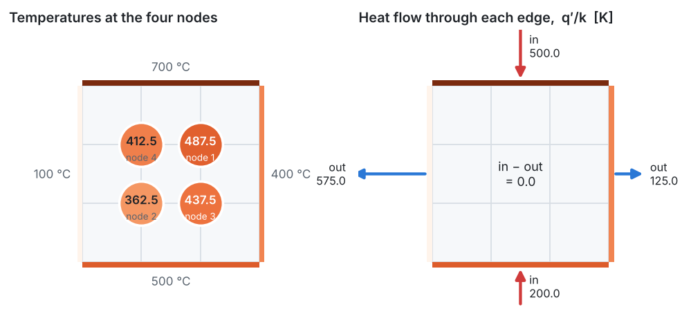

<p align="center">
  
</p>

# Problem 3 · Temperatures at four interior points of a square plate

**2D · steady · heat conduction (Laplace equation) · Dirichlet boundary conditions · direct vs iterative solvers**

> In the figure, calculate the temperatures at points 1, 2, 3 and 4 using the numerical method. The edges of the square are held at 700 °C (top), 100 °C (left), 400 °C (right) and 500 °C (bottom).

## 📦 What's in this folder

| File | What's inside |
|---|---|
| 📄 [`01_problem_statement.pdf`](01_problem_statement.pdf) | the problem, data, assumptions and tasks |
| 📘 [`02_solution.pdf`](02_solution.pdf) | the step-by-step solution: five-point formula, node equations, Gaussian elimination, Gauss–Seidel, energy check, grid study |
| 💻 [`03_fdm_solver.ipynb`](03_fdm_solver.ipynb) | the complete solver in **plain Python**, explained cell by cell, with plots |
| 🎨 [`plots.py`](plots.py) | drawing helpers used by the notebook (matplotlib only, no numerics) |
| 🛠️ [`docs/`](docs) | Markdown sources of the two PDFs and their figures |

## 🎯 What you will learn

- How the 2D Laplace equation becomes the **five-point formula**: with $`\Delta x = \Delta y`$, each node is the **average of its four neighbours**.
- How to number a 2D grid and **assemble** the linear system $`A\,\mathbf{T} = \mathbf{b}`$.
- How **Gaussian elimination** (printed step by step) and **Gauss–Seidel iteration** solve the same system.
- Why the finite difference solution **conserves energy** exactly: heat in = heat out.
- How a **grid study** with over-relaxation (SOR) shows the accuracy of the four-node answer.

## 📊 Result

<p align="center">
  
</p>

| Node | 1 | 2 | 3 | 4 |
|---|:-:|:-:|:-:|:-:|
| FDM, 4 nodes | 487.5 °C | 362.5 °C | 437.5 °C | 412.5 °C |
| exact (series solution) | 490.4 °C | 359.6 °C | 438.1 °C | 411.9 °C |

Four equations already give every temperature within 3 °C. Refining the grid converges to the exact values at second order.

## ▶️ Run it

```bash
pip install -r ../../requirements.txt
jupyter lab 03_fdm_solver.ipynb
```

---

<p align="center"><a href="../../README.md#-course-problems">⬅ Back to the course home page</a></p>
