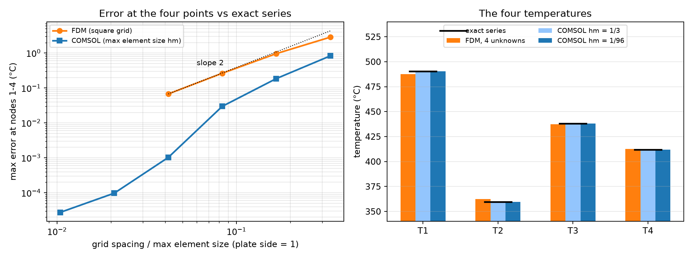

# Problem 3 · COMSOL Multiphysics solution

The same square plate, solved with the **finite element method** in **COMSOL Multiphysics 4.3a** (Heat Transfer in Solids, 2D stationary study, with a sweep over the mesh size). It shows how close the four-node finite difference answer is to a converged solution, and introduces commercial simulation software.

  

| File | What's inside |
|---|---|
| 📘 [`COMSOL_Square_Plate_FDM_Guide.pdf`](COMSOL_Square_Plate_FDM_Guide.pdf) | step-by-step guide for students (27 pages): the hand solution (Gauss elimination, Gauss–Seidel, heat balance) and 16 annotated COMSOL steps |
| 🧩 [`plate_fdm_comsol.mph`](plate_fdm_comsol.mph) | the finished COMSOL model, ready to open in COMSOL 4.3a or newer |
| 🖼️ [`p3_platemap.png`](p3_platemap.png) | the plate with the four node temperatures |
| 🐍 [`p3_analysis.py`](p3_analysis.py), [`p3_fig.py`](p3_fig.py) | scripts for the finite difference grid study and the comparison figures |
| 🔢 [`p3_numbers.json`](p3_numbers.json), [`p3_comsol_table.json`](p3_comsol_table.json) | the numbers behind the comparison |

**The four temperatures [°C]:**

| | $`T_1`$ | $`T_2`$ | $`T_3`$ | $`T_4`$ |
|---|:-:|:-:|:-:|:-:|
| FDM, 4 unknowns (the problem) | 487.5 | 362.5 | 437.5 | 412.5 |
| COMSOL, coarse mesh (element size 1/3) | 490.92 | 358.81 | 438.45 | 411.20 |
| COMSOL, fine mesh (element size 1/96) | 490.36 | 359.64 | 438.07 | 411.93 |
| exact series solution | 490.36 | 359.64 | 438.07 | 411.93 |

On the fine mesh, COMSOL reproduces the exact solution to 0.0001 °C. Refining the finite difference grid converges to the same values at second order.

> [!NOTE]
> `p3_fig.py` reads and writes files in the folder where it was first run (`C:\Users\marya\Downloads\plate_comsol`). To run it from this repository, change the `OUT` path at the top of the script to this folder. The scripts use NumPy and Matplotlib.

---

<a href="../README.md">⬅ Back to Problem 3</a>

