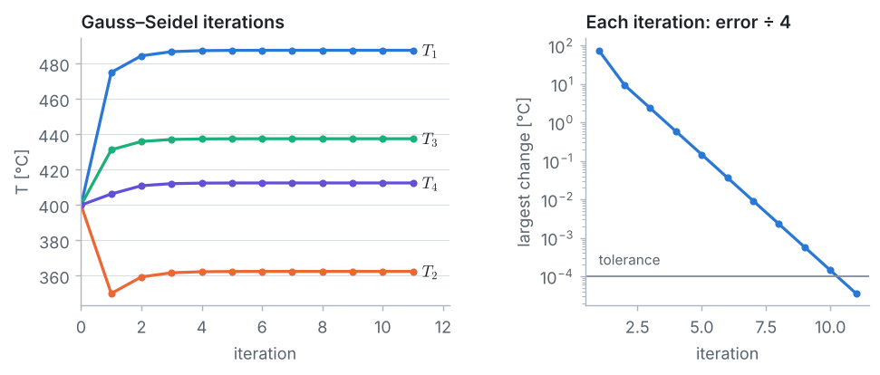
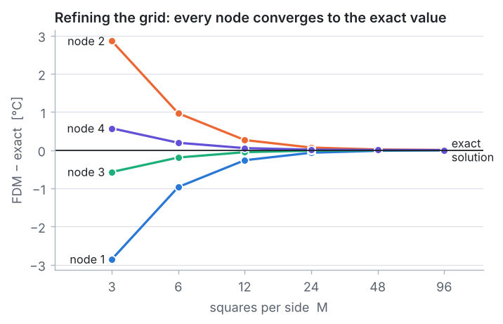
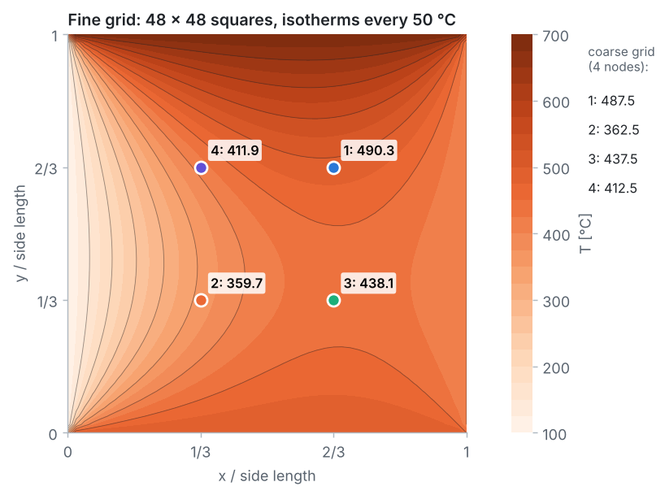

::: goal
**Plan.** Our first two-dimensional problem. We follow the 7 pillars of CFD: geometry → grid → physics → numerical scheme → solution setup → compute → post-processing. All code is plain Python (lists and loops only; `math` for the exact series solution) and is the code of the notebook `03_fdm_solver.ipynb`.
:::

## Step 1 · Geometry and data

The square is divided into $3 \times 3$ equal squares, so $\Delta x = \Delta y$. Its edges are held at fixed temperatures; heat flows from the hot edges to the cold ones until the plate reaches steady state.

{{code:data}}

## Step 2 · The grid

The grid lines cross at $4 \times 4 = 16$ nodes, labelled $(i, j)$ with $i$ along $x$ and $j$ along $y$, both from 0 to $M = 3$.

- The 12 edge nodes have known temperatures (Dirichlet boundary conditions).
- The 4 interior nodes are the unknowns: node 4 $= (1, 2)$, node 1 $= (2, 2)$, node 2 $= (1, 1)$, node 3 $= (2, 1)$.
- The 4 corners belong to two edges with different temperatures, but they are **never used** by the method.

{{code:grid}}

{{out:grid}}

## Step 3 · Physics: the Laplace equation

In steady state, with no heat generation, the heat conducted into a small element equals the heat conducted out. With Fourier's law this energy balance gives the **Laplace equation**

$$\frac{\partial^2 T}{\partial x^2} + \frac{\partial^2 T}{\partial y^2} = 0,$$

with the four edge temperatures as boundary conditions. The conductivity $k$ drops out: the temperature field does not depend on the material.

**Exact solution, for checking.** Because the equation is linear, the solution is the sum (superposition) of four simpler problems, each with only one hot edge. For a unit square with temperature 1 on the edge $\eta = 1$ and 0 elsewhere, separation of variables gives

$$S(\xi, \eta) = \sum_{n = 1, 3, 5, \dots} \frac{4}{n\pi}\,\sin(n\pi\xi)\,\frac{\sinh(n\pi\eta)}{\sinh(n\pi)},$$

$$T(x, y) = T_{top}\,S(x, y) + T_{bottom}\,S(x, 1 - y) + T_{left}\,S(y, 1 - x) + T_{right}\,S(y, x).$$

{{code:exact}}

{{out:exact}}

## Step 4 · Numerical scheme: the five-point formula

At an interior node $(i, j)$, central differences (error $\mathcal{O}(\Delta x^2)$) give

$$\frac{T_{i+1,j} - 2T_{i,j} + T_{i-1,j}}{\Delta x^2} + \frac{T_{i,j+1} - 2T_{i,j} + T_{i,j-1}}{\Delta y^2} = 0.$$

With $\Delta x = \Delta y$, after multiplying by $\Delta x^2$:

$$T_E + T_W + T_N + T_S - 4\,T_P = 0 \qquad\Longleftrightarrow\qquad T_P = \frac{T_E + T_W + T_N + T_S}{4}.$$

**Every node is the average of its four neighbours** (east, west, north, south). The grid spacing cancels, and the corners never appear. For our four nodes (known neighbours on the right-hand side):

| node | east | west | north | south | equation |
|:-:|:-:|:-:|:-:|:-:|---|
| 1 | 400 | $T_4$ | 700 | $T_3$ | $4T_1 - T_3 - T_4 = 1100$ |
| 2 | $T_3$ | 100 | $T_4$ | 500 | $4T_2 - T_3 - T_4 = 600$ |
| 3 | 400 | $T_2$ | $T_1$ | 500 | $4T_3 - T_1 - T_2 = 900$ |
| 4 | $T_1$ | 100 | 700 | $T_2$ | $4T_4 - T_1 - T_2 = 800$ |

The code **assembles** the same equations automatically: an unknown neighbour goes into the matrix $A$ (coefficient $-1$), a known edge temperature goes into the right-hand side $\mathbf{b}$.

{{code:assemble}}

{{out:assemble}}

## Step 5 · Solution setup: two ways to solve $A\,\mathbf{T} = \mathbf{b}$

**A · Gaussian elimination (direct).** Forward elimination makes the matrix upper triangular (zeros below the diagonal); back substitution then solves for the unknowns from the last row up.

{{code:elimination}}

**B · Gauss–Seidel (iterative).** Use each equation as an update rule, $T_k \leftarrow (b_k - \sum_{c \ne k} A_{kc} T_c)/A_{kk}$, always with the newest values, starting from a guess (here 400 °C for all nodes), until the largest change is below a tolerance.

{{code:gauss-seidel}}

| | Gaussian elimination | Gauss–Seidel |
|---|---|---|
| type | direct | iterative |
| result | exact (up to round-off) after a fixed number of steps | improves with every iteration |
| pros | no guess, no tolerance | very simple; tiny memory; suited to large grids |
| cons | cost grows like $n^3$ for $n$ unknowns | needs a guess and a tolerance; can be slow |

## Step 6 · Compute

**Gaussian elimination, step by step:**

{{code:run-elimination}}

{{out:run-elimination}}

**Gauss–Seidel, iteration by iteration:**

{{code:run-gs}}

{{out:run-gs}}

## Step 7 · Post-processing and verification

{{code:answer}}

{{out:answer}}

**Energy check.** Between an edge node $B$ and its interior neighbour $P$, Fourier's law gives the heat flow per unit depth $q' = k\,\Delta y\,(T_B - T_P)/\Delta x = k\,(T_B - T_P)$. Adding these along each edge:

{{code:energy}}

{{out:energy}}

The sum is exactly zero because it equals the sum of all four node equations, each of which is zero: **the finite difference solution conserves energy**.

**How good are four nodes?** The same plate is solved on finer grids ($M$ squares per side, a multiple of 3 so that points 1–4 remain nodes). With thousands of unknowns the five-point formula is applied directly on the grid, accelerated by **successive over-relaxation (SOR)** with $\omega = 2/(1 + \sin(\pi/M))$:

{{code:solve-plate}}

{{code:grid-study}}

{{out:grid-study}}

{{code:field}}

{{out:field}}

::: answer
**Result.** $T_1 = 487.5$ °C, $T_2 = 362.5$ °C, $T_3 = 437.5$ °C, $T_4 = 412.5$ °C. The exact values are 490.4, 359.6, 438.1 and 411.9 °C: four equations already give every temperature within 3 °C (less than 1 %). Finer grids converge to the exact solution at second order, and the discrete solution conserves energy exactly.
:::

## Key ideas

- With $\Delta x = \Delta y$, the five-point formula says that each node is the average of its four neighbours.
- Plate size, grid spacing and conductivity all cancel; the corner temperatures are never used.
- Gaussian elimination and Gauss–Seidel give the same answer; Gauss–Seidel scales to large grids, especially with over-relaxation (SOR).
- The finite difference equations conserve energy exactly: heat in = heat out.
- Refining the grid shows how accurate a coarse answer is.
