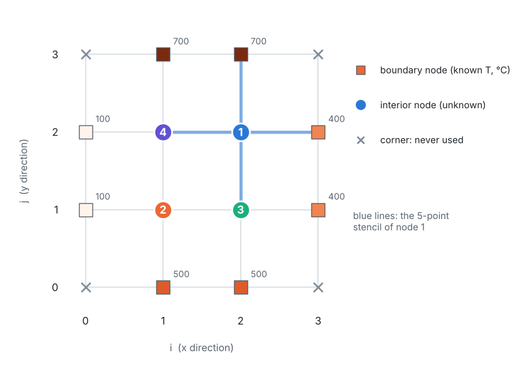

::: goal
**Aim of the lesson.** With four unknowns, this problem is the smallest possible two-dimensional finite difference problem, which makes it ideal for the board: every number can be computed with a pocket calculator in a few minutes. Students solve it **twice**, by **Gauss–Seidel iteration** (a table of averages) and by **direct elimination** (a few lines of algebra), then check the answer themselves. Every intermediate number is given below.
:::

## Lesson plan (about 45 minutes)

| Board | Content | Time |
|:-:|---|:-:|
| 1 | The plate, its edge temperatures and the node numbers | 5 min |
| 2 | Laplace equation → "each node is the average of its neighbours" | 10 min |
| 3 | The four node equations | 5 min |
| 4 | Method A: Gauss–Seidel iteration by hand | 10 min |
| 5 | Method B: direct elimination with sums and differences | 8 min |
| 6 | Checks: averages, energy balance, exact solution | 7 min |

## Board 1 · The plate

Copy the figure carefully, **with the node numbers exactly as in the problem**: 4 is top-left, 1 is top-right, 2 is bottom-left, 3 is bottom-right.

**Ask the class:** *Where do you expect the hottest interior point? The coldest?* (Node 1, next to the 700 °C and 400 °C edges; node 2, next to the 100 °C edge.)

## Board 2 · From the Laplace equation to averages

Steady conduction, no heat generation, constant $k$:

$$\frac{\partial^2 T}{\partial x^2} + \frac{\partial^2 T}{\partial y^2} = 0.$$

Central differences at node $P$, with neighbours East, West, North, South:

$$\frac{T_E - 2T_P + T_W}{\Delta x^2} + \frac{T_N - 2T_P + T_S}{\Delta y^2} = 0.$$

With $\Delta x = \Delta y$, multiply by $\Delta x^2$:

$$T_E + T_W + T_N + T_S - 4\,T_P = 0 \qquad\Longleftrightarrow\qquad \boxed{\,T_P = \frac{T_E + T_W + T_N + T_S}{4}\,}$$

**Every interior temperature is the average of its four neighbours.**

**Ask the class:** *Why do the plate size, the grid spacing and the conductivity not appear? Do we need the corner temperatures?* (No: the formula only uses the four side neighbours.)

## Board 3 · The four equations

Fill in this table on the board together, one node at a time:

| node | East | West | North | South | equation |
|:-:|:-:|:-:|:-:|:-:|---|
| 1 | 400 | $T_4$ | 700 | $T_3$ | $4T_1 = 1100 + T_3 + T_4$ |
| 2 | $T_3$ | 100 | $T_4$ | 500 | $4T_2 = 600 + T_3 + T_4$ |
| 3 | 400 | $T_2$ | $T_1$ | 500 | $4T_3 = 900 + T_1 + T_2$ |
| 4 | $T_1$ | 100 | 700 | $T_2$ | $4T_4 = 800 + T_1 + T_2$ |

## Board 4 · Method A: Gauss–Seidel by hand

Use each equation as an update rule, and always use the **newest** values:

$$T_1 \leftarrow \frac{1100 + T_3 + T_4}{4}, \quad
T_2 \leftarrow \frac{600 + T_3 + T_4}{4}, \quad
T_3 \leftarrow \frac{900 + T_1 + T_2}{4}, \quad
T_4 \leftarrow \frac{800 + T_1 + T_2}{4}.$$

::: tip
**Calculator shortcut.** $T_1$ and $T_2$ both need $S = T_3 + T_4$, and $T_3$ and $T_4$ both need $T_1 + T_2$: compute each sum once per iteration.
:::

Start with a guess of **400 °C** at all four nodes. **Iteration 1**, worked out on the board:

$$\begin{aligned}
T_1 &= (1100 + 400 + 400)/4 = 475.00\\
T_2 &= (600 + 400 + 400)/4 = 350.00\\
T_3 &= (900 + 475 + 350)/4 = 431.25 \quad\text{(uses the new } T_1, T_2)\\
T_4 &= (800 + 475 + 350)/4 = 406.25
\end{aligned}$$

Let the students do iteration 2 themselves, then complete the table:

| iteration | $T_1$ | $T_2$ | $T_3$ | $T_4$ | largest change |
|:-:|:-:|:-:|:-:|:-:|:-:|
| 0 (guess) | 400.00 | 400.00 | 400.00 | 400.00 | |
| 1 | 475.00 | 350.00 | 431.25 | 406.25 | 75.0 |
| 2 | 484.38 | 359.38 | 435.94 | 410.94 | 9.38 |
| 3 | 486.72 | 361.72 | 437.11 | 412.11 | 2.34 |
| 4 | 487.30 | 362.30 | 437.40 | 412.40 | 0.59 |
| 5 | 487.45 | 362.45 | 437.48 | 412.48 | 0.15 |
| 6 | 487.49 | 362.49 | 437.49 | 412.49 | 0.04 |

**Point out:** after the first iteration, the largest change is divided by **4** every time (9.38 → 2.34 → 0.59 → 0.15 → 0.04). Six iterations give the answer to better than 0.1 °C.

## Board 5 · Method B: direct elimination with sums and differences

Rewrite the equations with all unknowns on the left:

$$\begin{aligned}
(1)\quad & 4T_1 - T_3 - T_4 = 1100 \qquad\qquad & (3)\quad & 4T_3 - T_1 - T_2 = 900\\
(2)\quad & 4T_2 - T_3 - T_4 = 600 & (4)\quad & 4T_4 - T_1 - T_2 = 800
\end{aligned}$$

**Differences:**

$$(1) - (2):\ 4(T_1 - T_2) = 500 \ \Rightarrow\ T_1 - T_2 = 125, \qquad
(3) - (4):\ 4(T_3 - T_4) = 100 \ \Rightarrow\ T_3 - T_4 = 25.$$

**Sums**, with $S = T_1 + T_2$ and $Q = T_3 + T_4$:

$$(1) + (2):\ 4S - 2Q = 1700, \qquad (3) + (4):\ 4Q - 2S = 1700.$$

Subtracting gives $6S - 6Q = 0$, so $S = Q$, and then $2S = 1700$: $\;S = Q = 850$.

**Answer:**

$$T_1 = \frac{850 + 125}{2} = 487.5, \quad T_2 = \frac{850 - 125}{2} = 362.5, \quad
T_3 = \frac{850 + 25}{2} = 437.5, \quad T_4 = \frac{850 - 25}{2} = 412.5\ \text{°C}.$$

Both methods agree. (The notebook also solves the same system by standard Gaussian elimination, printing the matrix after every step.)

## Board 6 · Checks the class can do by hand

**1. Every node is the average of its neighbours:**

| node | neighbours | average |
|:-:|---|:-:|
| 1 | $(400 + 700 + 412.5 + 437.5)/4$ | 487.5 ✓ |
| 2 | $(100 + 500 + 412.5 + 437.5)/4$ | 362.5 ✓ |
| 3 | $(400 + 500 + 487.5 + 362.5)/4$ | 437.5 ✓ |
| 4 | $(100 + 700 + 487.5 + 362.5)/4$ | 412.5 ✓ |

**2. Energy balance (heat in = heat out).** Between an edge and its interior neighbour the heat flow is $q'/k = T_{edge} - T_{node}$ (with $\Delta x = \Delta y$):

| edge | $q'/k$ [K] | |
|---|:-:|---|
| top (700 °C) | $(700 - 412.5) + (700 - 487.5) = +500$ | in |
| bottom (500 °C) | $(500 - 362.5) + (500 - 437.5) = +200$ | in |
| left (100 °C) | $(100 - 412.5) + (100 - 362.5) = -575$ | out |
| right (400 °C) | $(400 - 487.5) + (400 - 437.5) = -125$ | out |
| **sum** | **0** | ✓ |

**3. Comparison with the exact solution** (series solution, computed in the notebook):

| node | 1 | 2 | 3 | 4 |
|---|:-:|:-:|:-:|:-:|
| by hand, 4 nodes [°C] | 487.5 | 362.5 | 437.5 | 412.5 |
| exact [°C] | 490.4 | 359.6 | 438.1 | 411.9 |
| difference [°C] | −2.9 | +2.9 | −0.6 | +0.6 |

::: answer
**Four equations and a pocket calculator give every temperature within 3 °C of the exact solution.** The notebook shows that finer grids close this gap, the error falling by about 4 each time the grid spacing is halved.
:::

## Questions for a discussion

- **Start Gauss–Seidel from 425 °C** (the average of the four edge temperatures). It converges in **one** iteration! Why? (Because $425 + 425 = 850 = T_3 + T_4$ exactly, so the first two updates are already exact, and so are the next two. See Board 5.)
- Use **Jacobi** instead (update all four nodes from the *old* values only). It still converges, but more slowly: the change is divided by 2, not 4, per iteration.
- How would the equations change if the bottom edge were **insulated**? (Nodes 2 and 3 get a ghost node below them, as in Problem 1.)

## Common mistakes to watch for

- **Mixing up the node numbers**: 4 is top-left and 1 is top-right.
- Using the **corner** temperatures: they never appear in the five-point formula.
- Forgetting to use the **newest** values in Gauss–Seidel (that is Jacobi, which is slower).
- Dividing by 4 too early in the elimination and losing precision.

## From the board to the notebook

`03_fdm_solver.ipynb` repeats every board: it **assembles** the same four equations automatically, solves them by Gaussian elimination and by Gauss–Seidel (from 400 °C, giving the table of Board 4), runs the energy check of Board 6, and then solves the same plate on grids of up to 96 × 96 squares, which nobody would want to do by hand.
