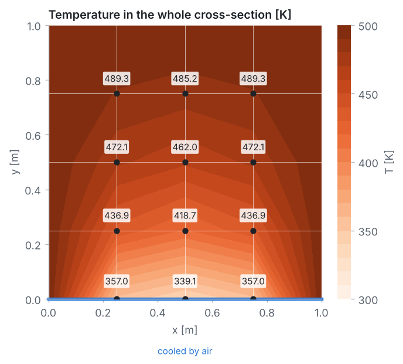

<p align="center">
  
</p>

# Problem 4 · A brick column cooled by air on one side

**2D · steady · heat conduction with a convection boundary · energy balance method · symmetry**

> A large industrial furnace is supported on a long column of fireclay brick, 1 m by 1 m on a side. Three surfaces of the column are kept at 500 K, while the remaining surface is exposed to an air stream with $`T_\infty = 300`$ K and $`h = 10`$ W/(m²·K). Using a grid with $`\Delta x = \Delta y = 0.25`$ m, determine the two-dimensional temperature distribution in the column and the heat rate to the air stream per unit length.
> *(Adapted from Incropera et al., Fundamentals of Heat and Mass Transfer, Example 4.3.)*

## 📦 What's in this folder

| File | What's inside |
|---|---|
| 📄 [`01_problem_statement.pdf`](01_problem_statement.pdf) | the problem, data, grid, assumptions and tasks |
| 📘 [`02_solution.pdf`](02_solution.pdf) | the step-by-step solution: energy balances, node equations, solvers, heat rate, energy check, grid refinement |
| 💻 [`03_fdm_solver.ipynb`](03_fdm_solver.ipynb) | the complete solver in **plain Python**, explained cell by cell, with plots |
| 🎨 [`plots.py`](plots.py) | drawing helpers used by the notebook (matplotlib only, no numerics) |
| 🛠️ [`docs/`](docs) | Markdown sources of the two PDFs and their figures |

## 🎯 What you will learn

- How to derive node equations from **energy balances on control volumes**.
- How a **convection surface node** works: a half control volume, $`T_W + T_E + 2T_N + 2\,Bi\,T_\infty - 2(Bi + 2)T_P = 0`$.
- How **symmetry** reduces 12 unknowns to 8.
- How to compute a **heat rate** from the temperature field, and check that **energy is conserved**.
- Why a grid that is fine enough for temperatures can be far too coarse for **heat fluxes near corners**.

## 📊 Result

<p align="center">
  
</p>

| Node | 1 | 2 | 3 | 4 | 5 | 6 | 7 | 8 |
|---|:-:|:-:|:-:|:-:|:-:|:-:|:-:|:-:|
| T [K] | 489.30 | 485.15 | 472.07 | 462.01 | 436.95 | 418.74 | 356.99 | 339.05 |

Heat rate to the air on this grid: **q′ ≈ 883 W/m**, as in Incropera's example.

> [!IMPORTANT]
> **Refine the grid and the heat rate drops to about 625 W/m**, while most temperatures change by less than 3 K (only node 7, next to the cooled corner, moves by 8.6 K). On the 0.25 m grid, each bottom corner (held at 500 K) is credited with 12.5 cm of hot surface exposed to the air, which alone gives 500 W/m. The notebook's grid study shows this step by step.

## 🔁 Cross-check with COMSOL

The same column is also solved with the finite element method in COMSOL Multiphysics 4.3a: see [`comsol_solution/`](comsol_solution) for the model file and a step-by-step guide for students. COMSOL confirms the grid study: on a fine mesh the heat rate to the air is 623.6 W/m.

## ▶️ Run it

```bash
pip install -r ../../requirements.txt
jupyter lab 03_fdm_solver.ipynb
```

---

<p align="center"><a href="../../README.md#-course-problems">⬅ Back to the course home page</a></p>
