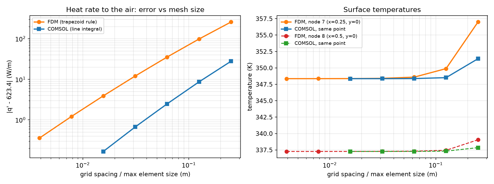

# Problem 4 · COMSOL Multiphysics solution

The same brick column, solved with the **finite element method** in **COMSOL Multiphysics 4.3a** (Heat Transfer in Solids with a convective boundary, 2D stationary study, with a sweep over the mesh size). It confirms the main lesson of the notebook: the coarse 0.25 m grid gives good temperatures but over-predicts the heat rate to the air.

  

| File | What's inside |
|---|---|
| 📘 [`COMSOL_Brick_Column_Guide.pdf`](COMSOL_Brick_Column_Guide.pdf) | step-by-step guide for students (27 pages): the hand solution (energy balances, Gauss elimination, Gauss–Seidel) and 16 annotated COMSOL steps |
| 🧩 [`brick_column_comsol.mph`](brick_column_comsol.mph) | the finished COMSOL model, ready to open in COMSOL 4.3a or newer |
| 🖼️ [`p4_platemap.png`](p4_platemap.png) | the cross-section with the eight node temperatures |
| 📈 [`table_points.txt`](table_points.txt), [`table_qrate.txt`](table_qrate.txt) | temperatures at the node locations and heat rate to the air, exported from COMSOL for each mesh size |
| 🐍 [`p4_analysis.py`](p4_analysis.py), [`p4_fig.py`](p4_fig.py) | scripts for the finite difference grid study and the comparison figures |
| 🔢 [`p4_numbers.json`](p4_numbers.json), [`p4_comsol_table.json`](p4_comsol_table.json) | the numbers behind the comparison |

**Heat rate to the air and bottom-centre temperature (node 8):**

| | heat rate $`q'`$ [W/m] | $`T_8`$ [K] |
|---|:-:|:-:|
| FDM, $`\Delta x = 0.25`$ m (the problem, 8 unknowns) | 882.6 | 339.05 |
| FDM, $`\Delta x = 1/256`$ m | 623.8 | 337.27 |
| COMSOL, element size 0.25 m | 651.3 | 337.85 |
| COMSOL, element size 1/64 m | **623.6** | **337.27** |

Both methods converge to $`q' \approx 623.6`$ W/m: the coarse finite difference grid over-predicts the heat loss by about 41 %. Most node temperatures change by less than 3 K; node 7, next to the cooled corner, changes by 8.6 K.

> [!NOTE]
> `p4_analysis.py` and `p4_fig.py` read and write files in the folder where they were first run (`C:\Users\marya\Downloads\brick_comsol`). To run them from this repository, change that path in the scripts to this folder. They use NumPy, SciPy and Matplotlib.

---

<a href="../README.md">⬅ Back to Problem 4</a>

