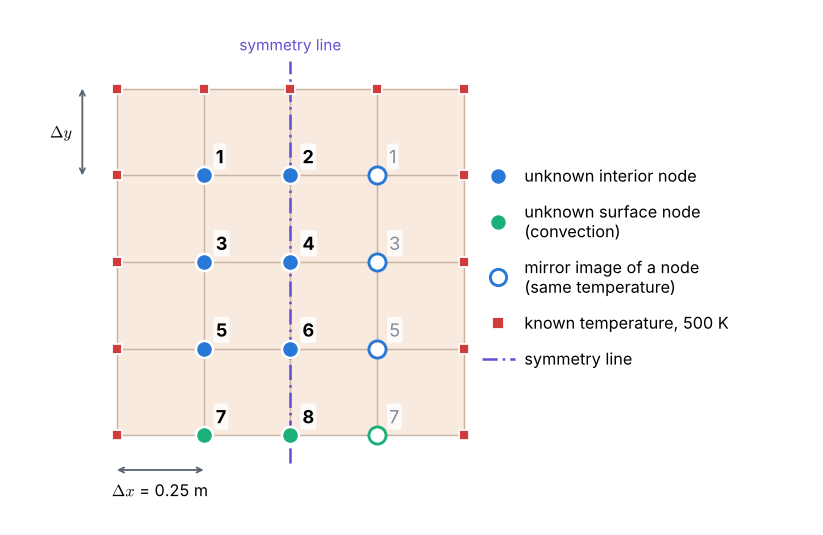

## The problem

::: given
A large industrial furnace is supported on a long column of **fireclay brick**, which is **1 m by 1 m** on a side. During steady-state operation, three surfaces of the column are maintained at **500 K**, while the remaining surface is exposed to an **air stream** for which $T_\infty = 300$ K and $h = 10$ W/(m²·K).

Using a grid of $\Delta x = \Delta y = 0.25$ m, determine the **two-dimensional temperature distribution** in the column and the **heat rate to the air stream per unit length** of column.

*(Adapted from Incropera et al., Fundamentals of Heat and Mass Transfer, Example 4.3.)*
:::

## Data

| Quantity | Symbol | Value |
|---|:-:|---|
| width and height of the cross-section | $W$ | 1 m |
| grid spacing | $\Delta x = \Delta y$ | 0.25 m |
| thermal conductivity of fireclay brick (at about 478 K) | $k$ | 1 W/(m·K) |
| temperature of the top, left and right surfaces | $T_s$ | 500 K |
| air temperature | $T_\infty$ | 300 K |
| convection coefficient at the bottom surface | $h$ | 10 W/(m²·K) |

## Assumptions

- Steady state.
- Two-dimensional conduction: the column is long and nothing changes along its length.
- No heat generation inside the brick.
- Constant thermal conductivity and convection coefficient.
- Radiation is neglected.

## Tasks

1. **Physics.** Write the governing equation in the brick and the boundary condition on each surface. What is the Biot number $Bi = h\Delta x/k$ of a grid cell?
2. **Grid and symmetry.** Draw the grid. Which node temperatures are known and which are unknown? Use the symmetry of the problem to reduce the number of unknowns to eight, numbered 1 to 8 as in the grid figure above.
3. **Discretization.** Derive the node equations with the **energy balance method**: an interior node, a node on the convective surface (half control volume), and a node on the symmetry line.
4. **Solution.** Solve the eight equations by **Gaussian elimination** and by **Gauss–Seidel iteration**.
5. **Results.** Show the temperature distribution over the whole cross-section and calculate the **heat rate to the air** per unit length.
6. **Verification.** Check that the heat conducted in from the hot surfaces equals the heat convected out. Then solve the problem on finer grids: how do the temperatures and the heat rate change?

## What you will learn

- How to derive node equations from **energy balances on control volumes**, including a **convection boundary**.
- How **symmetry** reduces the number of unknowns.
- How to calculate a **heat rate** from a discrete temperature field.
- Why a grid that is fine enough for temperatures may not be fine enough for **heat fluxes near corners**.

::: tip
**Files for this problem:** `02_solution.pdf` explains the solution step by step. `03_fdm_solver.ipynb` contains the complete Python code (plain Python, no numerical libraries), with explanations and plots, to run cell by cell.
:::
