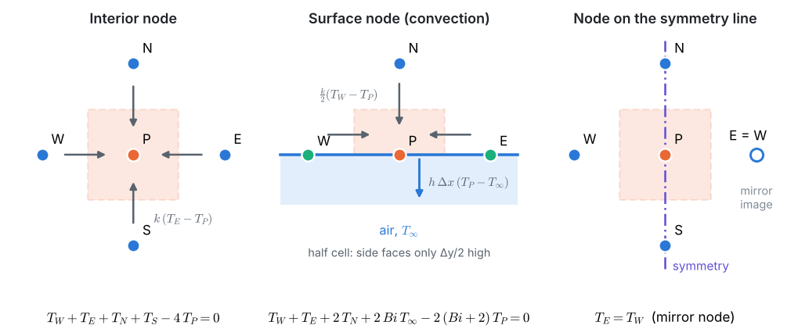
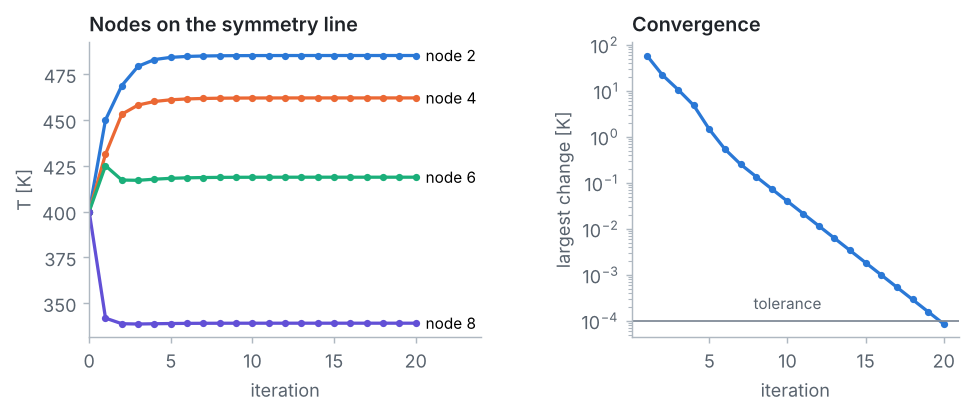
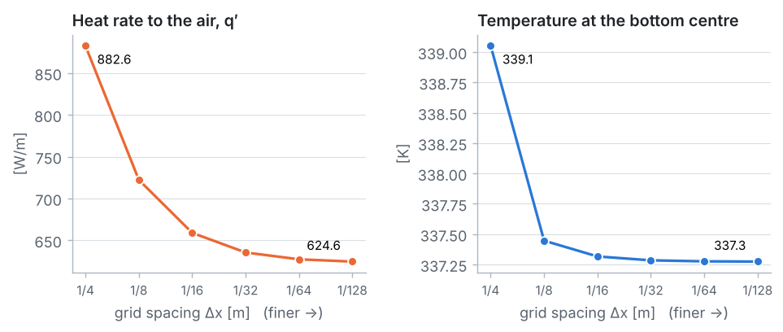
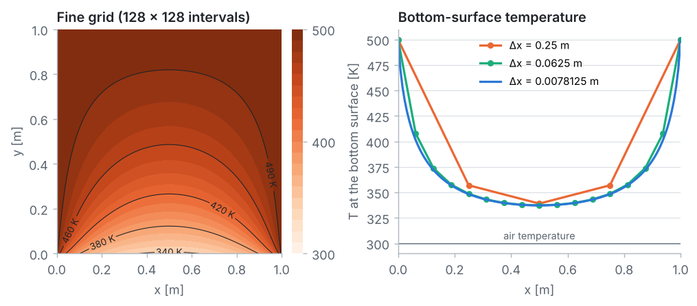

::: goal
**Plan.** One surface now loses heat by **convection**, so its temperature is unknown and needs its own node equation. We derive every node equation with the **energy balance method** and use **symmetry** to halve the work, following the 7 pillars of CFD. All code is plain Python (lists and loops only) and is the code of the notebook `03_fdm_solver.ipynb`.
:::

## Step 1 · Geometry and data

The column is long and nothing changes along it, so the temperature varies only over the $1 \times 1$ m cross-section. Heat flows from the three 500 K surfaces through the brick to the bottom surface, where the air carries it away.

{{code:data}}

## Step 2 · Grid and symmetry

The $0.25$ m grid has $5 \times 5$ nodes $(i, j)$, with $j = 0$ on the bottom surface. The top, left and right nodes are known (500 K), including the two bottom corners, which belong to the hot side walls. The 9 interior nodes and the 3 bottom-surface nodes are unknown.

The geometry and boundary conditions are symmetric about $x = 0.5$ m, so column $i = 3$ has the same temperatures as column $i = 1$. That leaves **8 unknowns**: odd numbers in column $i = 1$, even numbers on the symmetry line $i = 2$.

{{code:grid}}

{{out:grid}}

## Step 3 · Physics

Inside the brick: steady 2D conduction without generation, the **Laplace equation**

$$\frac{\partial^2 T}{\partial x^2} + \frac{\partial^2 T}{\partial y^2} = 0.$$

| surface | condition | type |
|---|---|---|
| top, left, right | $T = T_s = 500$ K | Dirichlet |
| bottom ($y = 0$) | $k\,\dfrac{\partial T}{\partial y} = h\,(T - T_\infty)$ | convection (Robin) |

The cell **Biot number** compares cooling by the air with conduction through the brick: $Bi = h\,\Delta x/k = 2.5$. No simple exact solution exists, so the answer is checked by grid refinement.

## Step 4 · Numerical scheme: energy balances on control volumes

Around every node, put a small control volume and require that, in steady state, the heat flowing in from all sides adds up to zero. Between two nodes, Fourier's law gives (per unit length of column)
$q = k \times \text{face length} \times (T_{neighbour} - T_P)/\text{distance}$.

**Interior node** (full cell, all faces $\Delta x$ long, $\Delta x = \Delta y$):

$$T_E + T_W + T_N + T_S - 4\,T_P = 0.$$

**Surface node with convection** (half cell, side faces $\Delta y/2$, top face $\Delta x$, bottom face $\Delta x$ exposed to the air):

$$k\,\frac{\Delta y}{2}\,\frac{T_W - T_P}{\Delta x} + k\,\frac{\Delta y}{2}\,\frac{T_E - T_P}{\Delta x} + k\,\Delta x\,\frac{T_N - T_P}{\Delta y} + h\,\Delta x\,(T_\infty - T_P) = 0$$

$$\Longrightarrow\quad T_W + T_E + 2\,T_N + 2\,Bi\,T_\infty - 2\,(Bi + 2)\,T_P = 0.$$

**Node on the symmetry line:** its right-hand neighbour is the mirror image of its left-hand one, so that temperature appears twice.

{{code:node-equation}}

The equations are **assembled** into $A\,\mathbf{T} = \mathbf{b}$: an unknown neighbour (after symmetry) adds its weight to $A$; a known 500 K neighbour and the constant term go to $\mathbf{b}$.

{{code:assemble}}

{{out:assemble}}

## Step 5 · Solution setup

As in Problem 3: **Gaussian elimination** (direct) and **Gauss–Seidel** (iterative, starting from 400 K everywhere).

{{code:elimination}}

{{code:gauss-seidel}}

## Step 6 · Compute

{{code:run-elimination}}

{{out:run-elimination}}

{{code:run-gs}}

{{out:run-gs}}

Both methods agree, and agree with the published solution of Incropera's Example 4.3.

## Step 7 · Post-processing and verification

**Heat rate to the air.** Each surface node owns a piece of the bottom surface: each corner (part of the hot walls) $\Delta x/2$, node 8 $\Delta x$ (half on each side of the symmetry line), node 7 and its mirror image $\Delta x$ each. With Newton's law of cooling and symmetry:

$$q' = 2h\left[\frac{\Delta x}{2}(T_s - T_\infty) + \Delta x\,(T_7 - T_\infty) + \frac{\Delta x}{2}(T_8 - T_\infty)\right].$$

{{code:heat-rate}}

{{out:heat-rate}}

**Energy check.** The heat conducted from all known 500 K nodes into their unknown neighbours (with the same face lengths as the energy balances) must equal the heat convected from the unknown surface nodes:

{{code:energy}}

{{out:energy}}

The two are equal: the control-volume balances add up to a balance for the whole column, so **the discrete solution conserves energy**. The remaining 500 W/m reach the air through the two corners, which are part of the hot walls.

**Grid refinement.** A general SOR solver for the full cross-section (no symmetry needed) solves the same problem on finer grids:

{{code:solve-column}}

{{code:refine}}

{{out:refine}}

::: warning
**Temperatures converge fast; the heat rate does not.** The bottom-centre temperature only moves from 339.1 K to 337.3 K, but the heat rate drops from **883 W/m** to about **625 W/m**: the coarse grid overestimates the heat loss by about 40 %. On the coarse grid each bottom corner, held at 500 K, is credited with 0.125 m of hot surface exposed to the air, which alone gives 500 W/m. On finer grids this strip shrinks and the surface next to the corner cools quickly. Steep gradients near corners need fine grids, which is why real CFD meshes are refined near corners and walls.
:::

::: answer
**Result.** On the $0.25$ m grid: $T_1 = 489.30$, $T_2 = 485.15$, $T_3 = 472.07$, $T_4 = 462.01$, $T_5 = 436.95$, $T_6 = 418.74$, $T_7 = 356.99$, $T_8 = 339.05$ K, and the heat rate to the air is $q' \approx$ **883 W/m**, as in Incropera's example. Grid refinement shows that the temperatures are already accurate to within about 2 K, while the heat rate converges to about **625 W/m**.
:::

## Key ideas

- Energy balances on control volumes give the node equations, and handle convection boundaries naturally.
- A convective surface node uses a half control volume: $T_W + T_E + 2T_N + 2\,Bi\,T_\infty - 2(Bi + 2)T_P = 0$.
- Symmetry halves the number of unknowns; a node on the symmetry line counts its mirror neighbour twice.
- The finite difference solution conserves energy exactly.
- A grid that is fine enough for temperatures may be far too coarse for heat fluxes near corners: always check with grid refinement.
