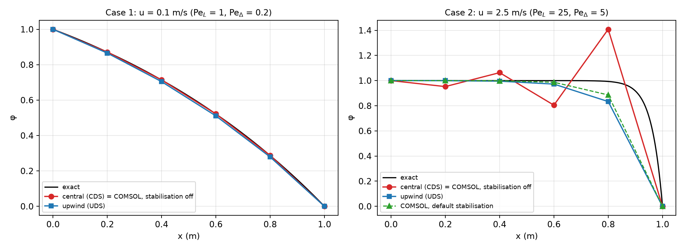

# Problem 5 · COMSOL Multiphysics solution

The same convection–diffusion problem, solved with the **finite element method** in **COMSOL Multiphysics 4.3a** (Transport of Diluted Species, 1D stationary study, with a sweep over the mesh size). It shows two things. With its numerical **stabilisation switched off**, COMSOL's linear elements on a uniform mesh reproduce the **central-difference (CDS)** values exactly, wiggles included. With its **default stabilisation**, COMSOL removes the wiggles by adding artificial diffusion, much like the upwind scheme does.

  

| File | What's inside |
|---|---|
| 📘 [`COMSOL_Convection_Diffusion_Guide.pdf`](COMSOL_Convection_Diffusion_Guide.pdf) | step-by-step guide for students (27 pages): the hand solution (CDS and UDS coefficients, Thomas algorithm, false diffusion, Gauss–Seidel), 16 annotated COMSOL steps and the grid study |
| 🧩 [`convdiff_comsol.mph`](convdiff_comsol.mph) | the finished COMSOL model (stabilisation off), ready to open in COMSOL 4.3a or newer |
| 🖼️ [`p5_domain.png`](p5_domain.png), [`p5_exact.png`](p5_exact.png), [`p5_cases.png`](p5_cases.png), [`p5_convergence.png`](p5_convergence.png) | the figures of the guide: domain, exact solutions, the two cases, grid refinement |
| 📈 [`profiles_stab.txt`](profiles_stab.txt) | profiles exported from COMSOL with the default stabilisation, for every velocity and mesh size |
| 🐍 [`p5_analysis.py`](p5_analysis.py), [`p5_parse.py`](p5_parse.py), [`p5_parse2.py`](p5_parse2.py), [`p5_fig.py`](p5_fig.py) | the finite difference reference, the parsing of the COMSOL exports and the figures |
| 🔢 [`p5_numbers.json`](p5_numbers.json), [`p5_comsol.json`](p5_comsol.json), [`p5_comsol_stab.json`](p5_comsol_stab.json) | the numbers behind the comparison (finite differences, COMSOL without and with stabilisation) |

**Node values for the fast flow, $`u = 2.5`$ m/s, 5 elements ($`Pe_\Delta = 5`$):**

| $`x`$ [m] | 0.2 | 0.4 | 0.6 | 0.8 |
|---|:-:|:-:|:-:|:-:|
| FDM, central (CDS) | 0.9525 | 1.0633 | 0.8047 | 1.4082 |
| COMSOL, stabilisation off | 0.9525 | 1.0633 | 0.8047 | 1.4082 |
| COMSOL, default stabilisation | 0.9999 | 0.9985 | 0.9870 | 0.8860 |
| FDM, upwind (UDS) | 0.9994 | 0.9955 | 0.9723 | 0.8334 |
| exact | 1.0000 | 1.0000 | 1.0000 | 0.9933 |

**Grid refinement, $`u = 2.5`$ m/s, largest nodal error:**

| elements | 5 | 10 | 20 | 40 | 80 | 160 | 320 |
|---|:-:|:-:|:-:|:-:|:-:|:-:|:-:|
| FDM, CDS = COMSOL, stabilisation off | 0.415 | 0.193 | 0.0557 | 0.0121 | 0.00302 | 0.000749 | 0.000187 |
| COMSOL, default stabilisation | 0.107 | 0.0983 | 0.0434 | 0.0115 | 0.00297 | 0.000746 | 0.000187 |
| FDM, UDS | 0.160 | 0.204 | 0.158 | 0.0922 | 0.0507 | 0.0270 | 0.0139 |

With stabilisation switched off, COMSOL agrees with the central-difference notebook to round-off on every mesh. The default stabilisation keeps every value between 0 and 1 on all meshes and is more accurate than plain upwinding. Once the mesh is fine enough ($`Pe_\Delta < 2`$), it converges at 2nd order like CDS.

> [!NOTE]
> The scripts read and write files in the folder where they were first run (`C:\Users\marya\Downloads\convdiff_comsol`). To run them from this repository, change that path in the scripts to this folder. `p5_parse.py` reads `profiles.txt`, the export without stabilisation, which is not included here; its results are saved in `p5_comsol.json`. The scripts use NumPy and Matplotlib.

---

<a href="../README.md">⬅ Back to Problem 5</a>

