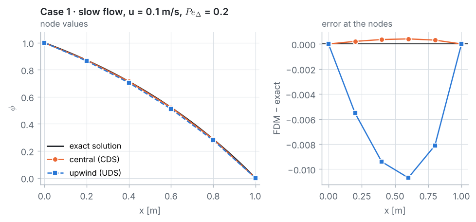
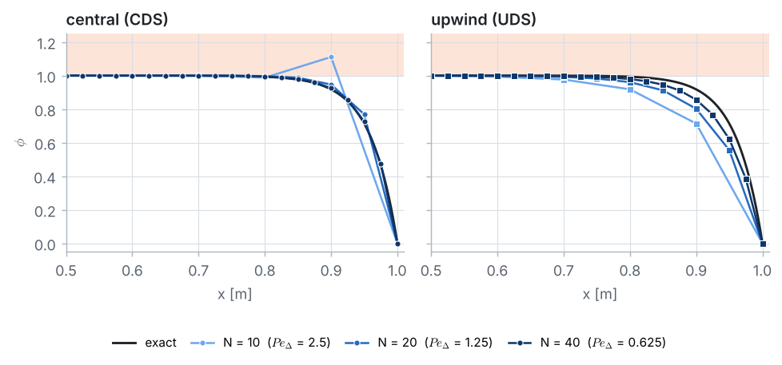
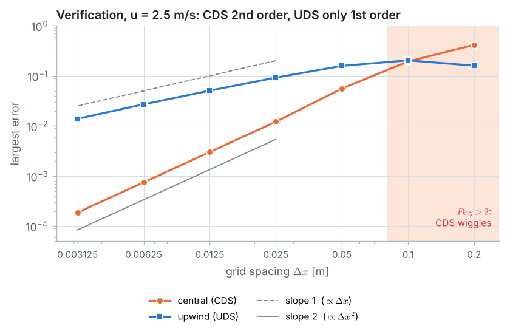
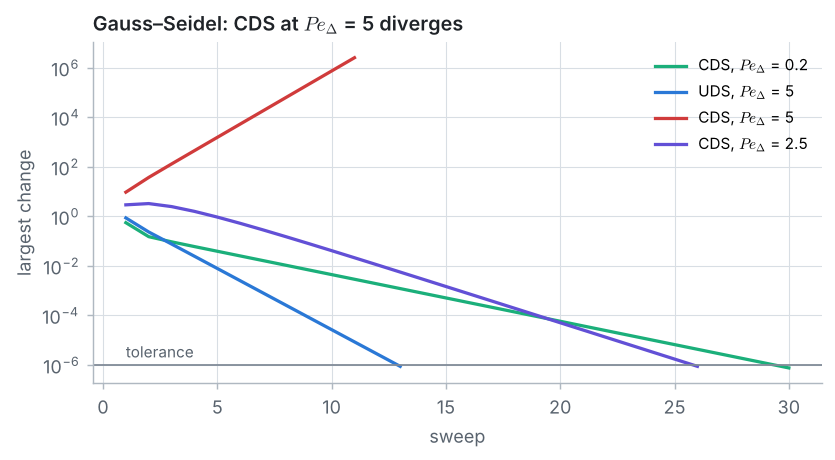

::: goal
**Plan.** We follow the 7 pillars of CFD: geometry → grid → physics → numerical scheme → solution setup → compute → post-processing. All code below is plain Python (lists and loops only; `math` for the exact solution and the order of accuracy). It is the code of the notebook `03_fdm_solver.ipynb`, where it can be run cell by cell.
:::

## Step 1 · Geometry and data

A fluid flows with constant velocity $u$ through a channel of length $L = 1$ m, from a reservoir with $\phi_0 = 1$ to a reservoir with $\phi_L = 0$. The density is $\rho = 1$ kg/m³ and the diffusion coefficient $\Gamma = 0.1$ kg/(m·s). We study a slow flow, $u = 0.1$ m/s, and a fast flow, $u = 2.5$ m/s.

{{code:data}}

Problems 1 to 4 were about heat diffusing through a solid. In a **fluid** the material itself moves and **carries** $\phi$ with it: this is **convection**. Every equation of fluid flow, including the Navier–Stokes equations, has a convection term; it is what makes CFD *fluid* dynamics. Which effect wins is measured by the **Péclet number**:

$$Pe_L = \frac{\text{convection}}{\text{diffusion}} = \frac{\rho\,u\,L}{\Gamma}.$$

{{code:peclet-L}}

{{out:peclet-L}}

## Step 2 · The grid

We keep $N + 1$ equally spaced nodes, $x_i = i\,\Delta x$ with $\Delta x = L/N$. Nodes 0 and $N$ sit in the reservoirs (known values). With the coarse grid $N = 5$, nodes 1 to 4 are the four unknowns.

{{code:grid}}

{{out:grid}}

On the grid, the Péclet number of **one interval**, the **cell Péclet number**, will decide how our schemes behave:

$$Pe_\Delta = \frac{\rho\,u\,\Delta x}{\Gamma}.$$

{{code:peclet}}

{{out:peclet}}

## Step 3 · Physics: the convection–diffusion equation

Through every cross-section flow two fluxes of $\phi$: the **convective flux** $\rho u\,\phi$ (carried by the flow) and the **diffusive flux** $-\Gamma\,d\phi/dx$ (from high to low values). In steady state with no source the total flux is the same everywhere, so

$$\frac{d(\rho u\,\phi)}{dx} = \frac{d}{dx}\left(\Gamma\,\frac{d\phi}{dx}\right), \qquad \phi(0) = \phi_0 = 1, \qquad \phi(L) = \phi_L = 0.$$

Continuity, $d(\rho u)/dx = 0$, makes $\rho u$ constant. The two terms behave very differently:

- **diffusion** spreads $\phi$ in **both** directions;
- **convection** carries $\phi$ in **one** direction only, downstream. This is called **transportiveness**: the value at a point is mostly decided by what comes from upstream.

**Exact solution** (used to judge every numerical result):

$$\frac{\phi(x) - \phi_0}{\phi_L - \phi_0} = \frac{\exp(\rho u x/\Gamma) - 1}{\exp(\rho u L/\Gamma) - 1}.$$

It always stays between 0 and 1: with no source, $\phi$ cannot exceed the largest boundary value or fall below the smallest. A good scheme must keep this property, called **boundedness**.

{{code:exact}}

{{out:exact}}

## Step 4 · Numerical scheme: CDS and UDS

At an interior node $i$ ($P$, with neighbours $W = i - 1$ and $E = i + 1$), the diffusion term gets the usual central difference, $\Gamma\,(\phi_{i-1} - 2\phi_i + \phi_{i+1})/\Delta x^2$. For the convection term we compare two choices:

$$\text{CDS (2nd order):}\quad \rho u\,\frac{\phi_{i+1} - \phi_{i-1}}{2\,\Delta x},
\qquad\qquad
\text{UDS, } u > 0 \text{ (1st order):}\quad \rho u\,\frac{\phi_{i} - \phi_{i-1}}{\Delta x}.$$

Upwind uses only the node the flow comes **from**, like the flow itself. Multiplying by $\Delta x$ and introducing the flux strengths $F = \rho u$ and $D = \Gamma/\Delta x$ (so that $F/D = Pe_\Delta$), both schemes give

$$a_P\,\phi_i = a_W\,\phi_{i-1} + a_E\,\phi_{i+1}, \qquad a_P = a_W + a_E,$$

| | $a_W$ (west) | $a_E$ (east) | $a_P$ |
|---|:-:|:-:|:-:|
| central (CDS) | $D + F/2$ | $D - F/2$ | $2D$ |
| upwind (UDS), $u > 0$ | $D + F$ | $D$ | $2D + F$ |

{{code:coefficients}}

{{code:show-coefficients}}

{{out:show-coefficients}}

With $Pe_\Delta = 5$, the CDS east coefficient is **negative** and the equation is no longer **diagonally dominant** ($|a_W| + |a_E| > a_P$). This happens whenever $F > 2D$, i.e. $Pe_\Delta > 2$. Upwind keeps all coefficients positive for any velocity.

As in Problem 1, every equation is stored as $a_i\,\phi_{i-1} + b_i\,\phi_i + c_i\,\phi_{i+1} = r_i$, a **tridiagonal** system, and the two boundary rows simply say $\phi_0 = 1$ and $\phi_N = 0$:

{{code:system}}

For the fast flow with CDS:

{{code:show-system}}

{{out:show-system}}

## Step 5 · Solution setup: the Thomas algorithm

The system is tridiagonal, so we solve it **directly** with the Thomas algorithm of Problem 1. It solves each scheme's equations exactly (up to round-off), whatever the signs of the coefficients. Any strange result must then come from the **scheme**, not from the solver.

{{code:thomas}}

## Step 6 · Compute

{{code:table}}

**Case 1 · slow flow, $u = 0.1$ m/s ($Pe_\Delta = 0.2$).**

{{code:case1}}

{{out:case1}}

**Case 2 · fast flow, $u = 2.5$ m/s ($Pe_\Delta = 5$).**

{{code:case2}}

{{out:case2}}

::: warning
**CDS at $Pe_\Delta = 5$ is not just inaccurate, it is wrong.** The values go down, up, down, up (0.95, 1.06, 0.80, 1.41), and two of them exceed 1, the largest value present anywhere in the problem. The Thomas algorithm solved the CDS equations exactly: the wiggles are the true answer of the CDS equations on this grid. **UDS** is bounded and monotone, but at node 4 it gives 0.83 instead of 0.99.
:::

The whiteboard guide solves both cases by hand with the Thomas algorithm, writing $\phi_i = P_i\,\phi_{i+1} + Q_i$, with all coefficients divided by $D$. The notebook prints the same intermediate numbers:

{{code:hand}}

{{out:hand}}

## Step 7 · Post-processing and verification

**Why CDS wiggles.** Divide the node equation by $a_P$:

$$\phi_i = \frac{a_W}{a_P}\,\phi_{i-1} + \frac{a_E}{a_P}\,\phi_{i+1}.$$

With two **positive** weights that add up to 1, every node value lies between its neighbours, and no value can leave the range $[0, 1]$ set by the boundaries. With CDS at $Pe_\Delta = 5$ the weights are $1.75$ and $-0.75$, and this averaging is lost.

The equations even give the shape of the answer. Trying $\phi_i = s^i$ works for $s = 1$ and for $s = a_W/a_E$, so

$$\phi_i = 1 - \frac{s^i - 1}{s^N - 1}, \qquad s_{CDS} = \frac{1 + Pe_\Delta/2}{1 - Pe_\Delta/2}, \qquad s_{UDS} = 1 + Pe_\Delta.$$

The exact solution at the nodes is the same formula with $s$ replaced by $e^{Pe_\Delta}$. A good scheme has $s$ close to $e^{Pe_\Delta}$; a **negative** $s$ makes $s^i$ flip sign at every node: a zig-zag.

{{code:ratio}}

{{out:ratio}}

::: note
**Rule of thumb.** Central differences for convection are bounded only when $Pe_\Delta \le 2$: then $a_E = D - F/2 \ge 0$ and the matrix is diagonally dominant. Upwind has $s = 1 + Pe_\Delta > 0$ and can never wiggle, but $s = 6$ is far below $e^5 = 148$: the profile is smeared.
:::

**False diffusion.** A backward difference is a central difference plus a diffusion-like correction:

$$\frac{\phi_i - \phi_{i-1}}{\Delta x} = \frac{\phi_{i+1} - \phi_{i-1}}{2\,\Delta x} - \frac{\Delta x}{2}\,\frac{\phi_{i+1} - 2\phi_i + \phi_{i-1}}{\Delta x^2}.$$

So the upwind equations are **exactly** the central equations with a larger diffusion coefficient, $\Gamma + \rho u\,\Delta x/2$. The extra part is called **false** (or **numerical**) **diffusion**.

{{code:false-diffusion}}

{{out:false-diffusion}}

**Grid refinement (case 3).** Both defects shrink with $\Delta x$: CDS becomes bounded once $Pe_\Delta < 2$ (for $u = 2.5$ m/s, $\Delta x < 0.08$ m), and false diffusion goes to zero. The observed order between two grids is $p = \log(e_{coarse}/e_{fine})/\log 2$.

{{code:refine}}

{{out:refine}}

- **CDS** fails while $Pe_\Delta > 2$ ($N = 5$ and 10). From $N = 40$ on its error falls by a factor of 4 per halving of $\Delta x$: **2nd order**.
- **UDS** never wiggles, but its error even grows from $N = 5$ to $N = 10$ (on the coarsest grid no node lies inside the boundary layer), and on the finest grids it only halves per halving of $\Delta x$ (observed order 0.95): **1st order**. With 320 intervals UDS (0.014) is still less accurate than CDS with 40 intervals (0.012).

**Iterative solvers.** Gauss–Seidel is guaranteed to converge for diagonally dominant systems. Starting from $\phi = 0$ inside the domain:

{{code:gauss-seidel}}

{{out:gauss-seidel}}

CDS at $Pe_\Delta = 5$ **diverges**. CDS at $Pe_\Delta = 2.5$ is not diagonally dominant either, yet it converges: losing diagonal dominance removes the *guarantee*, it does not always mean divergence.

**Why commercial codes do not use plain central differences for convection.** Real flows have very large Péclet numbers, so keeping $Pe_\Delta < 2$ everywhere would need far too many cells, while plain upwinding is too diffusive. Commercial codes therefore use **upwind-biased** schemes (second-order upwind, QUICK, TVD schemes with limiters) or add a controlled amount of numerical diffusion only where needed (**stabilisation**; COMSOL, for example, applies streamline-diffusion stabilisation by default in its transport interfaces).

::: answer
**Result.** For the slow flow ($Pe_\Delta = 0.2$) both schemes work on 5 intervals: the largest CDS error is 0.0004 and the largest UDS error 0.011. For the fast flow ($Pe_\Delta = 5$) CDS gives wiggles outside the physical range (up to 1.41 at node 4, exact 0.99), while UDS is bounded but smeared (0.83 at node 4) by false diffusion 2.5 times larger than the real diffusion. Refining the grid, CDS converges at **2nd order** once $Pe_\Delta < 2$, UDS at only **1st order**.
:::

## Key ideas

- The convection term carries $\phi$ downstream (transportiveness); the Péclet number compares it with diffusion.
- On a grid, the cell Péclet number $Pe_\Delta = \rho u\,\Delta x/\Gamma$ decides how a scheme behaves.
- Central differences are 2nd order but unbounded for $Pe_\Delta > 2$: a negative neighbour coefficient, loss of diagonal dominance, wiggles, and Gauss–Seidel may diverge.
- Upwind differences are always bounded but only 1st order, and add false diffusion $\rho u\,\Delta x/2$.
- Practical CFD codes use upwind-biased or stabilised schemes to get both boundedness and accuracy.
