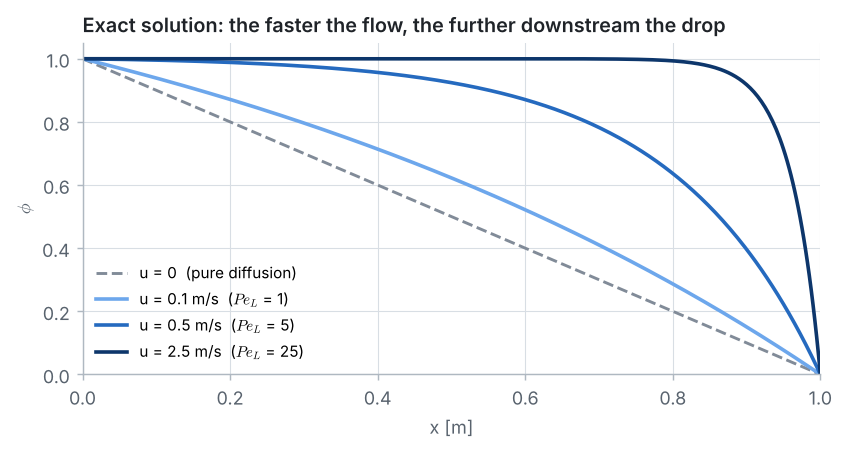
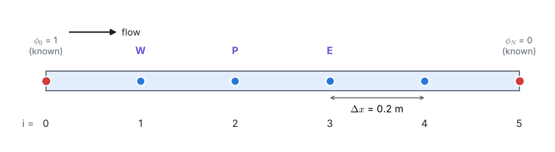
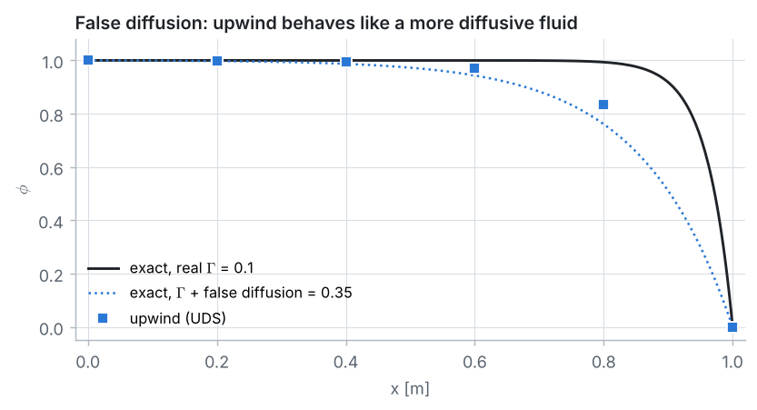

::: goal
**Aim of the lesson.** Students solve the convection–diffusion problem by hand with **5 intervals** (4 unknowns) three times: central differences for a slow flow, central differences for a fast flow, and upwind differences for the fast flow. They *see* central differences produce impossible values, find the reason in the signs of two coefficients, and meet false diffusion, all before opening the notebook. Every intermediate number is given below so you can check the class's calculator results line by line.
:::

## Lesson plan (about 60 minutes)

| Board | Content | Time |
|:-:|---|:-:|
| 1 | The physical problem: convection versus diffusion, the Péclet number | 5 min |
| 2 | The equation, its exact solution and a sketch for several velocities | 8 min |
| 3 | The grid and the cell Péclet number | 4 min |
| 4 | Central and upwind differences → neighbour coefficients | 10 min |
| 5 | Case 1, slow flow, CDS by hand (Thomas algorithm) | 10 min |
| 6 | Case 2, fast flow, CDS by hand: the wiggles | 8 min |
| 7 | Case 2, fast flow, UDS by hand: bounded but smeared, false diffusion | 8 min |
| 8 | Why: positive weights, the factor $s$, the rule $Pe_\Delta \le 2$ | 7 min |

::: tip
**Calculator advice for the class.** Divide every coefficient by $D = \Gamma/\Delta x$ first: the equations then have simple coefficients (1.1, 2, 0.9 or 3.5, 2, −1.5 or 6, 7, 1), and nothing in the answer changes. Keep **6 decimals** in $P_i$ and $Q_i$. In case 2 with CDS the values $P_i$ are **negative**: watch the signs.
:::

## Board 1 · The physical problem

Write the data on the board:

| | |
|---|---|
| domain | $0 \le x \le L$, $L = 1$ m |
| fluid | $\rho = 1$ kg/m³, $\Gamma = 0.1$ kg/(m·s) |
| boundaries | $\phi(0) = 1$ (left reservoir), $\phi(L) = 0$ (right reservoir) |
| velocity | case 1: $u = 0.1$ m/s; case 2: $u = 2.5$ m/s (left to right) |

Explain the two mechanisms with a picture everybody knows: a drop of ink in a river. It **spreads** (diffusion) and is **carried downstream** (convection). In Problems 1 to 4 only diffusion existed, because a solid does not move. The convection term is what makes CFD *fluid* dynamics.

**Péclet number** = convection / diffusion:

$$Pe_L = \frac{\rho u L}{\Gamma} = \frac{1 \times 0.1 \times 1}{0.1} = 1 \;\;\text{(case 1)}, \qquad \frac{1 \times 2.5 \times 1}{0.1} = 25 \;\;\text{(case 2)}.$$

**Ask the class:** *In case 2, what do you expect $\phi$ to look like? Where does it drop from 1 to 0?*

## Board 2 · The equation and its exact solution

Flux of $\phi$ through a cross-section = carried by the flow + diffusing:

$$J = \rho u\,\phi - \Gamma\,\frac{d\phi}{dx}.$$

Steady, no source: $J$ is the same everywhere, $dJ/dx = 0$:

$$\frac{d(\rho u\,\phi)}{dx} = \frac{d}{dx}\left(\Gamma\frac{d\phi}{dx}\right) \qquad\Longrightarrow\qquad \rho u\,\frac{d\phi}{dx} = \Gamma\,\frac{d^2\phi}{dx^2}$$

($\rho u$ is constant by continuity, $d(\rho u)/dx = 0$). Exact solution:

$$\phi(x) = 1 - \frac{e^{\rho u x/\Gamma} - 1}{e^{\rho u L/\Gamma} - 1}.$$

Sketch the curves. Point out two facts the numerical answers must respect:

- the exact $\phi$ always lies between 0 and 1 (**boundedness**);
- for a fast flow, $\phi$ stays near 1 and drops in a thin layer, about $\Gamma/(\rho u) = 0.04$ m thick, at the outlet: information travels **downstream** (**transportiveness**).

## Board 3 · The grid

$$N = 5, \qquad \Delta x = 0.2\ \text{m}, \qquad x_i = 0,\ 0.2,\ 0.4,\ 0.6,\ 0.8,\ 1.0\ \text{m}.$$

The **cell Péclet number** compares convection and diffusion across **one interval**:

$$Pe_\Delta = \frac{\rho u\,\Delta x}{\Gamma} = 0.2 \;\;\text{(case 1)}, \qquad 5 \;\;\text{(case 2)}.$$

**Ask the class:** *The boundary layer in case 2 is 0.04 m thick. How many nodes fall inside it?* (None.)

## Board 4 · Finite differences → neighbour coefficients

Diffusion, central as always:

$$\Gamma\,\frac{d^2\phi}{dx^2} \approx \Gamma\,\frac{\phi_{i-1} - 2\phi_i + \phi_{i+1}}{\Delta x^2}.$$

Convection, two choices:

$$\text{CDS: } \rho u\,\frac{\phi_{i+1} - \phi_{i-1}}{2\Delta x}, \qquad\qquad \text{UDS } (u > 0)\text{: } \rho u\,\frac{\phi_i - \phi_{i-1}}{\Delta x}.$$

Multiply by $\Delta x$, write $F = \rho u$ and $D = \Gamma/\Delta x$, and collect terms:

$$a_P\,\phi_i = a_W\,\phi_{i-1} + a_E\,\phi_{i+1}$$

| | $a_W$ | $a_E$ | $a_P$ | divided by $D$ |
|---|:-:|:-:|:-:|:-:|
| CDS | $D + F/2$ | $D - F/2$ | $2D$ | $1 + Pe_\Delta/2,\ \ 1 - Pe_\Delta/2,\ \ 2$ |
| UDS | $D + F$ | $D$ | $2D + F$ | $1 + Pe_\Delta,\ \ 1,\ \ 2 + Pe_\Delta$ |

With $D = 0.1/0.2 = 0.5$ kg/(m²·s), and dividing by $D$:

| case | scheme | $a_W$ | $a_E$ | $a_P$ |
|---|:-:|:-:|:-:|:-:|
| 1, $Pe_\Delta = 0.2$ | CDS | 1.1 | 0.9 | 2 |
| 2, $Pe_\Delta = 5$ | CDS | 3.5 | **−1.5** | 2 |
| 2, $Pe_\Delta = 5$ | UDS | 6 | 1 | 7 |

**Ask the class:** *Which coefficient looks suspicious?* (The negative $a_E$ of CDS in case 2.) Leave it on the board; Board 8 comes back to it.

## Board 5 · Case 1, slow flow, CDS: the Thomas algorithm by hand

Equations ($\phi_0 = 1$ and $\phi_5 = 0$ already inserted):

$$\begin{aligned}
(1)\quad & 2\,\phi_1 - 0.9\,\phi_2 &= 1.1\\
(2)\quad & -1.1\,\phi_1 + 2\,\phi_2 - 0.9\,\phi_3 &= 0\\
(3)\quad & -1.1\,\phi_2 + 2\,\phi_3 - 0.9\,\phi_4 &= 0\\
(4)\quad & -1.1\,\phi_3 + 2\,\phi_4 &= 0
\end{aligned}$$

**Idea** (as in Problem 1): write every unknown in terms of the next one, $\phi_i = P_i\,\phi_{i+1} + Q_i$, going downstream; then come back. Putting $\phi_{i-1} = P_{i-1}\phi_i + Q_{i-1}$ into $a_P\phi_i = a_W\phi_{i-1} + a_E\phi_{i+1}$ gives the two recipes

$$P_i = \frac{a_E}{a_P - a_W P_{i-1}}, \qquad Q_i = \frac{a_W\,Q_{i-1}}{a_P - a_W P_{i-1}}, \qquad\text{starting from } P_0 = 0,\ Q_0 = \phi_0 = 1.$$

**Forward sweep:**

| $i$ | $a_P - a_W P_{i-1}$ | $P_i$ | $Q_i$ |
|:-:|:-:|:-:|:-:|
| 1 | $2 - 1.1 \times 0 = 2.000000$ | $0.9/2 = 0.450000$ | $1.1 \times 1/2 = 0.550000$ |
| 2 | $2 - 1.1 \times 0.45 = 1.505000$ | 0.598007 | 0.401993 |
| 3 | $2 - 1.1 \times 0.598007 = 1.342193$ | 0.670545 | 0.329455 |
| 4 | $2 - 1.1 \times 0.670545 = 1.262401$ | 0.712927 | 0.287073 |

**Back substitution**, starting from $\phi_5 = 0$, so $\phi_4 = P_4 \times 0 + Q_4 = Q_4$:

| node | calculation | $\phi_i$ | exact | error |
|:-:|---|:-:|:-:|:-:|
| 4 | $Q_4$ | **0.287073** | 0.286764 | +0.000309 |
| 3 | $0.670545 \times 0.287073 + 0.329455$ | **0.521951** | 0.521546 | +0.000405 |
| 2 | $0.598007 \times 0.521951 + 0.401993$ | **0.714123** | 0.713769 | +0.000354 |
| 1 | $0.450000 \times 0.714123 + 0.550000$ | **0.871355** | 0.871149 | +0.000207 |

**Check one equation**, e.g. (2): $-1.1 \times 0.871355 + 2 \times 0.714123 - 0.9 \times 0.521951 = -0.958491 + 1.428246 - 0.469756 \approx 0$ ✓.

::: answer
**Case 1:** with 4 unknowns and central differences, every value is within 0.0005 of the exact solution.
:::

## Board 6 · Case 2, fast flow, CDS: the wiggles

Same method, new coefficients: $a_W = 3.5$, $a_E = -1.5$, $a_P = 2$.

$$\begin{aligned}
(1)\quad & 2\,\phi_1 + 1.5\,\phi_2 &= 3.5\\
(2)\quad & -3.5\,\phi_1 + 2\,\phi_2 + 1.5\,\phi_3 &= 0\\
(3)\quad & -3.5\,\phi_2 + 2\,\phi_3 + 1.5\,\phi_4 &= 0\\
(4)\quad & -3.5\,\phi_3 + 2\,\phi_4 &= 0
\end{aligned}$$

**Forward sweep:**

| $i$ | $a_P - a_W P_{i-1}$ | $P_i$ | $Q_i$ |
|:-:|:-:|:-:|:-:|
| 1 | $2 - 3.5 \times 0 = 2.000000$ | $-1.5/2 = -0.750000$ | $3.5/2 = 1.750000$ |
| 2 | $2 - 3.5 \times (-0.75) = 4.625000$ | −0.324324 | 1.324324 |
| 3 | $2 - 3.5 \times (-0.324324) = 3.135135$ | −0.478448 | 1.478448 |
| 4 | $2 - 3.5 \times (-0.478448) = 3.674569$ | −0.408211 | 1.408211 |

**Back substitution:**

| node | calculation | $\phi_i$ | exact |
|:-:|---|:-:|:-:|
| 4 | $Q_4$ | **1.408211** | 0.993262 |
| 3 | $-0.478448 \times 1.408211 + 1.478448$ | **0.804692** | 0.999955 |
| 2 | $-0.324324 \times 0.804692 + 1.324324$ | **1.063343** | 1.000000 |
| 1 | $-0.750000 \times 1.063343 + 1.750000$ | **0.952493** | 1.000000 |

**Check one equation**, e.g. (2): $-3.5 \times 0.952493 + 2 \times 1.063343 + 1.5 \times 0.804692 = -3.333726 + 2.126686 + 1.207038 \approx 0$ ✓. The arithmetic is right: these *are* the solutions of the CDS equations.

Now show the wiggle in a table. Write the change from one node to the next:

| node $i$ | 0 | 1 | 2 | 3 | 4 | 5 |
|---|:-:|:-:|:-:|:-:|:-:|:-:|
| $\phi_i$ (CDS) | 1 | 0.952493 | 1.063343 | 0.804692 | **1.408211** | 0 |
| change $\phi_i - \phi_{i-1}$ | | −0.047507 | +0.110850 | −0.258651 | +0.603519 | −1.408211 |
| change ÷ previous change | | | −2.333 | −2.333 | −2.333 | −2.333 |

Every change is **−2.333 times** the previous one: the sign flips at every node and the size grows. Two values are **larger than 1**, which is impossible in the real problem: no value above 1 exists anywhere.

**Ask the class:** *Is this a rounding error? A bug?* (No: board 8 explains it.)

## Board 7 · Case 2, fast flow, UDS: bounded, but smeared

Upwind coefficients: $a_W = 6$, $a_E = 1$, $a_P = 7$ (all positive).

$$\begin{aligned}
(1)\quad & 7\,\phi_1 - \phi_2 &= 6\\
(2)\quad & -6\,\phi_1 + 7\,\phi_2 - \phi_3 &= 0\\
(3)\quad & -6\,\phi_2 + 7\,\phi_3 - \phi_4 &= 0\\
(4)\quad & -6\,\phi_3 + 7\,\phi_4 &= 0
\end{aligned}$$

**Forward sweep:**

| $i$ | $a_P - a_W P_{i-1}$ | $P_i$ | $Q_i$ |
|:-:|:-:|:-:|:-:|
| 1 | $7 - 6 \times 0 = 7.000000$ | $1/7 = 0.142857$ | $6/7 = 0.857143$ |
| 2 | $7 - 6 \times 0.142857 = 6.142857$ | 0.162791 | 0.837209 |
| 3 | $7 - 6 \times 0.162791 = 6.023256$ | 0.166023 | 0.833977 |
| 4 | $7 - 6 \times 0.166023 = 6.003861$ | 0.166559 | 0.833441 |

**Back substitution:**

| node | calculation | $\phi_i$ | exact |
|:-:|---|:-:|:-:|
| 4 | $Q_4$ | **0.833441** | 0.993262 |
| 3 | $0.166023 \times 0.833441 + 0.833977$ | **0.972347** | 0.999955 |
| 2 | $0.162791 \times 0.972347 + 0.837209$ | **0.995498** | 1.000000 |
| 1 | $0.142857 \times 0.995498 + 0.857143$ | **0.999357** | 1.000000 |

**Check** (2): $-6 \times 0.999357 + 7 \times 0.995498 - 0.972347 = -5.996142 + 6.968486 - 0.972347 \approx 0$ ✓.

All values lie between 0 and 1 and fall steadily: **bounded and monotone**. But at node 4 UDS gives 0.83 instead of 0.99: the drop starts too early. The changes are −0.000643, −0.003859, −0.023151, −0.138906, −0.833441: each is **6 times** the previous one, always with the same sign.

**False diffusion.** Show on the board that

$$\frac{\phi_i - \phi_{i-1}}{\Delta x} = \frac{\phi_{i+1} - \phi_{i-1}}{2\Delta x} - \frac{\Delta x}{2}\cdot\frac{\phi_{i+1} - 2\phi_i + \phi_{i-1}}{\Delta x^2}$$

(expand the right-hand side: the $\phi_{i+1}$ terms cancel). So UDS = CDS with diffusion $\Gamma + \rho u\,\Delta x/2 = 0.1 + 2.5 \times 0.2/2 = 0.1 + 0.25 = 0.35$. The scheme behaves as if the fluid diffused **3.5 times** more than it really does.

## Board 8 · Why: positive weights and the factor $s$

Divide by $a_P$:

$$\phi_i = \frac{a_W}{a_P}\,\phi_{i-1} + \frac{a_E}{a_P}\,\phi_{i+1}.$$

| case | weights $a_W/a_P$, $a_E/a_P$ | meaning |
|---|:-:|---|
| case 1, CDS | 0.55, 0.45 | both positive: $\phi_i$ is an **average** of its neighbours |
| case 2, CDS | 1.75, **−0.75** | not an average: $\phi_i$ can go **outside** its neighbours |
| case 2, UDS | 0.857, 0.143 | both positive, upstream neighbour counts most |

With positive weights, no node can be larger than both its neighbours or smaller than both, so no value can escape $[0, 1]$.

**The factor $s$.** Try $\phi_i = s^i$ in $a_P\phi_i = a_W\phi_{i-1} + a_E\phi_{i+1}$ (with $a_P = a_W + a_E$): it works for $s = 1$ and $s = a_W/a_E$. Fitting the two boundary values gives

$$\phi_i = 1 - \frac{s^i - 1}{s^5 - 1}, \qquad\text{while the exact solution is}\qquad \phi(x_i) = 1 - \frac{(e^{Pe_\Delta})^i - 1}{(e^{Pe_\Delta})^5 - 1}.$$

| | $e^{Pe_\Delta}$ (exact) | $s$ CDS $= a_W/a_E$ | $s$ UDS $= 1 + Pe_\Delta$ |
|---|:-:|:-:|:-:|
| case 1, $Pe_\Delta = 0.2$ | 1.221 | $1.1/0.9 = 1.222$ | 1.200 |
| case 2, $Pe_\Delta = 5$ | 148.4 | $3.5/(-1.5) = -2.333$ | 6.000 |

**A scheme is good when $s$ is close to $e^{Pe_\Delta}$.** In case 1 both are close, CDS closer. In case 2, CDS has a **negative** $s$: that is the −2.333 of Board 6. UDS has $s = 6$, positive but far too small: that is the smearing of Board 7.

::: note
**The rule:** central differences for convection are bounded only if $a_E = D - F/2 \ge 0$, that is

$$Pe_\Delta = \frac{\rho u\,\Delta x}{\Gamma} \le 2.$$

Then the equations are also **diagonally dominant**, $|a_W| + |a_E| \le a_P$. For $u = 2.5$ m/s this needs $\Delta x \le 0.08$ m, i.e. at least 13 intervals.
:::

::: answer
**Summary for the board.** Case 1: CDS within 0.0005 of the exact solution, UDS within 0.011. Case 2: CDS wiggles (up to 1.41), UDS is bounded but smeared (0.83 instead of 0.99 at node 4). The cure for CDS is a finer grid ($Pe_\Delta \le 2$); the cure for UDS is also a finer grid, but its error only halves when $\Delta x$ is halved.
:::

## Questions for the class

- **At which velocity does CDS on 5 intervals start to wiggle?** ($Pe_\Delta = 2$: $u = 2\Gamma/(\rho\Delta x) = 1$ m/s.)
- **What happens at exactly $Pe_\Delta = 2$?** ($a_E = 0$, so $\phi_i = \phi_{i-1}$: the CDS answer is 1, 1, 1, 1, 1, 0. Bounded, but the boundary layer is invisible.)
- **Why is the central difference of the diffusion term never a problem?** (Its contributions to $a_W$ and $a_E$ are both $+D$: always positive.)
- **Reverse the flow** ($u = -2.5$ m/s). Which node is upwind now, and how do the UDS coefficients change? ($a_W = D$, $a_E = D + |F|$.)
- **Would Gauss–Seidel solve the case-2 CDS equations?** (No: the notebook shows it diverges at $Pe_\Delta = 5$. The equations are not diagonally dominant. With the positive UDS coefficients it converges in 13 sweeps.)

## Common mistakes to watch for

- **Using the wrong neighbour for upwind**: for a flow from left to right, the upwind node is the **west** (left) node $i - 1$.
- **Forgetting the 2** in the central difference $(\phi_{i+1} - \phi_{i-1})/(2\Delta x)$: it gives $F/2$, not $F$, in $a_W$ and $a_E$.
- Writing $D = \Gamma/\Delta x^2$: after multiplying the equation by $\Delta x$, it is $D = \Gamma/\Delta x$.
- **Dropping the minus signs** of $P_i$ in case 2: $a_P - a_W P_{i-1}$ becomes $2 + 3.5 \times |P_{i-1}|$.
- Believing the wiggles are a calculator or rounding error. They are the exact solution of the CDS equations: check an equation and it is satisfied.
- Writing an equation for nodes 0 and 5: their values are known.

## From the board to the notebook

Every board has a matching cell in `03_fdm_solver.ipynb`: `coefficients` and `build_system` are Board 4; `thomas` is Boards 5 to 7, and the cell under *Checking the whiteboard numbers* prints every $P_i$ and $Q_i$ of the three tables above (with the coefficients divided by $D$, as on the board); the sections *What UDS costs: false diffusion* and *Why CDS wiggles* are Boards 7 and 8. The notebook then refines the grid to 320 intervals, shows that CDS converges at 2nd order once $Pe_\Delta < 2$ while UDS converges at only 1st order, and runs Gauss–Seidel on all three systems.
