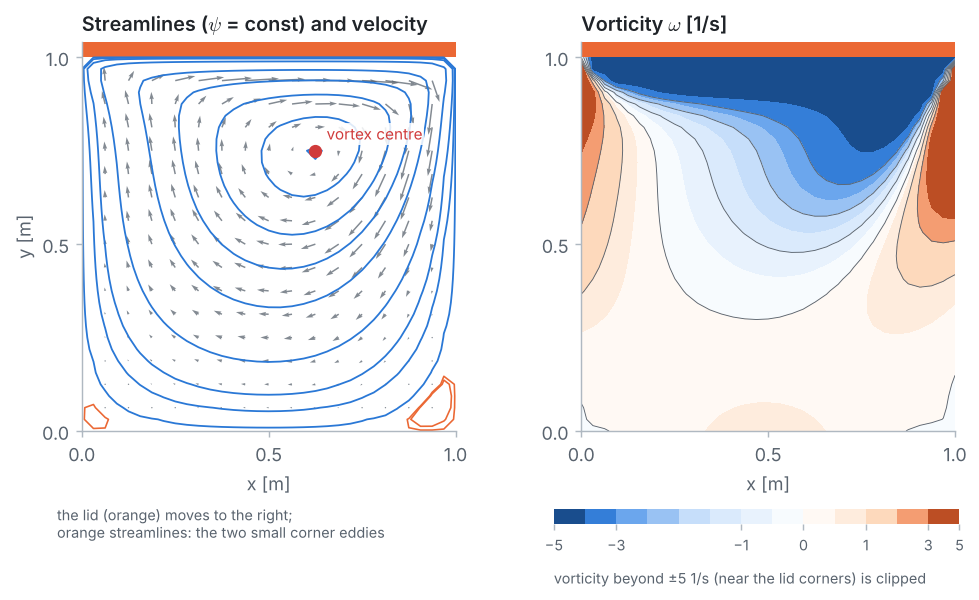

<p align="center">
  
</p>

# Problem 6 · Lid-driven cavity flow

**2D · steady · incompressible Navier–Stokes · stream function–vorticity · wall vorticity (Thom) · benchmark validation**

> A square cavity is filled with a viscous fluid. Its lid slides to the right at a constant speed while the other three walls stay at rest. Find the steady flow inside the cavity at Reynolds number 100 with the Finite Difference Method, and compare it with the benchmark solution of Ghia, Ghia & Shin (1982) ($`L = 1`$ m, $`U = 1`$ m/s, $`\nu = 0.01`$ m²/s).

## 📦 What's in this folder

| File | What's inside |
|---|---|
| 📄 [`01_problem_statement.pdf`](01_problem_statement.pdf) | the problem, data (including a box with everything a simulation package needs), assumptions and tasks |
| 📘 [`02_solution.pdf`](02_solution.pdf) | the step-by-step solution: stream function and vorticity, Thom's formula, the coupled Gauss–Seidel iteration, flow pattern, grid study, benchmark |
| 💻 [`03_fdm_solver.ipynb`](03_fdm_solver.ipynb) | the complete solver in **plain Python**, explained cell by cell, with plots |
| 🧮 [`04_whiteboard_guide.pdf`](04_whiteboard_guide.pdf) | **for instructors:** the method built on the board, and the first two iterations on a 5 × 5 grid done by hand with a pocket calculator, with every intermediate number |
| 🎨 [`plots.py`](plots.py) | drawing helpers used by the notebook (matplotlib only, no numerics) |
| 🛠️ [`docs/`](docs) | Markdown sources of the PDFs and their figures |

## 🎯 What you will learn

- How the **stream function** satisfies continuity automatically and the **vorticity** removes the pressure, turning the 2D **Navier–Stokes equations** into a Poisson equation (Problem 3) and a convection–diffusion equation (Problem 5).
- How the **no-slip condition** becomes a boundary condition for the vorticity: **Thom's formula** $`\omega_{lid} = -2\psi_{N-1}/h^2 - 2U/h`$.
- How to solve two **coupled, nonlinear** equations with one Gauss–Seidel iteration, starting from a fluid at rest.
- How to **verify** a flow solver with no exact solution: a **grid study** and a published **benchmark**.

## 📊 Result

<p align="center">
  
</p>

| | grid | $`\psi_{min}`$ [m²/s] | vortex centre $`(x, y)`$ [m] |
|---|:-:|:-:|:-:|
| FDM | 33 × 33 | −0.10038 | (0.6250, 0.7500) |
| FDM | 129 × 129 | −0.10332 | (0.6172, 0.7344) |
| Ghia et al. (1982) | 129 × 129 | −0.10342 | (0.6172, 0.7344) |

On the finest grid the vortex centre is at exactly Ghia's node and $`\psi_{min}`$ agrees to about 0.1 %; the centre-line velocities agree to within 0.0042 m/s ($`u`$) and 0.0084 m/s ($`v`$). The grid study shows second-order convergence.

## ▶️ Run it

```bash
pip install -r ../../requirements.txt
jupyter lab 03_fdm_solver.ipynb
```

The grid study at the end solves the cavity on up to 129 × 129 nodes and takes about two minutes in plain Python.

---

<p align="center"><a href="../../README.md#-course-problems">⬅ Back to the course home page</a></p>
