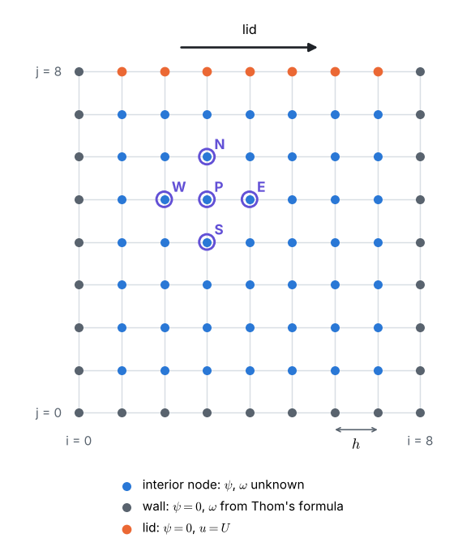
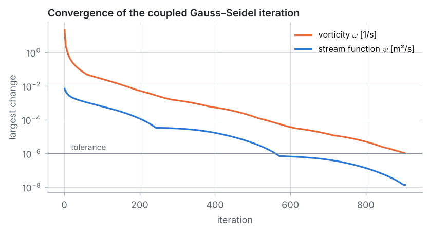
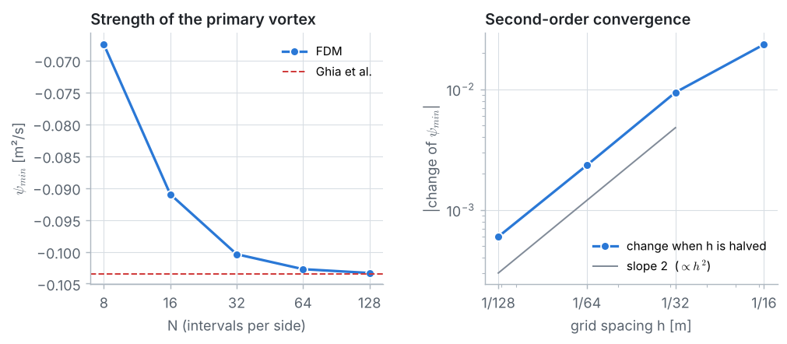
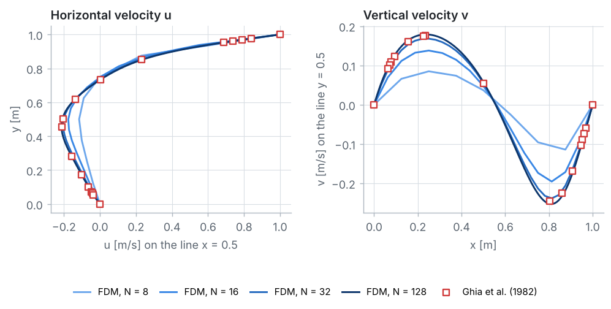

::: goal
**Plan.** We follow the 7 pillars of CFD: geometry → grid → physics → numerical scheme → solution setup → compute → post-processing. All code below is plain Python (lists and loops only; `math` and `time` from Python itself). It is the code of the notebook `03_fdm_solver.ipynb`, where it can be run cell by cell.
:::

## Step 1 · Geometry and data

A square cavity of side $L = 1$ m is filled with a fluid of kinematic viscosity $\nu = 0.01$ m²/s. The lid slides to the right at $U = 1$ m/s; the other walls are at rest. Friction drags the fluid under the lid along, and a large vortex fills the cavity.

The flow depends on one number only, the **Reynolds number** (inertia over viscous friction):

{{code:data}}

{{out:data}}

Any cavity with $Re = 100$ has the same flow pattern, for example water ($\nu = 10^{-6}$ m²/s) in a 1 cm cavity with a lid moving at 1 cm/s.

## Step 2 · The grid

A uniform grid with $N$ intervals per side and spacing $h = L/N$; node $(i, j)$ sits at $x_i = i\,h$, $y_j = j\,h$. Wall nodes are known; the $(N - 1)^2$ interior nodes are unknown.

{{code:grid}}

{{out:grid}}

The **cell Reynolds number** $Uh/\nu$ plays the role of the cell Péclet number of Problem 5.

## Step 3 · Physics: from Navier–Stokes to stream function and vorticity

The steady, incompressible 2D flow obeys continuity and the two Navier–Stokes equations, three equations for $u$, $v$ and $p$. Two definitions simplify them:

- **stream function** $\psi$: $\;u = \partial\psi/\partial y$, $\;v = -\partial\psi/\partial x$. Then $\partial u/\partial x + \partial v/\partial y = \psi_{yx} - \psi_{xy} = 0$: continuity holds automatically. Lines of constant $\psi$ are streamlines.
- **vorticity** $\omega = \partial v/\partial x - \partial u/\partial y$, the local spin of the fluid. Inserting $u$ and $v$ gives $\nabla^2\psi = -\omega$.

Differentiating the $u$-equation with respect to $y$ and the $v$-equation with respect to $x$ and subtracting removes the pressure and leaves the **vorticity transport equation**. The flow is described by two coupled equations:

$$\underbrace{\nabla^2\psi = -\,\omega}_{\text{Poisson, Problem 3}}, \qquad
\underbrace{u\,\frac{\partial\omega}{\partial x} + v\,\frac{\partial\omega}{\partial y} = \nu\,\nabla^2\omega}_{\text{convection–diffusion, Problem 5}}.$$

**Boundary conditions.** No fluid crosses a wall, so every wall is a streamline: $\psi = 0$ on all four walls. The no-slip condition ($u = U$ on the lid, $u = v = 0$ elsewhere) gives the wall vorticity in Step 4.

**Benchmark.** There is no exact solution. We compare with the classic tables of Ghia, Ghia & Shin (1982), computed on 129 × 129 nodes:

{{code:ghia}}

{{out:ghia}}

## Step 4 · Numerical scheme

Store $\psi$ and $\omega$ as rows, `psi[j][i]`, `w[j][i]`. Interior node $P = (i, j)$, neighbours $E$, $W$, $N$, $S$.

**Stream function** (five-point formula, Problem 3):

$$\psi_P = \frac{\psi_E + \psi_W + \psi_N + \psi_S + h^2\,\omega_P}{4}.$$

**Velocities** (central differences): $\;u_P = (\psi_N - \psi_S)/(2h)$, $\;v_P = -(\psi_E - \psi_W)/(2h)$.

**Vorticity** (central differences for convection and diffusion, Problem 5 in 2D):

$$\omega_P = \frac{1}{4}\Big[\big(1 - \tfrac{R_x}{2}\big)\,\omega_E + \big(1 + \tfrac{R_x}{2}\big)\,\omega_W + \big(1 - \tfrac{R_y}{2}\big)\,\omega_N + \big(1 + \tfrac{R_y}{2}\big)\,\omega_S\Big],$$

$$R_x = \frac{u_P\,h}{\nu}, \qquad R_y = \frac{v_P\,h}{\nu}.$$

These are the CDS coefficients $a_W = D + F/2$, $a_E = D - F/2$ of Problem 5, in two directions, with the local cell Reynolds numbers in the role of $Pe_\Delta$.

**Wall vorticity: Thom's formula.** On the lid, a Taylor series from the wall to the first interior node gives

$$\psi_{N-1} = \underbrace{\psi_{wall}}_{0} - h\,\underbrace{\frac{\partial\psi}{\partial y}\bigg|_{wall}}_{U} + \frac{h^2}{2}\,\underbrace{\frac{\partial^2\psi}{\partial y^2}\bigg|_{wall}}_{-\omega_{wall}} - \dots
\quad\Longrightarrow\quad
\omega_{lid} = -\frac{2\,\psi_{N-1}}{h^2} - \frac{2U}{h},$$

because $v = 0$ along the whole wall makes $\partial v/\partial x = 0$, so $\omega_{wall} = -\partial u/\partial y = -\partial^2\psi/\partial y^2$. On the walls at rest the $U$ term disappears: $\omega_{wall} = -2\psi_{adjacent}/h^2$. Corner nodes are never used.

{{code:wall}}

## Step 5 · Solution setup: one iteration for two equations

Start from rest ($\psi = \omega = 0$) and repeat:

1. wall vorticity from the current $\psi$ (Thom's formula);
2. one Gauss–Seidel sweep of the vorticity equation (velocities from the current $\psi$);
3. one Gauss–Seidel sweep of the Poisson equation for $\psi$ (with the new $\omega$);

until the largest changes of $\omega$ and $\psi$ in one iteration are both below $10^{-6}$.

{{code:solver}}

{{code:velocity}}

::: note
**Why plain Gauss–Seidel?** Over-relaxing the $\psi$ sweep (SOR, Problem 3) roughly halves the number of iterations on fine grids, but in our tests it made the coarse grids ($N = 4$ and $8$) diverge. Plain Gauss–Seidel converged on every grid from $N = 4$ to $N = 128$.
:::

## Step 6 · Compute

{{code:run}}

{{out:run}}

A small change per iteration is not the same as a small error (Problem 1). A run with a tolerance 100 times smaller checks it:

{{code:tolerance}}

{{out:tolerance}}

The difference is more than a thousand times smaller than the effect of refining the grid (Step 7), so the tolerance is tight enough.

**The whiteboard numbers.** The whiteboard guide does the first iteration by hand on $N = 4$. Because the iteration starts from rest, `max_iter=1` returns the fields after one iteration:

{{code:hand}}

{{out:hand}}

## Step 7 · Post-processing and verification

{{code:centre}}

{{out:centre}}

**Grid study.** Solve the same flow on $N = 4$ to $128$ (the finest grid has the same 129 × 129 nodes as Ghia et al. and takes about two minutes in plain Python):

{{code:refine}}

{{out:refine}}

- From $N = 32$ to $64$ and from $64$ to $128$, the change of $\psi_{min}$ falls by a factor of about 4: **second-order** convergence.
- On 129 × 129 nodes the vortex centre is at exactly Ghia's node, $(0.6172, 0.7344)$, and $\psi_{min}$ agrees with Ghia's value to about 0.1 %.
- On $N = 4$ ($Uh/\nu = 25$) the vortex is far too weak: $\psi_{min}$ is less than 60 % of the benchmark.

**Centre-line velocities.**

{{code:centreline}}

On 129 × 129 nodes the benchmark points fall on our nodes:

{{code:benchmark}}

{{out:benchmark}}

**Cell Reynolds number.** The largest local value at an interior node:

{{code:cell-re}}

{{out:cell-re}}

It exceeds 2 on the grids up to $N = 32$, yet the iteration converges, and from $N = 32$ on the results converge at second order. The rule $Pe_\Delta \le 2$ of Problem 5 *guarantees* bounded results; breaking it in a thin layer under the lid does not necessarily spoil the solution. At higher Reynolds numbers this layer becomes thinner and the cell Reynolds numbers larger, so much finer grids or upwind-biased schemes become necessary.

::: answer
**Result** ($Re = 100$). One large clockwise vortex fills the cavity, with two tiny counter-rotating eddies in the bottom corners. On the 33 × 33 grid the vortex centre is at $(0.625, 0.750)$ m with $\psi_{min} = -0.1004$ m²/s. Refining to 129 × 129 nodes gives $\psi_{min} = -0.10332$ m²/s at $(0.6172, 0.7344)$ m, within about 0.1 % of the Ghia et al. benchmark at the same position. The centre-line velocities agree with the benchmark to within 0.0042 m/s ($u$) and 0.0084 m/s ($v$), and the solution converges at second order.
:::

## Key ideas

- The **stream function** satisfies continuity automatically, and the **vorticity** removes the pressure: 2D Navier–Stokes = Poisson equation + convection–diffusion equation.
- The no-slip condition becomes a vorticity boundary condition through **Thom's formula**.
- Two coupled equations can be solved with one Gauss–Seidel iteration, starting from rest.
- Without an exact solution, a code is verified with a **grid study** and a published **benchmark**.
