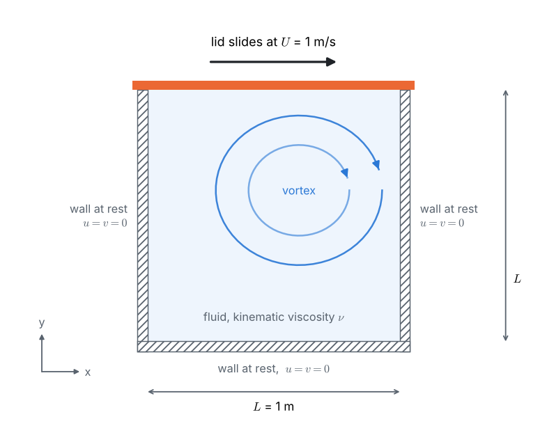
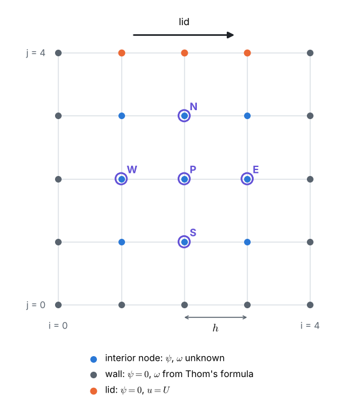
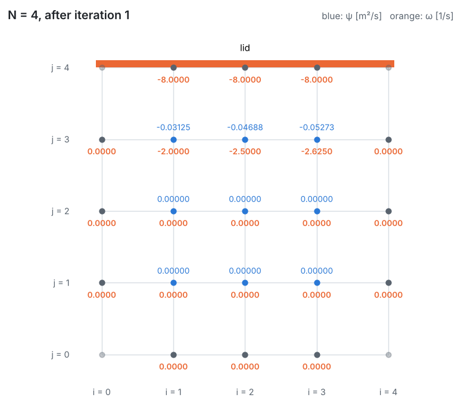
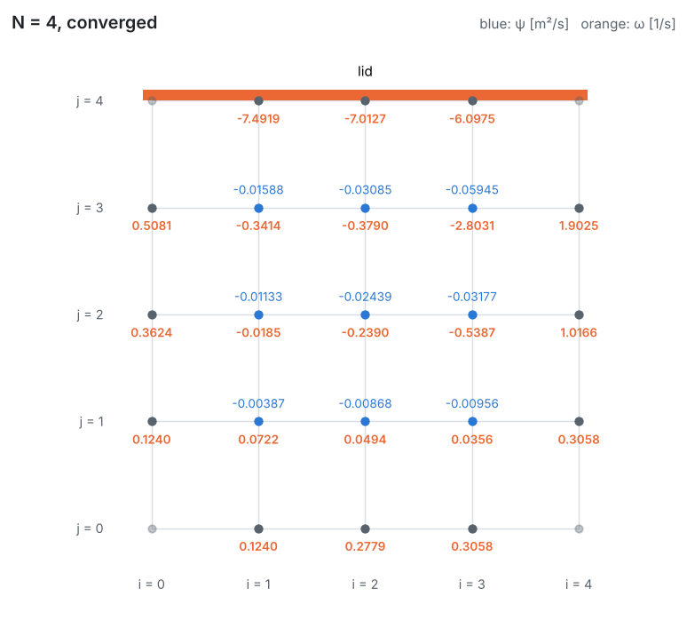

::: goal
**Aim of the lesson.** The cavity is the first real Navier–Stokes problem of the course: two coupled equations, nonlinear, on a 2D grid. Even on the coarsest grid ($N = 4$, 9 interior nodes) it needs about 30 iterations, too many for the board. So the lesson builds the method on the board and **carries out the first two iterations by hand**. Students see the flow being born: the lid creates vorticity, the vorticity diffuses into the fluid, and the stream function turns it into motion. Every number below can be checked against the notebook cell under *Checking the whiteboard numbers*.
:::

## Lesson plan (about 60 minutes)

| Board | Content | Time |
|:-:|---|:-:|
| 1 | The cavity, the moving lid and the Reynolds number | 5 min |
| 2 | From Navier–Stokes to stream function and vorticity | 12 min |
| 3 | Wall vorticity: Thom's formula | 8 min |
| 4 | The grid with $N = 4$ and the two update formulas | 8 min |
| 5 | Iteration 1 by hand: the lid sets the fluid in motion | 10 min |
| 6 | Iteration 2 by hand: convection appears | 12 min |
| 7 | What the computer finds | 5 min |

::: tip
**Calculator advice for the class.** Work with $h = 0.25$, $h^2 = 0.0625$, $1/h^2 = 16$ and $1/(4\nu) = 25$. Keep **6 decimals** for $\psi$ and **4** for $\omega$. Always use the **newest** values (Gauss–Seidel), sweeping row by row from the bottom ($j = 1$) to the top ($j = 3$), and from left to right in each row.
:::

## Board 1 · The cavity

Write the data: $L = 1$ m, $U = 1$ m/s (to the right), $\nu = 0.01$ m²/s, so

$$Re = \frac{UL}{\nu} = \frac{1 \times 1}{0.01} = 100.$$

**Ask the class:** *Which way does the fluid turn? Where does it move fastest?* (Clockwise; just under the lid.)

## Board 2 · From Navier–Stokes to $\psi$ and $\omega$

Write continuity and the two momentum equations (Problem statement). Then two definitions:

$$u = \frac{\partial\psi}{\partial y}, \quad v = -\frac{\partial\psi}{\partial x} \;\;\Longrightarrow\;\; \frac{\partial u}{\partial x} + \frac{\partial v}{\partial y} = \psi_{yx} - \psi_{xy} = 0 \;\;\checkmark$$

$$\omega = \frac{\partial v}{\partial x} - \frac{\partial u}{\partial y} = -\left(\psi_{xx} + \psi_{yy}\right) \;\;\Longrightarrow\;\; \nabla^2\psi = -\,\omega.$$

Differentiate the $u$-equation by $y$, the $v$-equation by $x$, subtract: the pressure terms $-\frac{1}{\rho}p_{xy}$ and $-\frac{1}{\rho}p_{yx}$ cancel, leaving

$$u\,\omega_x + v\,\omega_y = \nu\,\nabla^2\omega.$$

Point at the two equations: **"Problem 3"** (Poisson) and **"Problem 5"** (convection–diffusion). Nothing here is new except that they are coupled.

**Ask the class:** *What is $\psi$ on the walls?* (No fluid crosses a wall, so each wall is one streamline; all walls touch each other, so the same value, $\psi = 0$.)

## Board 3 · Thom's formula for the wall vorticity

Draw the lid and the first row of nodes under it, at distance $h$. Taylor series of $\psi$ downwards from the lid:

$$\psi_{N-1} = \psi_{lid} - h\,\psi_y + \frac{h^2}{2}\,\psi_{yy} - \dots$$

On the lid: $\psi_{lid} = 0$, $\psi_y = u = U$, and since $v = 0$ all along the lid, $v_x = 0$ and $\omega_{lid} = -u_y = -\psi_{yy}$. So

$$\psi_{N-1} \approx -hU - \frac{h^2}{2}\,\omega_{lid} \quad\Longrightarrow\quad \boxed{\;\omega_{lid} = -\frac{2\,\psi_{N-1}}{h^2} - \frac{2U}{h}\;}$$

and on the walls at rest ($U = 0$): $\;\omega_{wall} = -2\,\psi_{adjacent}/h^2$.

With $h = 0.25$: $\;\omega_{lid} = -32\,\psi_{i,3} - 8$, $\;\omega_{wall} = -32\,\psi_{adjacent}$.

## Board 4 · The grid and the two update formulas

Draw a 5 × 5 grid of nodes, $i = 0 \dots 4$ to the right, $j = 0 \dots 4$ upwards. The 9 interior nodes each carry two unknowns, $\psi$ and $\omega$. Write the two update formulas:

$$\psi_P = \frac{\psi_E + \psi_W + \psi_N + \psi_S + h^2\,\omega_P}{4}$$

$$\omega_P = \frac{(1 - a_x)\,\omega_E + (1 + a_x)\,\omega_W + (1 - a_y)\,\omega_N + (1 + a_y)\,\omega_S}{4},$$

$$a_x = \frac{u_P h}{2\nu} = 25\,(\psi_N - \psi_S), \qquad a_y = \frac{v_P h}{2\nu} = 25\,(\psi_W - \psi_E).$$

($a_x$ and $a_y$ are half the local cell Reynolds numbers; with $u_P = (\psi_N - \psi_S)/(2h)$ the factor is $1/(4\nu) = 25$.)

**One iteration** = (1) wall vorticity, (2) sweep $\omega$, (3) sweep $\psi$.

## Board 5 · Iteration 1: the lid sets the fluid in motion

Start from rest: $\psi = 0$ and $\omega = 0$ everywhere.

**(1) Wall vorticity.** All $\psi = 0$, so the walls at rest get $\omega = 0$ and the lid gets $\omega = -8$ at $i = 1, 2, 3$.

**(2) Vorticity sweep.** All $\psi = 0$, so $a_x = a_y = 0$: every update is just the **average of the four neighbours** (pure diffusion). Rows $j = 1$ and $j = 2$ only see zeros: $\omega = 0$. Row $j = 3$ touches the lid:

| node | calculation | $\omega$ [1/s] |
|:-:|---|:-:|
| (1, 3) | $(0 + 0 + (-8) + 0)/4$ | **−2.0000** |
| (2, 3) | $(0 + (-2) + (-8) + 0)/4$ (uses the new $\omega_{1,3}$) | **−2.5000** |
| (3, 3) | $(0 + (-2.5) + (-8) + 0)/4$ | **−2.6250** |

**(3) Stream-function sweep.** Rows 1 and 2: everything is still zero, $\psi = 0$. Row 3:

| node | calculation | $\psi$ [m²/s] |
|:-:|---|:-:|
| (1, 3) | $(0 + 0 + 0 + 0 + 0.0625 \times (-2))/4$ | **−0.031250** |
| (2, 3) | $(0 + (-0.03125) + 0 + 0 + 0.0625 \times (-2.5))/4$ | **−0.046875** |
| (3, 3) | $(0 + (-0.046875) + 0 + 0 + 0.0625 \times (-2.625))/4$ | **−0.052734** |

**Point out:** negative $\psi$ under the lid means a clockwise circulation has started. The vorticity was **born at the lid** and diffused one row into the fluid.

## Board 6 · Iteration 2: convection appears

**(1) Wall vorticity** from the new $\psi$ (Thom):

| wall node | calculation | $\omega$ [1/s] |
|---|---|:-:|
| lid, $i = 1$ | $-32 \times (-0.031250) - 8$ | −7.0000 |
| lid, $i = 2$ | $-32 \times (-0.046875) - 8$ | −6.5000 |
| lid, $i = 3$ | $-32 \times (-0.052734) - 8$ | −6.3125 |
| left wall, $j = 3$ | $-32 \times (-0.031250)$ | +1.0000 |
| right wall, $j = 3$ | $-32 \times (-0.052734)$ | +1.6875 |

All other wall values stay 0.

**(2) Vorticity sweep.** Row 1: still all zeros. Now the velocities are no longer zero, so $a_x$ and $a_y$ enter. Remember to use the new $\omega$ values as soon as they exist:

| node | $a_x = 25(\psi_N - \psi_S)$ | $a_y = 25(\psi_W - \psi_E)$ | $\omega$ [1/s] |
|:-:|:-:|:-:|:-:|
| (1, 2) | $-0.781250$ | $0$ | **−0.5000** |
| (2, 2) | $-1.171875$ | $0$ | **−0.6035** |
| (3, 2) | $-1.318359$ | $0$ | **−0.6082** |
| (1, 3) | $0$ | $+1.171875$ | **−0.3457** |
| (2, 3) | $0$ | $+0.537109$ | **−1.7268** |
| (3, 3) | $0$ | $-1.171875$ | **−3.4112** |

The calculations, with the weights $(1 \mp a)$ in front of $\omega_E, \omega_W, \omega_N, \omega_S$:

$$\begin{aligned}
\omega_{1,2} &= \tfrac{1}{4}\,[\,1 \times (-2)\,] = -0.5 \qquad\text{(only } \omega_N \ne 0\text{)}\\
\omega_{2,2} &= \tfrac{1}{4}\,[\,(1 - 1.171875)(-0.5) + 1 \times (-2.5)\,] = -0.603516\\
\omega_{3,2} &= \tfrac{1}{4}\,[\,(1 - 1.318359)(-0.603516) + 1 \times (-2.625)\,] = -0.608216\\
\omega_{1,3} &= \tfrac{1}{4}\,[\,(-2.5) + 1.0 + (1 - 1.171875)(-7) + (1 + 1.171875)(-0.5)\,] = -0.345703\\
\omega_{2,3} &= \tfrac{1}{4}\,[\,(-2.625) + (-0.345703) + 0.462891\,(-6.5) + 1.537109\,(-0.603516)\,] = -1.726791\\
\omega_{3,3} &= \tfrac{1}{4}\,[\,1.6875 + (-1.726791) + 2.171875\,(-6.3125) - 0.171875\,(-0.608216)\,] = -3.411179
\end{aligned}$$

**Point out at node (3, 3):** the fluid there moves **down** ($v < 0$, so $a_y < 0$). The weight of the upstream node N (the lid) grows to 2.17 and the weight of the downstream node S becomes **negative** (−0.17): the local cell Reynolds number is $|2a_y| = 2.34 > 2$, exactly the situation of Problem 5. Convection carries the strong lid vorticity **down the right wall**.

**(3) Stream-function sweep** with the new $\omega$ (row 1 stays 0):

| node | calculation | $\psi$ [m²/s] |
|:-:|---|:-:|
| (1, 2) | $(0 + 0 + (-0.03125) + 0 + 0.0625 \times (-0.5))/4$ | −0.015625 |
| (2, 2) | $(0 + (-0.015625) + (-0.046875) + 0 + 0.0625 \times (-0.603516))/4$ | −0.025055 |
| (3, 2) | $(0 + (-0.025055) + (-0.052734) + 0 + 0.0625 \times (-0.608216))/4$ | −0.028951 |
| (1, 3) | $(-0.046875 + 0 + 0 + (-0.015625) + 0.0625 \times (-0.345703))/4$ | −0.021027 |
| (2, 3) | $(-0.052734 + (-0.021027) + 0 + (-0.025055) + 0.0625 \times (-1.726791))/4$ | −0.051685 |
| (3, 3) | $(0 + (-0.051685) + 0 + (-0.028951) + 0.0625 \times (-3.411179))/4$ | −0.073459 |

The circulation has reached the second row, and it is strongest at the top right.

## Board 7 · What the computer finds

The notebook repeats the same three steps until nothing changes. On $N = 4$ it converges after **31 iterations**:

Compare $\psi$ [m²/s] with the same points on the fine 129 × 129 grid (notebook):

| | $N = 4$, $x = 0.25$ | $x = 0.5$ | $x = 0.75$ | $N = 128$, $x = 0.25$ | $x = 0.5$ | $x = 0.75$ |
|:-:|:-:|:-:|:-:|:-:|:-:|:-:|
| $y = 0.75$ | −0.0159 | −0.0309 | **−0.0595** | −0.0490 | −0.0958 | −0.0902 |
| $y = 0.5$ | −0.0113 | −0.0244 | −0.0318 | −0.0323 | −0.0663 | −0.0451 |
| $y = 0.25$ | −0.0039 | −0.0087 | −0.0096 | −0.0097 | −0.0187 | −0.0090 |

::: answer
**The 9-node answer has the right shape but the wrong size.** It shows one clockwise vortex, strongest near the lid and pushed towards the right, and the wall vorticity is largest at the lid. But most values are about two to three times too small: the grid cannot resolve the thin layer under the lid ($Uh/\nu = 25$). Refining to 33 × 33 nodes gives $\psi_{min} = -0.1004$, and to 129 × 129 nodes $-0.10332$, within 0.1 % of the Ghia et al. benchmark. Nobody wants to do that by hand: this is why we need computers.
:::

## Questions for the class

- **Why is $\psi = 0$ on all four walls, and not a different constant on each wall?** (The walls are connected at the corners, so they form one closed streamline.)
- **Where does the vorticity come from?** (Only from the walls, through Thom's formula; inside the fluid it is only carried and diffused.)
- **Why does the vortex centre sit to the right of the middle?** (The lid drags the fluid to the right, and convection carries the vorticity downstream.)
- **At node (3, 3) in iteration 2, a weight became negative. Why did the iteration not blow up?** (The cell Reynolds number exceeds 2 only in a few nodes; the notebook shows the iteration converges on every grid. The rule $Pe_\Delta \le 2$ is a guarantee, not a necessity.)
- **What changes if the lid moves to the left?** (Everything mirrors: anticlockwise vortex, $\psi > 0$, $\omega_{lid} = +8$ at the start.)

## Common mistakes to watch for

- **Sign of the lid term**: $\omega_{lid} = -2\psi/h^2 - 2U/h$; for a lid moving to the right the lid vorticity is negative.
- Forgetting $h^2$ in the $\psi$ update: it is $+h^2\omega_P$, not $+\omega_P$.
- Using **old** values where Gauss–Seidel uses new ones (row by row, bottom to top, left to right).
- Mixing up $a_y$: $v = -\partial\psi/\partial x$, so $a_y = 25\,(\psi_W - \psi_E)$, West minus East.
- Using corner nodes: they never appear in a five-point formula.

## From the board to the notebook

Every board has a matching cell in `03_fdm_solver.ipynb`: `wall_vorticity` is Board 3; the two loops of `solve_cavity` are the update formulas of Board 4, run exactly as on Boards 5 and 6; the cell under *Checking the whiteboard numbers* prints the fields after iterations 1 and 2 and the converged $N = 4$ solution of Board 7. The notebook then solves the cavity on 33 × 33 nodes in under a second, and on grids up to 129 × 129 nodes for the comparison with Ghia et al.
