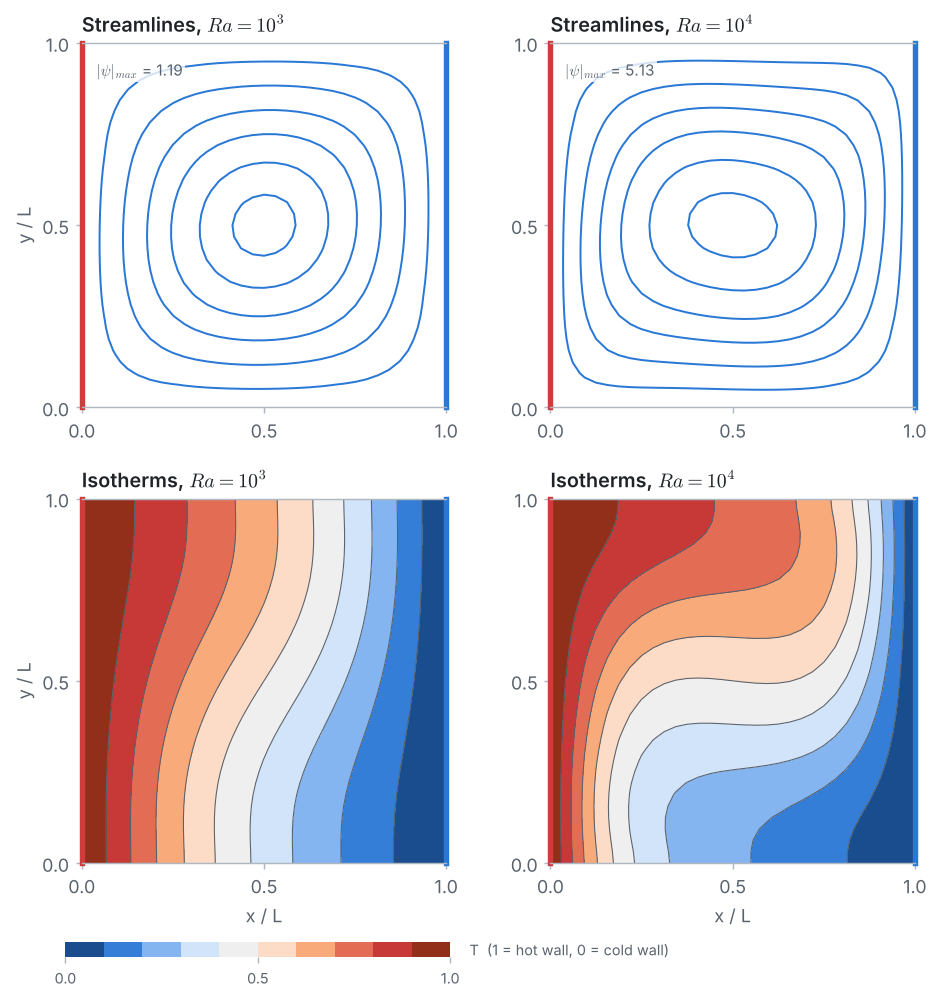

<p align="center">
  
</p>

# Problem 7 · Natural convection in a heated square cavity

**2D · steady · buoyancy-driven flow + heat transfer · Boussinesq · stream function–vorticity–temperature · Nusselt number · Richardson extrapolation**

> A square cavity filled with air has a hot left wall, a cold right wall, and insulated top and bottom walls. Buoyancy sets the air in motion. Find the steady flow, the temperature field and the heat transferred across the cavity for Rayleigh numbers $`10^3`$ and $`10^4`$ ($`Pr = 0.71`$) with the Finite Difference Method, and compare with the benchmark solution of de Vahl Davis (1983).

## 📦 What's in this folder

| File | What's inside |
|---|---|
| 📄 [`01_problem_statement.pdf`](01_problem_statement.pdf) | the problem, equations, data, benchmark values, a box with everything a simulation package needs, and the tasks |
| 📘 [`02_solution.pdf`](02_solution.pdf) | the step-by-step solution: buoyancy and energy equations, ghost nodes on insulated walls, the coupled iteration, Nusselt number, energy balance, grid study, Richardson extrapolation |
| 💻 [`03_fdm_solver.ipynb`](03_fdm_solver.ipynb) | the complete solver in **plain Python**, explained cell by cell, with plots |
| 🧮 [`04_whiteboard_guide.pdf`](04_whiteboard_guide.pdf) | **for instructors:** how buoyancy creates the flow, worked by hand on a 5 × 5 grid (iteration 1 and the start of iteration 2), and the Nusselt number of the converged answer, with every intermediate number |
| 🎨 [`plots.py`](plots.py) | drawing helpers used by the notebook (matplotlib only, no numerics) |
| 🛠️ [`docs/`](docs) | Markdown sources of the PDFs and their figures |

## 🎯 What you will learn

- How **buoyancy** (the Boussinesq approximation) adds a vorticity source $`Ra\,Pr\,\partial T/\partial x`$ to the equations of Problem 6, and how the **energy equation** lets the flow carry heat.
- How to solve **three coupled equations** in one Gauss–Seidel iteration, starting from pure conduction.
- How to apply an **insulated wall** with a ghost node on a 2D grid (Problem 1 in 2D).
- What the **Rayleigh, Prandtl and Nusselt numbers** measure, and how an **energy balance** checks the result.
- How **Richardson extrapolation** turns two grids into an estimate of the grid-independent answer.

## 📊 Result

<p align="center">
  
</p>

| | $`\lvert\psi\rvert`$ at the centre | average Nusselt number |
|---|:-:|:-:|
| $`Ra = 10^3`$, FDM 33 × 33 | 1.185 | 1.118 |
| $`Ra = 10^3`$, Richardson (33 × 33 and 65 × 65) | 1.175 | 1.118 |
| $`Ra = 10^3`$, de Vahl Davis (1983) | 1.174 | 1.118 |
| $`Ra = 10^4`$, FDM 33 × 33 | 5.129 | 2.268 |
| $`Ra = 10^4`$, Richardson (33 × 33 and 65 × 65) | 5.074 | 2.242 |
| $`Ra = 10^4`$, de Vahl Davis (1983) | 5.071 | 2.243 |

At $`Ra = 10^4`$ the flow more than doubles the heat transfer compared with pure conduction. Richardson extrapolation reproduces the benchmark to within 0.1 %.

## ▶️ Run it

```bash
pip install -r ../../requirements.txt
jupyter lab 03_fdm_solver.ipynb
```

The grid study at the end solves both cases on up to 65 × 65 nodes and takes about a minute and a half in plain Python.

## 🔁 Cross-check with COMSOL

The same problem is also solved with the finite element method in COMSOL Multiphysics 4.3a (Non-Isothermal Flow): see [`comsol_solution/`](comsol_solution) for the model file and a step-by-step guide for students. On the same 33 × 33 nodes COMSOL gives $`\lvert\psi\rvert = 1.171`$ and $`5.073`$ at the centre and $`\overline{Nu} = 1.117`$ and $`2.235`$. On 128 × 128 elements it agrees with de Vahl Davis to 0.1 %.

---

<p align="center"><a href="../../README.md#-course-problems">⬅ Back to the course home page</a></p>
