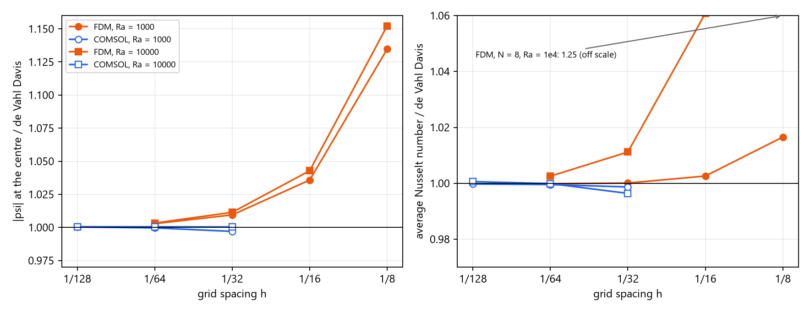

# Problem 7 · COMSOL Multiphysics solution

The same natural-convection cavity, solved with the **finite element method** in **COMSOL Multiphysics 4.3a** (Non-Isothermal Flow, 2D, stationary study, with a sweep over the mesh and the Rayleigh number). The dimensionless problem is turned into a COMSOL model by choosing unit properties: $`L = \rho = c_p = k = 1`$, $`\mu = Pr`$, $`T_h = 1`$ K, $`T_c = 0`$ K. Buoyancy enters as a volume force $`F_y = Ra\,Pr\,\rho\,(T - 0.5)`$. COMSOL's mapped 32 × 32 mesh has the same 33 × 33 nodes as the main FDM grid.

  

| File | What's inside |
|---|---|
| 📘 [`COMSOL_Natural_Convection_Guide.pdf`](COMSOL_Natural_Convection_Guide.pdf) | step-by-step guide for students (32 pages): from the dimensionless equations to the COMSOL inputs, 20 annotated COMSOL steps with "Why?" notes, results, the comparison with the FDM and the benchmark, the grid study and troubleshooting |
| 🧩 [`natural_convection_comsol.mph`](natural_convection_comsol.mph) | the finished COMSOL model with all six solutions (nel = 32, 64, 128 × Ra = 10³, 10⁴), ready to open in COMSOL 4.3a or newer |
| 📈 [`cutx_1.txt`](cutx_1.txt) … [`cutx_6.txt`](cutx_6.txt), [`cuty_1.txt`](cuty_1.txt) … [`cuty_6.txt`](cuty_6.txt) | u, v, T exported at the mesh nodes along x = 0.5 and y = 0.5 (runs 1–6 = nel 32, 64, 128, each with Ra = 10³ then 10⁴) |
| 🔢 [`nu_hot.txt`](nu_hot.txt), [`nu_cold.txt`](nu_cold.txt), [`p7_comsol_numbers.json`](p7_comsol_numbers.json) | average Nusselt numbers on the hot and the cold wall for every run, and all the numbers of the comparison |
| 🐍 [`p7_comsol.py`](p7_comsol.py), [`p7_fig.py`](p7_fig.py), [`p7_build_guide.py`](p7_build_guide.py) | reading the exports (\|ψ\| at the centre from ∫u dy, u_max, v_max, Richardson extrapolation), the figures, and the script that builds the guide |
| 🖼️ [`p7_profiles.png`](p7_profiles.png), [`p7_convergence.png`](p7_convergence.png) | centre-line velocities and the grid study |

**Main grid (33 × 33 nodes):**

| | \|ψ\| centre | u_max (y) | v_max (x) | Nu |
|---|:-:|:-:|:-:|:-:|
| Ra = 10³, de Vahl Davis | 1.174 | 3.649 (0.813) | 3.697 (0.178) | 1.118 |
| Ra = 10³, FDM notebook | 1.1851 | 3.649 (0.812) | 3.690 (0.188) | 1.1181 |
| Ra = 10³, COMSOL 32 × 32 | 1.1705 | 3.653 (0.812) | 3.699 (0.179) | 1.1165 |
| Ra = 10⁴, de Vahl Davis | 5.071 | 16.178 (0.823) | 19.617 (0.119) | 2.243 |
| Ra = 10⁴, FDM notebook | 5.1288 | 16.165 (0.812) | 19.544 (0.125) | 2.2681 |
| Ra = 10⁴, COMSOL 32 × 32 | 5.0727 | 16.244 (0.822) | 19.707 (0.121) | 2.2349 |

**Grid study (COMSOL):**

| | 32 × 32 | 64 × 64 | 128 × 128 | Richardson | FDM Richardson | de Vahl Davis |
|---|:-:|:-:|:-:|:-:|:-:|:-:|
| \|ψ\| centre, Ra = 10³ | 1.1705 | 1.1736 | 1.1744 | 1.1746 | 1.1747 | 1.174 |
| Nu, Ra = 10³ | 1.1165 | 1.1175 | 1.1177 | 1.1178 | 1.1177 | 1.118 |
| \|ψ\| centre, Ra = 10⁴ | 5.0727 | 5.0734 | 5.0736 | 5.0737 | 5.0738 | 5.071 |
| Nu, Ra = 10⁴ | 2.2349 | 2.2427 | 2.2443 | 2.2449 | 2.2423 | 2.243 |

**What agrees:**
- COMSOL and the FDM give the same flow and the same converged numbers. Their Richardson estimates agree with each other and with de Vahl Davis to 0.1 %.
- The energy balance holds: hot-wall and cold-wall Nu agree to 14 digits in COMSOL, and to the printed digits in the FDM.

**What differs:**
- On the same 33 × 33 nodes, COMSOL is closer to the benchmark at Ra = 10⁴. For \|ψ\| the error is +0.03 % against +1.14 % for the FDM; for Nu it is −0.36 % against +1.12 %.
- At Ra = 10³, the FDM Nusselt number on 33 × 33 nodes is the closer one: 1.1181 against COMSOL's 1.1165.
- For Nu, the errors of the two methods have opposite signs: the FDM is too high and COMSOL slightly too low.

The FDM values come from the notebook outputs in this folder's parent; the FDM was not re-run here.

> [!NOTE]
> `p7_comsol.py` and `p7_fig.py` read and write files in their own folder, so they run from here (NumPy and Matplotlib). `p7_build_guide.py` additionally needs the raw COMSOL screenshots (`shots/`, not included), ReportLab and the Windows Segoe UI fonts. It is included to document how the guide was made.

---

<a href="../README.md">⬅ Back to Problem 7</a>

