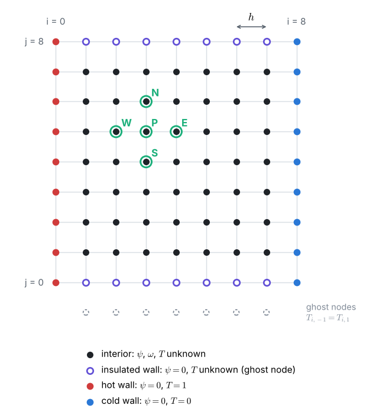
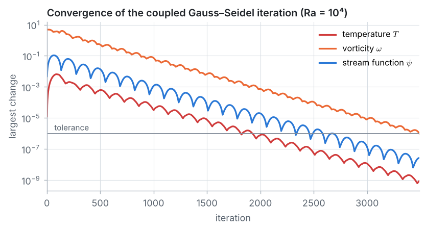
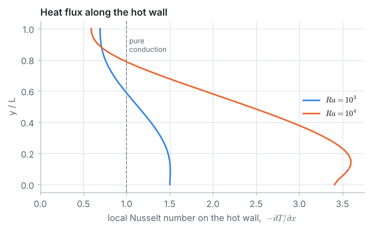
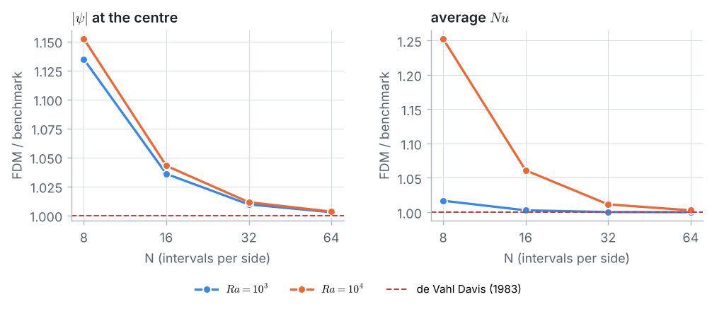
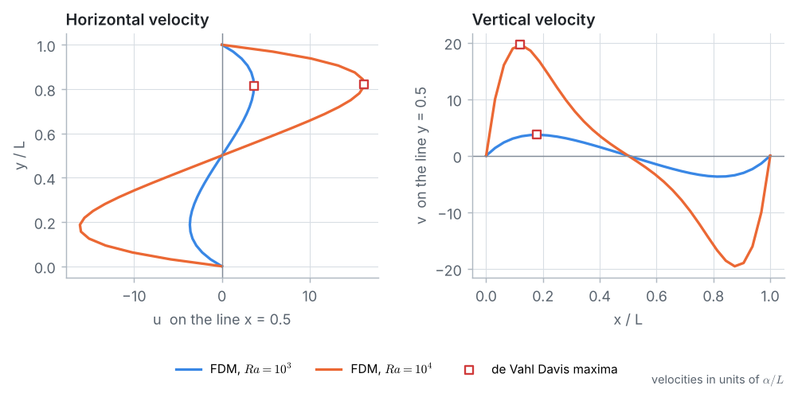

::: goal
**Plan.** We follow the 7 pillars of CFD: geometry → grid → physics → numerical scheme → solution setup → compute → post-processing. All code below is plain Python (lists and loops only; `math` and `time` from Python itself). It is the code of the notebook `03_fdm_solver.ipynb`, where it can be run cell by cell.
:::

## Step 1 · Geometry and data

A square cavity full of air: hot left wall, cold right wall, insulated top and bottom. Warm air rises along the hot wall, cool air sinks along the cold wall, and a slow clockwise circulation carries heat across the cavity.

In dimensionless form (lengths in $L$, velocities in $\alpha/L$, $T = (T_{dim} - T_c)/(T_h - T_c)$) only two numbers remain: the **Rayleigh number** $Ra = g\beta(T_h - T_c)L^3/(\nu\alpha)$, the strength of buoyancy against friction and heat diffusion, and the **Prandtl number** $Pr = \nu/\alpha = 0.71$ for air.

{{code:data}}

{{out:data}}

So $Ra = 10^3$ and $10^4$ correspond to double-glazing gaps of about 1 cm and 2 cm with 10 K between the panes.

## Step 2 · The grid

The grid of Problem 6: $N = 32$ intervals per side, $h = 1/32$. $\psi$ and $\omega$ are unknown at the interior nodes; $T$ is also unknown on the insulated top and bottom walls.

{{code:grid}}

{{out:grid}}

## Step 3 · Physics: stream function, vorticity and temperature

The flow equations of Problem 6 get two additions:

- **Buoyancy** (Boussinesq approximation): the density changes slightly with temperature, which matters only in the gravity term. Taking the curl of the momentum equations turns the buoyancy force into a **source of vorticity** $Ra\,Pr\,\partial T/\partial x$: wherever warm and cold fluid sit side by side, the fluid starts to turn.
- **Energy:** the temperature is carried by the flow and spreads by conduction, a convection–diffusion equation (Problem 5 in 2D).

$$\nabla^2\psi = -\,\omega, \qquad
u\,\omega_x + v\,\omega_y = Pr\,\nabla^2\omega + Ra\,Pr\,T_x, \qquad
u\,T_x + v\,T_y = \nabla^2 T.$$

| Wall | Flow | Temperature |
|---|---|---|
| left | $\psi = 0$, Thom's formula | $T = 1$ (hot) |
| right | $\psi = 0$, Thom's formula | $T = 0$ (cold) |
| top, bottom | $\psi = 0$, Thom's formula | $\partial T/\partial y = 0$ (insulated) |

**Heat transfer.** The local Nusselt number $Nu(y) = -\partial T/\partial x$ on the hot wall is the wall heat flux divided by the flux of pure conduction; its average $\overline{Nu}$ tells how many times more heat crosses the cavity than by conduction alone ($\overline{Nu} = 1$ without flow).

**Benchmark.** de Vahl Davis (1983) obtained reference values by extrapolating results from several fine grids:

{{code:benchmark-data}}

{{out:benchmark-data}}

## Step 4 · Numerical scheme

For an interior node $P$ with neighbours $E$, $W$, $N$, $S$ (central differences everywhere):

$$\psi_P = \tfrac{1}{4}\left(\psi_E + \psi_W + \psi_N + \psi_S + h^2\,\omega_P\right),$$

$$\omega_P = \tfrac{1}{4}\Big[(1 - a_x)\,\omega_E + (1 + a_x)\,\omega_W + (1 - a_y)\,\omega_N + (1 + a_y)\,\omega_S + \tfrac{Ra\,h}{2}\,(T_E - T_W)\Big],$$

$$T_P = \tfrac{1}{4}\Big[(1 - b_x)\,T_E + (1 + b_x)\,T_W + (1 - b_y)\,T_N + (1 + b_y)\,T_S\Big],$$

with $a_x = u_P h/(2Pr) = (\psi_N - \psi_S)/(4Pr)$, $a_y = (\psi_W - \psi_E)/(4Pr)$, $b_x = u_P h/2 = (\psi_N - \psi_S)/4$ and $b_y = (\psi_W - \psi_E)/4$.

**Insulated walls (ghost nodes, Problem 1).** On the bottom wall $\partial T/\partial y \approx (T_{i,1} - T_{i,-1})/(2h) = 0$ gives $T_{i,-1} = T_{i,1}$. With $u = v = 0$ on the wall the temperature equation there is pure conduction:

$$T_{i,0} = \tfrac{1}{4}\left(T_{i+1,0} + T_{i-1,0} + 2\,T_{i,1}\right), \qquad\text{and likewise on the top wall.}$$

**Wall vorticity.** Thom's formula of Problem 6 for walls at rest, $\omega_{wall} = -2\psi_{adjacent}/h^2$:

{{code:walls}}

## Step 5 · Solution setup

Start from **pure conduction**: $T = 1 - x$, $\psi = \omega = 0$. Then repeat, always using the newest values (Gauss–Seidel):

1. wall vorticity (Thom);
2. one sweep of the temperature equation, including the insulated walls;
3. one sweep of the vorticity equation, with the buoyancy source from the new $T$;
4. one sweep of the stream-function equation;

until the largest changes of $T$, $\omega$ and $\psi$ are all below $10^{-6}$.

{{code:solver}}

## Step 6 · Compute

{{code:run}}

{{out:run}}

In iteration 1 the temperature does not change at all: the conduction profile already satisfies the energy equation while the fluid is at rest. Buoyancy creates vorticity, and from iteration 2 on the moving fluid carries the heat.

**The whiteboard numbers.** The whiteboard guide does the first iterations by hand for $Ra = 10^3$ on $N = 4$. Because the iteration always starts from the same conduction state, `max_iter=1` returns the fields after one iteration:

{{code:hand}}

{{out:hand}}

## Step 7 · Post-processing and verification

**Nusselt number and energy balance.** On the walls only nodes inside the cavity are available, so the wall gradient uses a one-sided second-order difference, $\partial T/\partial x|_{x=0} \approx (-3T_0 + 4T_1 - T_2)/(2h)$ (and the mirror image on the cold wall), averaged with the trapezoidal rule:

{{code:nusselt}}

{{out:nusselt}}

The hot-wall and cold-wall averages agree to all printed decimals, as they must: energy is conserved (the top and bottom are insulated), and the problem is symmetric (turning the cavity upside down and swapping hot and cold gives the same problem).

**Grid study.** Both Rayleigh numbers on $N = 8$ to $64$ (the finest grid takes up to a minute per case in plain Python):

{{code:centre-values}}

{{code:refine}}

{{out:refine}}

**Richardson extrapolation.** For a second-order scheme the error behaves like $C h^2$, so two grids give an estimate of the exact value,

$$f_{exact} \approx f_{h/2} + \frac{f_{h/2} - f_h}{3},$$

and three grids give the observed order $p = \log_2\big[(f_{16} - f_{32})/(f_{32} - f_{64})\big]$:

{{code:richardson}}

{{out:richardson}}

- $|\psi_{mid}|$ converges with an observed order close to 2. For $\overline{Nu}$ the observed order is higher (3.3 and 2.5): its changes are already very small, so its error is not yet the clean $Ch^2$ of the theory.
- The extrapolated values agree with the de Vahl Davis benchmark to within 0.1 %, from grids of at most 65 × 65 nodes.

::: answer
**Result.** At $Ra = 10^3$ the circulation is weak ($|\psi_{mid}| = 1.185$ on 33 × 33 nodes) and heat crosses the cavity mostly by conduction: $\overline{Nu} = 1.118$. At $Ra = 10^4$ the flow is about four times stronger ($|\psi_{mid}| = 5.129$) and more than doubles the heat transfer: $\overline{Nu} = 2.268$ on 33 × 33 nodes, $2.249$ on 65 × 65 nodes, and $2.242$ after Richardson extrapolation, against $2.243$ from de Vahl Davis.
:::

## Key ideas

- Buoyancy (Boussinesq) adds a source $Ra\,Pr\,\partial T/\partial x$ to the vorticity equation; the energy equation is a convection–diffusion equation. Flow and heat are coupled both ways.
- Insulated walls are applied with ghost nodes; walls at rest get their vorticity from Thom's formula.
- Three coupled equations can be solved with one Gauss–Seidel iteration, starting from pure conduction.
- The Nusselt number measures how much the flow increases the heat transfer; the energy balance checks it.
- Richardson extrapolation turns two grids into an estimate of the grid-independent answer.
