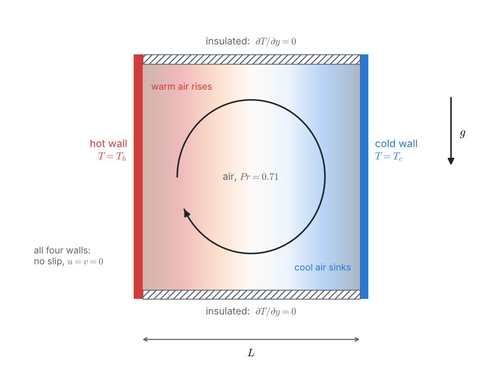
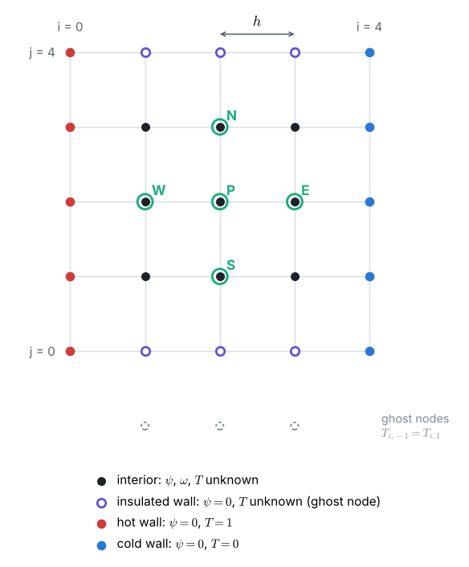
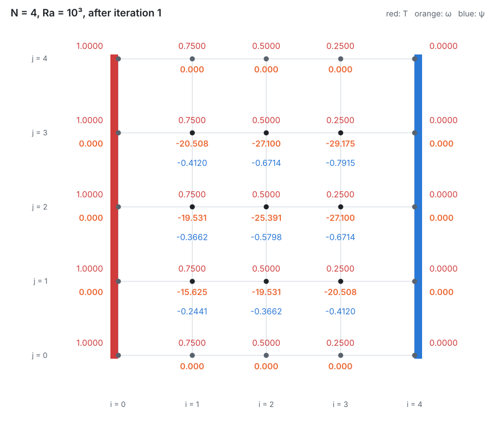
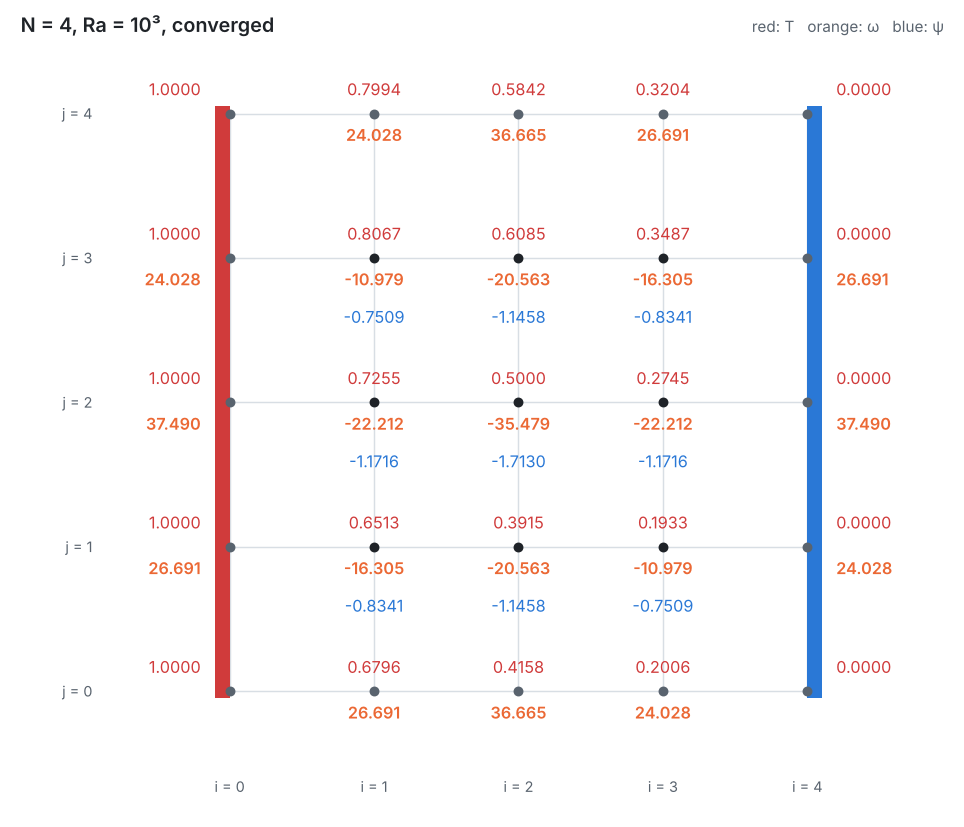

::: goal
**Aim of the lesson.** Students see a flow being **born from a temperature difference**. On the coarsest grid ($N = 4$, $Ra = 10^3$) they start from pure conduction and carry out the first iteration completely by hand, plus the start of the second. They see the buoyancy create vorticity, the vorticity create a circulation, and the circulation start to carry heat. The full solution needs 45 iterations, so the last board shows the computer's converged answer and the heat transfer computed from it. Every number below can be checked against the notebook cell under *Checking the whiteboard numbers*.
:::

## Lesson plan (about 60 minutes)

| Board | Content | Time |
|:-:|---|:-:|
| 1 | The cavity, buoyancy, and the Rayleigh and Prandtl numbers | 7 min |
| 2 | The three equations and the boundary conditions | 10 min |
| 3 | The grid with $N = 4$, the update formulas and the insulated walls | 8 min |
| 4 | Iteration 1 by hand: buoyancy creates vorticity | 12 min |
| 5 | Iteration 2: wall vorticity and the first heat carried by the flow | 10 min |
| 6 | The converged answer and the Nusselt number by hand | 10 min |
| 7 | Questions and discussion | 3 min |

::: tip
**Calculator advice for the class.** Work with $h = 0.25$, $h^2 = 0.0625$, $Ra\,h/2 = 125$ and $1/h^2 = 16$. Keep **3 decimals** for $\omega$ and **4** for $\psi$ and $T$. Sweep row by row from the bottom to the top, and left to right in each row, always using the **newest** values (Gauss–Seidel). One iteration = (1) wall $\omega$, (2) sweep $T$, (3) sweep $\omega$, (4) sweep $\psi$.
:::

## Board 1 · The cavity and buoyancy

**Ask the class:** *Which way will the air turn?* Warm air next to the hot wall is lighter and rises; cool air next to the cold wall sinks: a clockwise circulation.

Two numbers describe the problem:

$$Ra = \frac{g\,\beta\,\Delta T\,L^3}{\nu\,\alpha}, \qquad Pr = \frac{\nu}{\alpha} = 0.71 \;\;\text{(air)}.$$

$Ra$ measures buoyancy against friction and heat diffusion; $Pr$ compares how fast momentum and heat diffuse.

A double-glazed window, 10 K between the panes: a 1 cm gap gives $Ra \approx 10^3$, a 2.2 cm gap $Ra \approx 10^4$.

## Board 2 · Three equations

Write Problem 6's two equations and add buoyancy and energy (dimensionless):

$$\nabla^2\psi = -\omega, \qquad u\,\omega_x + v\,\omega_y = Pr\,\nabla^2\omega + \underbrace{Ra\,Pr\,T_x}_{\text{buoyancy}}, \qquad u\,T_x + v\,T_y = \nabla^2 T.$$

**Point out the buoyancy term:** vorticity is created wherever the temperature changes **sideways** ($T_x \neq 0$): warm fluid next to cold fluid starts to turn. With a hot wall on the left, $T_x < 0$, so the vorticity created is negative: clockwise.

Boundary conditions: $\psi = 0$ and Thom's formula $\omega = -2\psi_{adjacent}/h^2$ on all four walls (all at rest); $T = 1$ left, $T = 0$ right, $\partial T/\partial y = 0$ top and bottom.

**Ask the class:** *If nothing moves, what is the temperature?* Pure conduction between two walls: $T = 1 - x$, and the heat transfer is $\overline{Nu} = 1$.

## Board 3 · The grid and the update formulas

With $h = 0.25$ and $Ra = 1000$:

$$T_P = \tfrac{1}{4}\big[(1 - b_x)T_E + (1 + b_x)T_W + (1 - b_y)T_N + (1 + b_y)T_S\big], \qquad b_x = \tfrac{\psi_N - \psi_S}{4}, \;\; b_y = \tfrac{\psi_W - \psi_E}{4},$$

$$\omega_P = \tfrac{1}{4}\big[(1 - a_x)\omega_E + (1 + a_x)\omega_W + (1 - a_y)\omega_N + (1 + a_y)\omega_S + 125\,(T_E - T_W)\big],$$

$$a_x = \frac{b_x}{Pr}, \qquad a_y = \frac{b_y}{Pr},$$

$$\psi_P = \tfrac{1}{4}\big[\psi_E + \psi_W + \psi_N + \psi_S + 0.0625\,\omega_P\big].$$

**Insulated walls.** The ghost node below the bottom wall mirrors the node above it, $T_{i,-1} = T_{i,1}$, so on the wall $T_{i,0} = (T_{i+1,0} + T_{i-1,0} + 2\,T_{i,1})/4$ (and likewise on the top wall).

## Board 4 · Iteration 1: buoyancy creates vorticity

Start from pure conduction: $T = 1, 0.75, 0.5, 0.25, 0$ in the columns $i = 0 \dots 4$; $\psi = \omega = 0$.

**(1) Wall vorticity.** $\psi = 0$ everywhere, so $\omega = 0$ on all walls.

**(2) Temperature sweep.** The fluid is at rest ($b = 0$), and each $T$ is already the average of its neighbours (a straight line). On the insulated walls, e.g. $T_{1,0} = (0.5 + 1 + 2 \times 0.75)/4 = 0.75$. **Nothing changes.**

**(3) Vorticity sweep.** $a = 0$, and $125\,(T_E - T_W) = 125 \times (-0.5) = -62.5$ at every interior node:

| node | calculation | $\omega$ |
|:-:|---|:-:|
| (1, 1) | $(0 + 0 + 0 + 0 - 62.5)/4$ | **−15.625** |
| (2, 1) | $(0 + (-15.625) + 0 + 0 - 62.5)/4$ | **−19.531** |
| (3, 1) | $(0 + (-19.531) + 0 + 0 - 62.5)/4$ | **−20.508** |
| (1, 2) | $(0 + 0 + 0 + (-15.625) - 62.5)/4$ | **−19.531** |
| (2, 2) | $(0 + (-19.531) + 0 + (-19.531) - 62.5)/4$ | **−25.391** |
| (3, 2) | $(0 + (-25.391) + 0 + (-20.508) - 62.5)/4$ | **−27.100** |
| (1, 3) | $(0 + 0 + 0 + (-19.531) - 62.5)/4$ | **−20.508** |
| (2, 3) | $(0 + (-20.508) + 0 + (-25.391) - 62.5)/4$ | **−27.100** |
| (3, 3) | $(0 + (-27.100) + 0 + (-27.100) - 62.5)/4$ | **−29.175** |

(order of the terms: $\omega_E + \omega_W + \omega_N + \omega_S$ + source)

**(4) Stream-function sweep.** $\psi_P = (\psi_E + \psi_W + \psi_N + \psi_S + 0.0625\,\omega_P)/4$:

| node | calculation | $\psi$ |
|:-:|---|:-:|
| (1, 1) | $(0 + 0.0625 \times (-15.625))/4$ | **−0.2441** |
| (2, 1) | $(-0.2441 + 0.0625 \times (-19.531))/4$ | **−0.3662** |
| (3, 1) | $(-0.3662 + 0.0625 \times (-20.508))/4$ | **−0.4120** |
| (1, 2) | $(-0.2441 + 0.0625 \times (-19.531))/4$ | **−0.3662** |
| (2, 2) | $(-0.3662 - 0.3662 + 0.0625 \times (-25.391))/4$ | **−0.5798** |
| (3, 2) | $(-0.5798 - 0.4120 + 0.0625 \times (-27.100))/4$ | **−0.6714** |
| (1, 3) | $(-0.3662 + 0.0625 \times (-20.508))/4$ | **−0.4120** |
| (2, 3) | $(-0.4120 - 0.5798 + 0.0625 \times (-27.100))/4$ | **−0.6714** |
| (3, 3) | $(-0.6714 - 0.6714 + 0.0625 \times (-29.175))/4$ | **−0.7915** |

**Point out:** negative $\psi$ means a **clockwise** circulation, as the class predicted on Board 1. The flow was created by the sideways temperature difference alone. (The values are not symmetric yet only because Gauss–Seidel sweeps from the bottom left; they become symmetric at convergence.)

## Board 5 · Iteration 2: the flow starts to carry heat

**(1) Wall vorticity** (Thom, $-32\,\psi_{adjacent}$), for example:

| wall node | calculation | $\omega$ |
|---|---|:-:|
| bottom, $i = 1$ | $-32 \times (-0.2441)$ | 7.813 |
| bottom, $i = 3$ | $-32 \times (-0.4120)$ | 13.184 |
| top, $i = 3$ | $-32 \times (-0.7915)$ | 25.330 |
| left, $j = 2$ | $-32 \times (-0.3662)$ | 11.719 |

**(2) Temperature sweep.** The bottom wall row still sees the old, straight-line values: no change. Now node (1, 1), where the fluid moves:

$$b_x = \frac{\psi_{1,2} - \psi_{1,0}}{4} = \frac{-0.3662 - 0}{4} = -0.0916, \qquad b_y = \frac{\psi_{0,1} - \psi_{2,1}}{4} = \frac{0 + 0.3662}{4} = +0.0916.$$

So $u < 0$ (the fluid moves to the left, along the bottom) and $v > 0$ (up, towards the hot wall). Then

$$T_{1,1} = \tfrac{1}{4}\big[(1.0916)(0.5) + (0.9084)(1) + (0.9084)(0.75) + (1.0916)(0.75)\big] = 0.7386.$$

**Point out:** $T_{1,1}$ dropped from 0.75 to 0.7386: the circulation brings **colder** fluid from the right along the bottom. This is convection carrying heat. One more node, (2, 1), with $b_x = -0.1450$, $b_y = +0.0420$ and the new $T_{1,1}$:

$$T_{2,1} = \tfrac{1}{4}\big[(1.1450)(0.25) + (0.8550)(0.7386) + (0.9580)(0.5) + (1.0420)(0.5)\big] = 0.4794.$$

The rest of iteration 2 (vorticity and stream function) is the same procedure; the notebook prints all of it.

## Board 6 · The converged answer and the Nusselt number

The notebook needs **45 iterations** on $N = 4$:

**Point out the symmetry:** the converged fields look the same after turning the picture upside down and swapping hot and cold ($T \to 1 - T$). The problem has this symmetry, and Gauss–Seidel finds it in the end.

**Heat transfer by hand.** On the hot wall, $Nu = -\partial T/\partial x \approx (3T_0 - 4T_1 + T_2)/(2h) = (3 - 4T_{1,j} + T_{2,j})/0.5$:

| row $j$ | $T_{1,j}$ | $T_{2,j}$ | $Nu_j$ |
|:-:|:-:|:-:|:-:|
| 0 | 0.6796 | 0.4158 | 1.395 |
| 1 | 0.6513 | 0.3915 | 1.573 |
| 2 | 0.7255 | 0.5000 | 1.196 |
| 3 | 0.8067 | 0.6085 | 0.763 |
| 4 | 0.7994 | 0.5842 | 0.773 |

Trapezoidal rule: $\overline{Nu} = 0.25 \times \big[\tfrac{1.395}{2} + 1.573 + 1.196 + 0.763 + \tfrac{0.773}{2}\big] = 0.25 \times 4.616 = 1.154$.

::: answer
**With 9 interior nodes, the heat transfer is already within about 3 % of the benchmark** ($\overline{Nu} = 1.154$ against 1.118 from de Vahl Davis). The flow is weak at $Ra = 10^3$, so the result is close to pure conduction ($\overline{Nu} = 1$). The notebook refines to 65 × 65 nodes and, with Richardson extrapolation, matches the benchmark to within 0.1 %. At $Ra = 10^4$ the coarse grid is far worse: $N = 4$ does not even converge there, which is why we need fine grids and computers.
:::

## Questions for the class

- **Why does $T$ not change in iteration 1?** (The fluid is at rest and the straight-line profile already satisfies $\nabla^2 T = 0$ and the insulated-wall condition.)
- **Where is the heat flux on the hot wall largest, and why?** (Near the bottom, where cold fluid arriving along the bottom meets the hot wall.)
- **What would happen if the hot wall were at the bottom and the cold wall at the top?** (No sideways temperature gradient: $T_x = 0$, no vorticity source. Pure conduction stays a solution; above a critical $Ra$ it becomes unstable and convection cells appear, but that is another problem.)
- **Why is the vorticity on the walls positive, while it is negative inside?** (Near each wall the velocity drops to zero; the shear there turns the other way. Compare the lid of Problem 6.)
- **What changes if the hot wall is on the right?** (Everything mirrors: anticlockwise circulation, $\psi > 0$.)

## Common mistakes to watch for

- **Sign of the buoyancy term**: $+\,Ra\,h\,(T_E - T_W)/2$ inside the bracket; with the hot wall on the left it is negative.
- Forgetting the factor **2** in the insulated-wall formula ($2\,T_{i,1}$, from the ghost node).
- Treating the insulated-wall nodes as known: their temperature is unknown and must be updated every sweep.
- Mixing up $a$ and $b$: the vorticity coefficients have $Pr$ in the denominator, the temperature ones do not.
- Using **old** values where Gauss–Seidel uses new ones.

## From the board to the notebook

`03_fdm_solver.ipynb` repeats every board: `wall_vorticity` is Thom's formula of Board 2; the three sweeps of `solve_convection` are the formulas of Board 3, run exactly as on Boards 4 and 5; the cell under *Checking the whiteboard numbers* prints the fields after iterations 1 and 2 and the converged $N = 4$ solution of Board 6; `nusselt` is the table of Board 6. The notebook then solves both Rayleigh numbers on grids up to 65 × 65 nodes.
