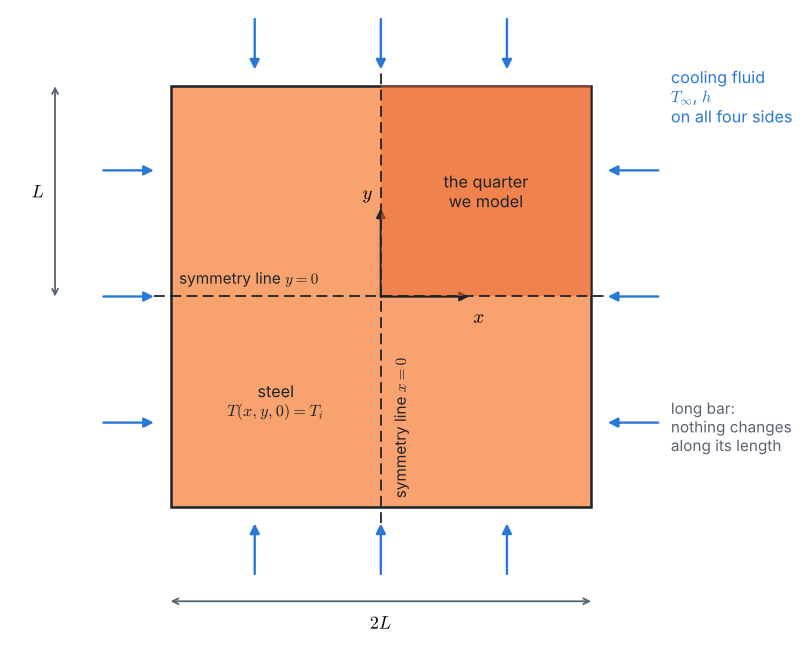
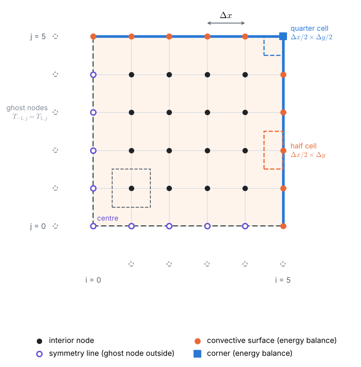
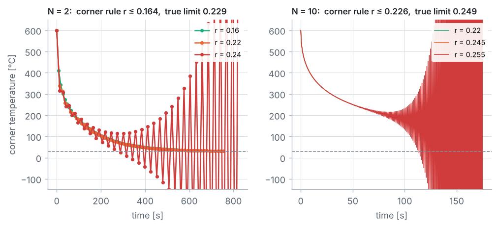
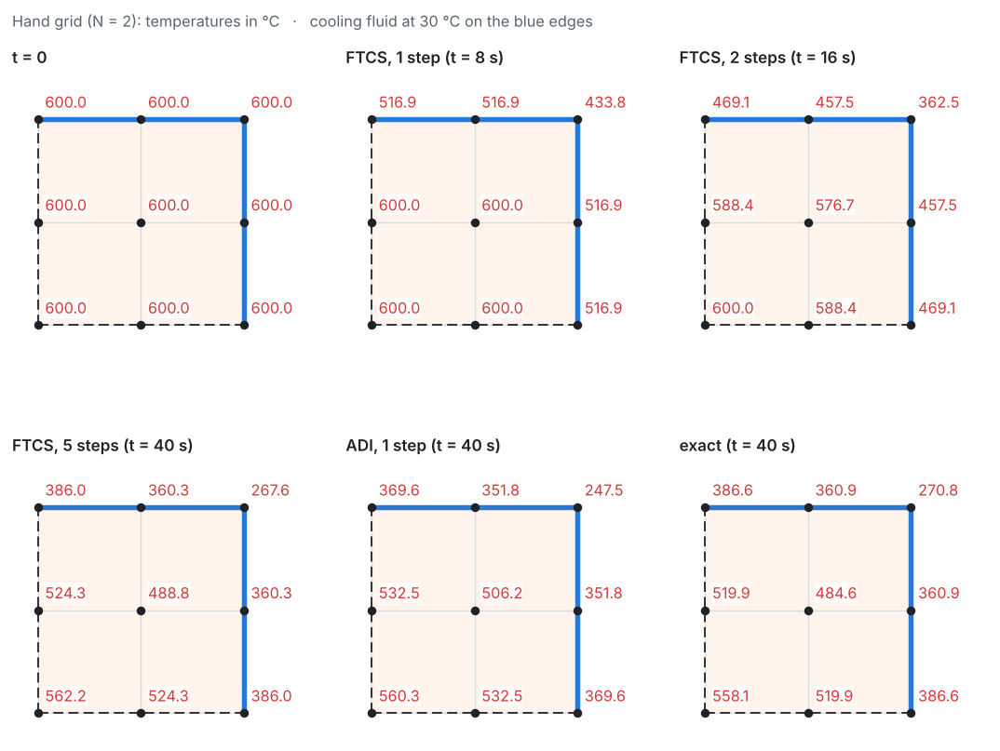
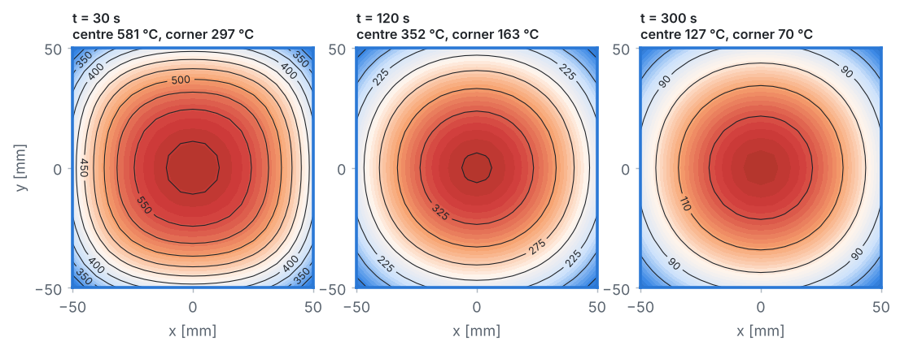
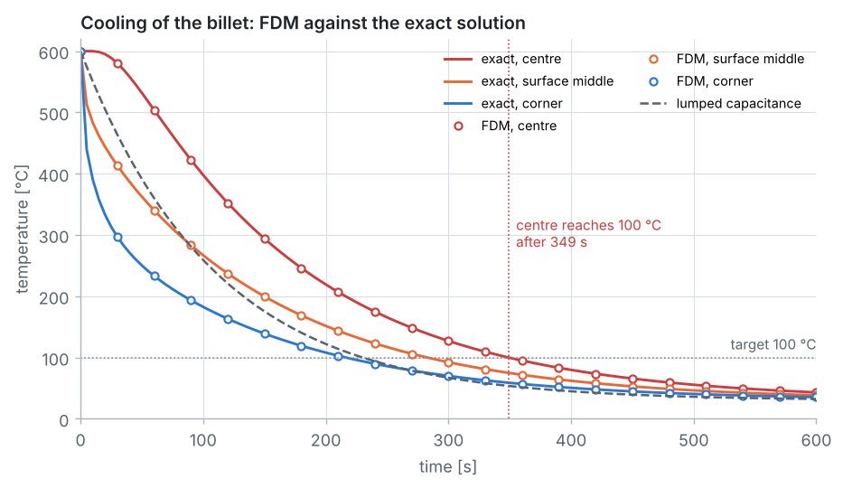
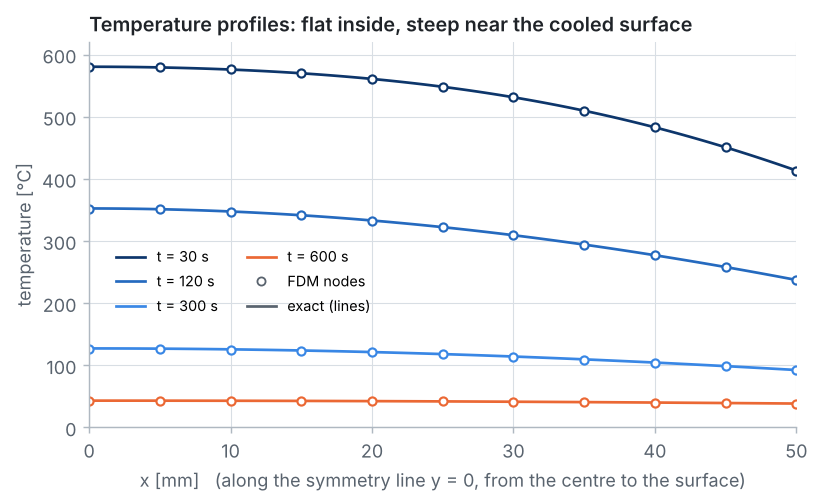
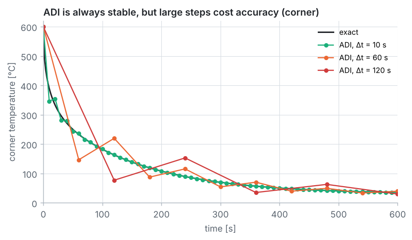
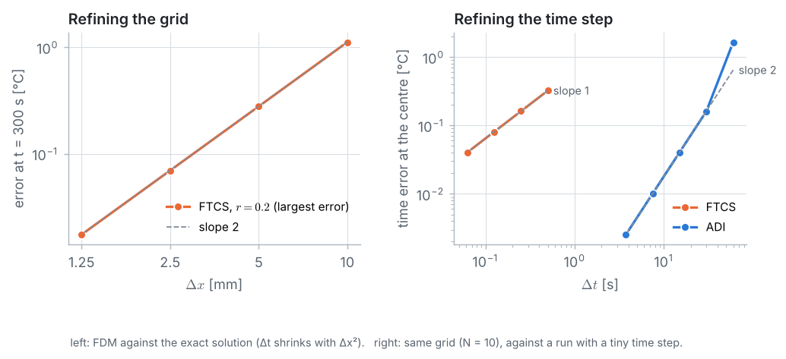

::: goal
**Plan.** We follow the 7 pillars of CFD: geometry → grid → physics → numerical scheme → solution setup → compute → post-processing. All code below is plain Python (lists and loops only; `math`, `time` and `json` from Python itself). It is the code of the notebook `03_fdm_solver.ipynb`, where it can be run cell by cell.
:::

## Step 1 · Geometry, data, and the lumped-capacitance check

A 100 mm × 100 mm steel billet at 600 °C is cooled by a water-mist spray (30 °C, $h = 1000$ W/(m²·K)) on all four sides. The properties are those of plain carbon steel at 600 K (Incropera et al., Table A.1), taken as constant.

{{code:data}}

{{out:data}}

**Could one temperature be enough?** Lumped capacitance treats the whole billet as one temperature, $T(t) = T_\infty + (T_i - T_\infty)\,e^{-t/\tau}$ with $\tau = \rho c_p V/(hA)$. It is valid only if $Bi = hL_c/k < 0.1$, with $L_c = V/A = L/2$ for a square bar:

{{code:lumped}}

{{out:lumped}}

$Bi \approx 0.52$ is five times too large: the surface cools much faster than the centre. We need the temperature field $T(x, y, t)$.

## Step 2 · Symmetry and the grid

The billet, its initial temperature and its cooling are symmetric about the lines $x = 0$ and $y = 0$ through its centre, so no heat crosses them. We compute **one quarter**, $0 \le x, y \le L$, with $N = 10$ intervals per side. Every node is unknown, including the surface nodes: their temperature follows from the convection condition.

{{code:grid}}

{{out:grid}}

## Step 3 · Physics and the exact solution

Inside the steel, $\partial T/\partial t = \alpha\,(\partial^2 T/\partial x^2 + \partial^2 T/\partial y^2)$, with $T = T_i$ at $t = 0$, $\partial T/\partial n = 0$ on the symmetry lines and $-k\,\partial T/\partial n = h\,(T - T_\infty)$ on the two cooled surfaces.

**Exact solution.** For a plane wall of half-thickness $L$ with the same conditions, $\theta^* = (T - T_\infty)/(T_i - T_\infty)$ is

$$P(x, t) = \sum_{n=1}^{\infty} C_n\, e^{-\zeta_n^2 Fo}\cos\!\left(\zeta_n \frac{x}{L}\right), \qquad Fo = \frac{\alpha t}{L^2}, \qquad C_n = \frac{4\sin\zeta_n}{2\zeta_n + \sin 2\zeta_n}, \qquad \zeta_n \tan\zeta_n = Bi.$$

The square bar is the intersection of two such walls, and its solution is their **product** (Incropera et al., §5.8):

$$\frac{T(x, y, t) - T_\infty}{T_i - T_\infty} = P(x, t)\,P(y, t).$$

{{code:exact}}

{{out:exact}}

{{code:exact-time}}

{{out:exact-time}}

## Step 4 · Numerical scheme

**Explicit FTCS from energy balances.** For each control volume, (heat stored per time step) = (heat flowing in at the old time level). With $r = \alpha\,\Delta t/\Delta x^2$ and $Bi_{cell} = h\,\Delta x/k$:

| node (control volume) | FTCS update |
|---|---|
| interior (full cell) | $T_P + r\,(T_E + T_W + T_N + T_S - 4T_P)$ |
| symmetry line $x = 0$ (ghost $T_W = T_E$) | $T_P + r\,(2T_E + T_N + T_S - 4T_P)$ |
| convective surface $x = L$ (half cell) | $T_P + r\,(2T_W + T_N + T_S - 4T_P) + 2\,r\,Bi_{cell}\,(T_\infty - T_P)$ |
| corner (quarter cell) | $T_P + 2\,r\,(T_W + T_S - 2T_P) + 4\,r\,Bi_{cell}\,(T_\infty - T_P)$ |

For example, the half cell of a surface node, $\tfrac{\Delta x}{2} \times \Delta y$, receives heat from W through a face $\Delta y$ long, from N and S through faces $\Delta x/2$ long, and from the fluid through the surface:

$$\rho c_p \frac{\Delta x\,\Delta y}{2}\,\frac{T_P^{n+1} - T_P}{\Delta t} = k\,\Delta y\,\frac{T_W - T_P}{\Delta x} + k\,\frac{\Delta x}{2}\,\frac{T_N - T_P}{\Delta y} + k\,\frac{\Delta x}{2}\,\frac{T_S - T_P}{\Delta y} + h\,\Delta y\,(T_\infty - T_P).$$

Every row of the table is the sum of an $x$ part and a $y$ part, each a 1D second difference with a ghost node: $2(T_1 - T_0)$ on a symmetry line, $T_{i+1} - 2T_i + T_{i-1}$ inside, and $2(T_{N-1} - T_N) - 2Bi_{cell}T_N + 2Bi_{cell}T_\infty$ on a cooled surface (the convection condition fixes the ghost value $T_{N+1}$). So one function serves all nodes:

{{code:ftcs}}

**Stability.** The weight of $T_P$ in each update must not be negative:

| node | weight of $T_P$ | positive if |
|---|---|---|
| interior, symmetry, centre | $1 - 4r$ | $r \le 1/4$ |
| convective surface | $1 - 4r - 2rBi_{cell}$ | $r \le 1/[2(2 + Bi_{cell})]$ |
| corner | $1 - 4r - 4rBi_{cell}$ | $r \le 1/[4(1 + Bi_{cell})]$ |

The **corner**, cooled on two faces but storing heat in only a quarter cell, sets the limit (Incropera et al., Table 5.3):

{{code:limits}}

{{out:limits}}

Positive weights are a **safe** rule: they keep every new value between $T_\infty$ and $T_i$. The **true** stability limit is where the worst error pattern (a checkerboard) starts to grow. Power iteration on the 1D second difference finds its growth rate $\mu$; the 2D checkerboard changes by $1 - 2r\mu$ per step, so stability needs $r \le 1/\mu$:

{{code:true-limit}}

{{out:true-limit}}

On the coarse grid even $r = 0.24 < 1/4$ is unstable: the convective corner, not the interior, sets the time step.

**Implicit: Crank–Nicolson and ADI.** An implicit method has no stability limit. Crank–Nicolson averages the old and new time levels and is second order in time, but in 2D every step is one system of $(N+1)^2$ equations with five diagonals. **ADI** (Peaceman and Rachford, 1955) splits the step in two halves, each implicit in one direction only:

$$T^* - T^n = \tfrac{r}{2}\left(\delta_x^2 T^* + \delta_y^2 T^n\right), \qquad T^{n+1} - T^* = \tfrac{r}{2}\left(\delta_x^2 T^* + \delta_y^2 T^{n+1}\right),$$

plus the constant $T_\infty$ terms of the cooled surfaces in each half. In the first half the unknowns of one row are coupled only to each other: a tridiagonal system for each row; in the second half, for each column. With the ghost nodes the matrix is the same for every line:

| position | $a_i$ (below) | $b_i$ (diagonal) | $c_i$ (above) |
|---|:-:|:-:|:-:|
| $i = 0$ (symmetry) | — | $1 + r$ | $-r$ |
| inside | $-r/2$ | $1 + r$ | $-r/2$ |
| $i = N$ (convection) | $-r$ | $1 + r\,(1 + Bi_{cell})$ | — |

The Thomas algorithm of Problem 1 solves each line:

{{code:thomas}}

{{code:adi}}

ADI is unconditionally stable and second order in time, like Crank–Nicolson, at the cost of $2(N+1)$ small tridiagonal solves per step.

## Step 5 · Solution setup

Initial condition $T = 600$ °C everywhere. **FTCS:** the corner rule on $N = 10$ allows $\Delta t \le 0.518$ s; we take $\Delta t = 0.5$ s. **ADI:** we take $\Delta t = 10$ s. One function marches either method and records the centre $(0, 0)$, the middle of a face $(L, 0)$ and the corner $(L, L)$; the time to reach 100 °C is interpolated linearly between steps:

{{code:setup}}

## Step 6 · Compute

{{code:run}}

{{out:run}}

**Breaking the stability limit on purpose.** FTCS with three values of $r$ on each grid:

{{code:unstable}}

{{out:unstable}}

**The whiteboard numbers.** The whiteboard guide does two FTCS steps ($N = 2$, $r = 0.14$) and one ADI step five times as long ($r = 0.7$) by hand:

{{code:hand}}

{{out:hand}}

## Step 7 · Post-processing and verification

The centre does not notice the cooling for the first half minute, then lags far behind the surface. Lumped capacitance is too cold for the centre and too warm for the surface; it predicts 100 °C after 230 s, a third too early.

{{code:profiles}}

{{out:profiles}}

**Cost against accuracy** (all on $N = 10$; run times depend on the computer):

{{code:compare}}

{{out:compare}}

- ADI with $\Delta t = 5$ s is about 20 times more accurate at the centre than FTCS with $\Delta t = 0.5$ s, and several times cheaper. FTCS is first order in time, and on this grid its error comes almost entirely from $\Delta t$.
- The tiny ADI errors at $\Delta t = 5$ and 10 s are partly luck: the spatial error of the grid ($+0.018$ °C at the centre) and the time error have opposite signs.
- With $\Delta t = 60$ s the centre is 1.6 °C too cold at 300 s. Stability is not accuracy.

{{code:adi-large}}

{{out:adi-large}}

ADI, like Crank–Nicolson, damps the fastest-changing patterns only weakly when $r$ is large, so the sudden start of cooling at the corner rings for a few steps. The time step must still be chosen for accuracy: small at the start, larger later. Commercial codes adapt their time step automatically for this reason.

**Verification 1: refining the grid.** FTCS with $r \approx 0.2$, so $\Delta t$ shrinks with $\Delta x^2$, against the exact solution at $t = 300$ s:

{{code:space}}

{{out:space}}

The error drops by 4 each time $\Delta x$ is halved: **second order**. Each halving multiplies the FTCS work by 16.

**Verification 2: refining the time step.** On the same grid ($N = 10$), against a run with a tiny time step, so that only the time error remains:

{{code:time-study}}

{{out:time-study}}

::: answer
**Result.** The centre of the billet reaches 100 °C after **349 s** (about 5.8 minutes): exact 349.1 s, FTCS ($N = 10$, $\Delta t = 0.5$ s) 348.6 s, ADI ($N = 10$, $\Delta t = 10$ s) 349.2 s. At that moment the middle of a face is at 75 °C and the corner at 59 °C. Lumped capacitance ($Bi = 0.52$) would have predicted 230 s, 34 % too early. FTCS needs $\Delta t \le 0.518$ s because of the cooled corner; ADI is stable for any $\Delta t$, second order in time, and with $\Delta t = 5$ to 10 s more accurate than FTCS at a fraction of the cost.
:::

## Key ideas

- $Bi = hL_c/k > 0.1$: lumped capacitance fails, and a temperature field is needed.
- Symmetry reduces the billet to a quarter; ghost nodes on the symmetry lines, energy balances on half and quarter cells at the cooled surfaces.
- Every node equation is a sum of an $x$ and a $y$ second difference; this is what makes ADI possible.
- The explicit time step is limited by the cooled corner: $r \le 1/[4(1 + Bi_{cell})]$ is safe; the true limit lies between this and 1/4.
- ADI = two sets of tridiagonal solves (Thomas algorithm) per step: unconditionally stable, second order in time, but large steps still cost accuracy.
- The exact product solution verifies the code: second order in $\Delta x$; first (FTCS) and second (ADI) order in $\Delta t$.
