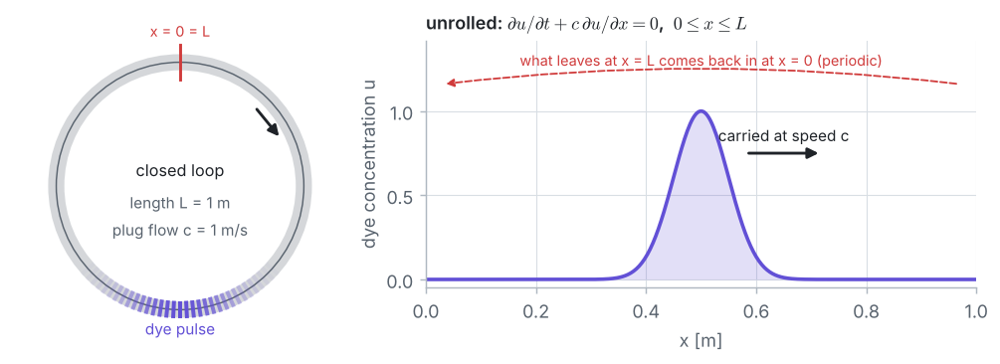

## The problem

::: given
Water circulates round a **closed loop of pipe**, $L = 1$ m long, as a **plug flow** with speed $c = 1$ m/s. At $t = 0$ a **pulse of dye** is in the loop. The dye diffuses so slowly that it is simply **carried** by the flow: after **one lap**, $t = L/c = 1$ s, it should be back where it started with exactly its initial shape. Predict the dye profile after one lap with the **Finite Difference Method**, for a smooth **Gaussian pulse** and a sharp **square pulse**, with three explicit schemes: **FTCS**, **first-order upwind** and **Lax–Wendroff**, at Courant numbers **0.5, 1.0 and 1.1**.
:::

## Governing equation

The **linear advection equation** on a **periodic** domain:

$$\frac{\partial u}{\partial t} + c\,\frac{\partial u}{\partial x} = 0, \qquad 0 \le x \le L, \qquad u(0, t) = u(L, t), \qquad u(x, 0) = u_0(x),$$

where $u$ is the dye concentration (scaled so that the pulses have height 1).

**Exact solution.** $u$ is constant along the **characteristics** $x - c\,t = \text{const}$, so the initial profile is shifted by $c\,t$ without changing its shape:

$$u(x, t) = u_0(x - c\,t), \qquad x - c\,t \text{ taken modulo } L.$$

**Initial pulses.**

$$\text{Gaussian:}\quad u_0(x) = \exp\left(-\frac{(x - x_0)^2}{2\sigma^2}\right), \qquad\qquad
\text{square:}\quad u_0(x) = \begin{cases} 1, & |x - x_0| \le 0.1\ \text{m} \\ 0, & \text{otherwise.} \end{cases}$$

## Data

| Quantity | Symbol | Value |
|---|:-:|---|
| length of the loop | $L$ | 1.0 m |
| flow speed | $c$ | 1.0 m/s |
| time for one lap | $t_{lap} = L/c$ | 1.0 s |
| centre of both pulses | $x_0$ | 0.5 m |
| width of the Gaussian (standard deviation) | $\sigma$ | 0.05 m |
| square pulse | | height 1, from 0.4 m to 0.6 m |
| main grid | $N$, $\Delta x$ | 100 intervals, $\Delta x = 0.01$ m |
| Courant numbers $C = c\,\Delta t/\Delta x$ | $C$ | 0.5 ($\Delta t = 0.005$ s), 1.0 ($\Delta t = 0.01$ s), 1.1 ($\Delta t = 0.011$ s) |
| grids for the error study ($C = 0.5$) | $N$ | 25, 50, 100, 200, 400, 800, 1600 |
| hand calculation (whiteboard) | $N$, $C$ | 8 intervals ($\Delta x = 0.125$ m), $C = 0.5$ ($\Delta t = 0.0625$ s), two time steps |

::: note
**Data for simulation software** (written for COMSOL Multiphysics 4.3a, *Mathematics → PDE Interfaces → Coefficient Form PDE*, 1D, time-dependent study):

- geometry: an interval from $x = 0$ to $x = 1$ m; one dependent variable $u$ (dimensionless);
- coefficients of the Coefficient Form PDE $e_a\,u_{tt} + d_a\,u_t + \nabla\cdot(-c\nabla u - \alpha u + \gamma) + \beta\cdot\nabla u + a\,u = f$: **$d_a = 1$, $\beta = 1$** (the flow speed $c$), all others 0 (COMSOL's diffusion coefficient, also called $c$, must be **0**);
- boundary: a **Periodic Condition** on the two end points $x = 0$ and $x = 1$ m (it overrides the default *Zero Flux* condition on these points);
- initial value: $u$ = a Gaussian with centre 0.5 m and standard deviation 0.05 m, **height 1** (COMSOL's *Gaussian Pulse* function has area 1, so multiply it by $\sigma\sqrt{2\pi} = 0.12533$), or a square pulse from 0.4 to 0.6 m (*Rectangle* function, or a *Step* function, with a small smoothing zone);
- mesh: uniform elements of size 0.01 m (100 elements); also 25 to 1600 elements for a grid study;
- times: output from 0 to 1 s every 0.005 s; to compare with the finite difference schemes, force a **fixed time step** $\Delta t = C\,\Delta x/c$ (0.005 s for $C = 0.5$);
- results to compare: $u(x)$ at $t = 1$ s, its **peak** (exact: 1) and the largest error against the initial profile.

Check the **consistent stabilisation** settings (streamline diffusion, which COMSOL's transport interfaces switch on by default) and switch it off to see the bare scheme. Its default time integrator (**BDF**) is implicit and stable for any time step, but it damps the pulse too.
:::

## Assumptions

- One-dimensional plug flow with a constant speed $c$ (every particle moves at the same speed).
- No diffusion of the dye (molecular diffusion over one lap is negligible) and no sources or sinks.
- The loop is closed: the domain is periodic, with no inlet and no outlet.

## Tasks

1. **Physics.** Derive the advection equation from a balance of the dye in a short piece of pipe. Show that $u$ is constant along the lines $x - c\,t = \text{const}$ and write the exact solution. Why is the equation called **hyperbolic**? How does it differ from the diffusion equation of Problem 2?
2. **Grid.** On a periodic grid with $N$ intervals, which nodes are stored and who are the neighbours of the end nodes? Define the **Courant number** $C = c\,\Delta t/\Delta x$ and explain its meaning.
3. **Discretization.** With a forward difference in time, write the update formulas of
   a. **FTCS**: central difference for $\partial u/\partial x$;
   b. **first-order upwind**: backward difference for $\partial u/\partial x$ ($c > 0$);
   c. **Lax–Wendroff**: a second-order Taylor expansion in time, $u_{tt} = c^2 u_{xx}$, with central differences.
4. **Stability.** Explain the **CFL condition** $C \le 1$ with the characteristic through a node. With a **von Neumann analysis**, find the amplification factor $G$ of each scheme and its stability range. Show that FTCS is unstable for every $C > 0$.
5. **Computation.** On $N = 100$ intervals, march one lap at $C = 0.5$ with each scheme for both pulses. Report the **peak**, the smallest value and the largest error after one lap. Repeat with upwind and Lax–Wendroff at $C = 1.0$ and $C = 1.1$. Explain what you see.
6. **Numerical diffusion.** Derive the **modified equation** of the upwind scheme and its numerical diffusion coefficient $D_{num}$. Compare with the false diffusion of Problem 5. Use $D_{num}$ to predict the peak of the Gaussian after one lap, before computing it. Which kind of error does Lax–Wendroff make instead?
7. **Verification.** For the Gaussian at $C = 0.5$, compute the largest error after one lap on grids from $N = 25$ to $1600$ and find the observed orders of accuracy.
8. *Hand calculation (whiteboard).* On $N = 8$ intervals with $C = 0.5$, do two time steps of upwind, Lax–Wendroff and FTCS by hand, starting from the square pulse.

## What you will learn

- What a **hyperbolic** equation is: information travels along **characteristics** with a finite speed, in one direction.
- What the **Courant number** means and why explicit schemes need the **CFL condition** $C \le 1$.
- How a **von Neumann analysis** decides the stability of a scheme, and why FTCS always fails for advection.
- The two typical errors of advection schemes: **numerical diffusion** (upwind, 1st order, smears) and **numerical dispersion** (Lax–Wendroff, 2nd order, wiggles), and how the **modified equation** predicts them.

::: tip
**Files for this problem:** `02_solution.pdf` explains the solution step by step. `03_fdm_solver.ipynb` contains the complete Python code (plain Python, no numerical libraries), with explanations and plots, to run cell by cell. `04_whiteboard_guide.pdf` guides the two time steps and the von Neumann analysis by hand, for the board.
:::
