::: goal
**Plan.** We follow the 7 pillars of CFD: geometry → grid → physics → numerical scheme → solution setup → compute → post-processing. All code below is plain Python (lists and loops only; `math` and `time` from Python itself). It is the code of the notebook `03_fdm_solver.ipynb`, where it can be run cell by cell.
:::

## Step 1 · Geometry and data

Water circulates round a closed loop of pipe, $L = 1$ m long, as a plug flow with speed $c = 1$ m/s, carrying a pulse of dye. Molecular diffusion of a dye in water ($D \approx 10^{-9}$ m²/s) spreads it by only about 0.05 mm in one second, so we neglect it: the dye is **only carried** by the flow. Unrolling the loop gives a straight domain $0 \le x \le L$ whose two ends are the same point: a **periodic** domain.

{{code:data}}

{{out:data}}

Two initial pulses, both centred at $x_0 = 0.5$ m and of height 1: a smooth **Gaussian** ($\sigma = 0.05$ m), to measure the order of accuracy, and a sharp **square pulse** (0.4 to 0.6 m), which contains waves of every length and shows what a scheme does to the shortest ones.

{{code:pulses}}

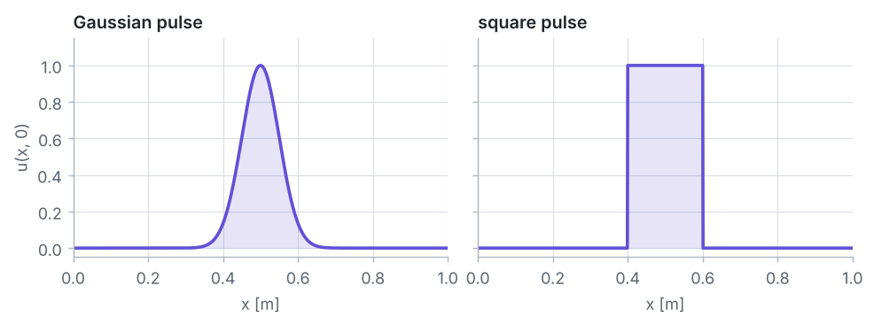

## Step 2 · The grid in space and time

**Space.** $N$ intervals, $\Delta x = L/N$. Node $N$ (at $x = L$) **is** node 0, so only the $N$ nodes $i = 0, \dots, N - 1$ are stored. Every node has two neighbours, also at the ends: the west neighbour of node 0 is node $N - 1$, the east neighbour of node $N - 1$ is node 0. There are no boundary nodes and no boundary conditions.

**Time.** As in Problem 2, time steps $\Delta t$, $t^n = n\,\Delta t$, values $u_i^n$.

**Courant number.** In one time step the flow moves the dye by $c\,\Delta t$; in grid intervals this is

$$C = \frac{c\,\Delta t}{\Delta x}.$$

It plays the role of $r = \alpha\,\Delta t/\Delta x^2$ in Problem 2. We choose $N$ and $C$; then $\Delta t = C\,\Delta x/c$, and one lap takes $N/C$ steps.

{{code:grid}}

{{out:grid}}

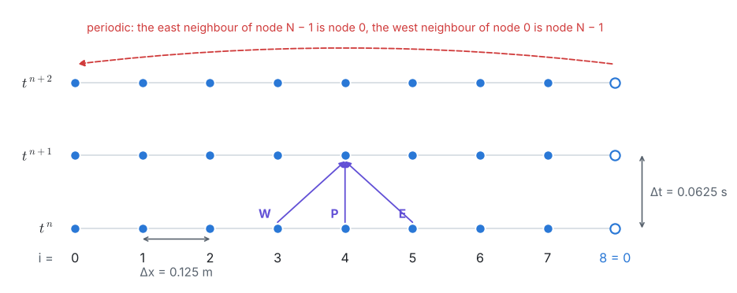

## Step 3 · Physics: the advection equation

A balance of the dye in a short piece of pipe (flux $c\,u$ in, flux $c\,u$ out, nothing else) gives the **linear advection equation**

$$\frac{\partial u}{\partial t} + c\,\frac{\partial u}{\partial x} = 0, \qquad u(0, t) = u(L, t), \qquad u(x, 0) = u_0(x).$$

It is the convection–diffusion equation of Problem 5 with the time derivative put back and no diffusion, and it is the simplest **hyperbolic** equation. Along any line $x = x_0 + c\,t$,

$$\frac{d}{dt}\,u(x_0 + c\,t,\ t) = \frac{\partial u}{\partial t} + c\,\frac{\partial u}{\partial x} = 0,$$

so $u$ is constant along these **characteristics**, and the **exact solution** is the initial profile shifted by $c\,t$ (wrapped round the loop):

$$u(x, t) = u_0(x - c\,t).$$

After one lap the profile is exactly the initial one. Every change of shape we see is a **numerical** error. Information travels with speed $c$, in one direction only, and never fades: unlike the elliptic problems (1, 3–7), where every point feels every other point, and the parabolic Problem 2, where a disturbance is felt everywhere at once but dies out.

{{code:exact}}

{{out:exact}}

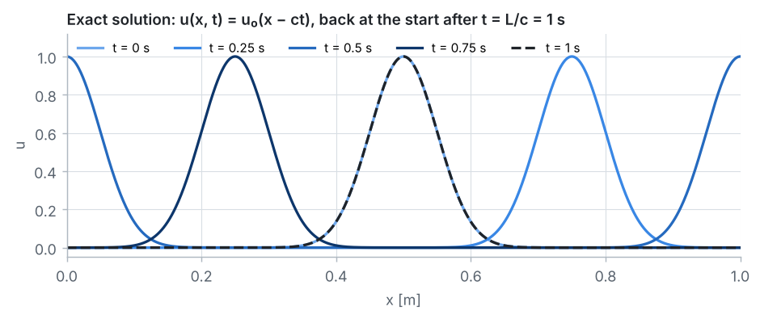

## Step 4 · Numerical scheme

All three schemes use a forward difference in time and the old values at $W = i - 1$, $P = i$, $E = i + 1$:

| scheme | update formula | order |
|---|---|:-:|
| FTCS | $u_i^{n+1} = u_i^n - \frac{C}{2}\,(u_{i+1}^n - u_{i-1}^n)$ | 1 in $t$, 2 in $x$ |
| upwind ($c > 0$) | $u_i^{n+1} = u_i^n - C\,(u_i^n - u_{i-1}^n) = (1 - C)\,u_i^n + C\,u_{i-1}^n$ | 1 |
| Lax–Wendroff | $u_i^{n+1} = u_i^n - \frac{C}{2}\,(u_{i+1}^n - u_{i-1}^n) + \frac{C^2}{2}\,(u_{i+1}^n - 2u_i^n + u_{i-1}^n)$ | 2 |

**Lax–Wendroff** comes from the Taylor series $u^{n+1} = u^n + \Delta t\,u_t + \tfrac12\Delta t^2\,u_{tt}$, with $u_t = -c\,u_x$ and $u_{tt} = c^2\,u_{xx}$ taken from the equation itself, and central differences for $u_x$ and $u_{xx}$. In the code, Python's index `u[i - 1]` is `u[-1]` (the last node) for $i = 0$, and `u[(i + 1) % N]` is `u[0]` for $i = N - 1$: the periodic wrap costs nothing.

{{code:schemes}}

**The CFL condition.** The exact value at $P$ at $t^{n+1}$ comes along the characteristic through $P$, which started one step earlier at $x_P - C\,\Delta x$. If $C > 1$ it started beyond $W$, outside the stencil, and the scheme cannot see the information that decides the answer (Courant, Friedrichs and Lewy, 1928):

$$C = \frac{c\,\Delta t}{\Delta x} \le 1.$$

This is necessary, not sufficient.

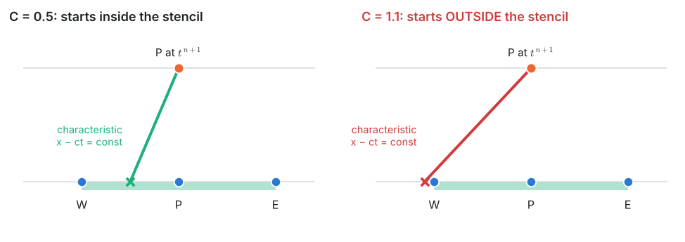

**Von Neumann analysis.** Follow one Fourier wave $u_i^n = G^n\,e^{\,\mathrm{i}\theta i}$, with $\theta = k\,\Delta x$ the phase change per node ($\theta = \pi$: the shortest wave, $2\Delta x$ long). Putting it into a scheme and using $u_{i\pm1} = e^{\pm\mathrm{i}\theta}\,u_i$ gives the **amplification factor** per time step:

$$|G_{FTCS}|^2 = 1 + C^2\sin^2\theta, \qquad |G_{upwind}|^2 = 1 - 2C(1 - C)(1 - \cos\theta), \qquad |G_{LW}|^2 = 1 - C^2(1 - C^2)(1 - \cos\theta)^2.$$

The exact solution only shifts every wave ($|G| = 1$). FTCS has $|G| > 1$ for every wave and **every** $C > 0$: it is unconditionally unstable. Upwind and Lax–Wendroff have $|G| \le 1$ exactly when $C \le 1$. The phase of $G$, divided by the exact shift $C\theta$, is the numerical speed of each wave.

{{code:von-neumann}}

{{out:von-neumann}}

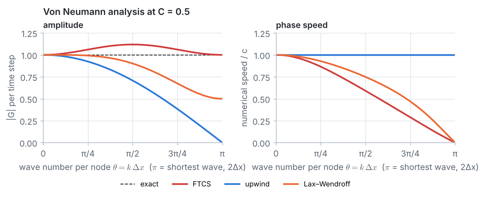

## Step 5 · Solution setup: explicit time marching

All three schemes are **explicit**: no system of equations, just one formula per node and step. Start from the initial pulse at the nodes and apply $N/C$ steps for one lap. For $C = 1.1$ one lap is not a whole number of steps; we take the nearest number (91 steps, $t = 1.001$ s) and compare with the exact solution at that time.

{{code:solve}}

## Step 6 · Compute

**FTCS** at $C = 0.5$:

{{code:ftcs}}

{{out:ftcs}}

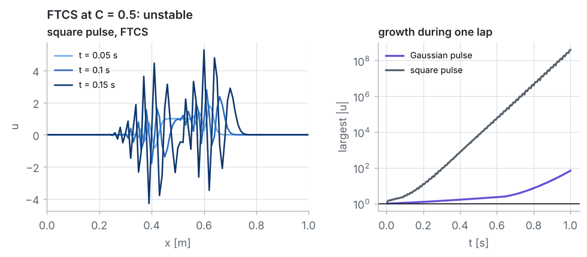

::: warning
**FTCS always blows up for advection.** A smaller time step only slows the growth ($C = 0.1$ still reaches 1.16 after one lap, and grows without limit), because $|G| > 1$ for every $C > 0$. We drop FTCS from now on.
:::

**Upwind and Lax–Wendroff**, one lap at $C = 0.5$:

{{code:lap}}

{{out:lap}}

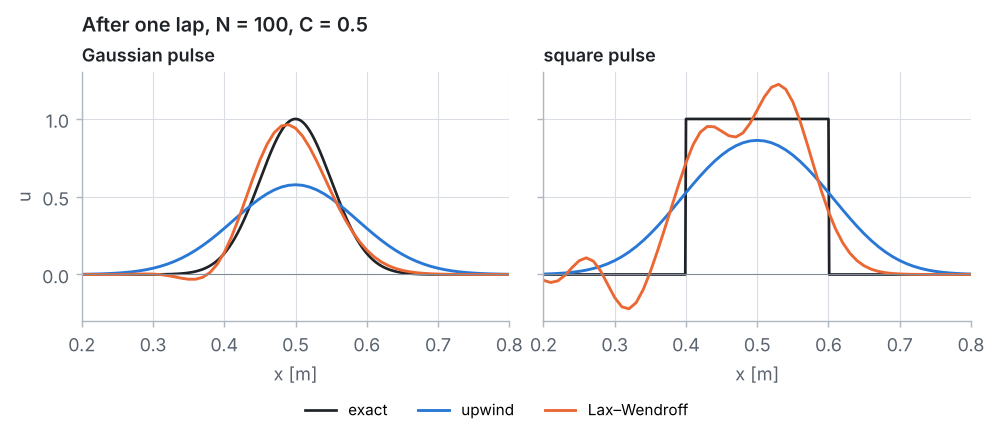

- **Upwind smears:** the Gaussian comes back at the right place but with **58 %** of its height; the square pulse becomes a bump with peak 0.86. No value is negative or above 1: the new value is an average $(1 - C)\,u_P + C\,u_W$ with positive weights (the boundedness argument of Problem 5). This is **numerical diffusion**.
- **Lax–Wendroff wiggles:** the Gaussian keeps **96 %** of its height with a small dip ($-0.03$) behind it; behind both edges of the square pulse a train of wiggles overshoots to 1.22 and undershoots to $-0.22$. The short waves travel too slowly and fall behind: **numerical dispersion**.

**Courant numbers 1.0 and 1.1:**

{{code:cfl}}

{{out:cfl}}

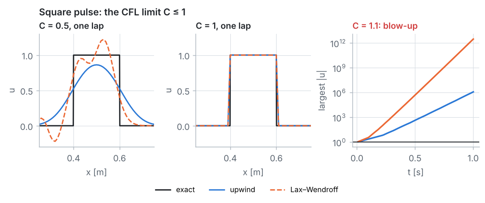

- **$C = 1$:** both formulas become $u_i^{n+1} = u_{i-1}^n$. Each step copies every value exactly one node downstream, which is what the flow does in $\Delta t = \Delta x/c$: the error is zero to round-off.
- **$C = 1.1$:** the CFL condition is violated. The shortest waves grow by $|G| = 1.2$ (upwind) and $1.42$ (Lax–Wendroff) per step; the square pulse reaches $10^6$ and $3 \times 10^{12}$ within one lap. The Gaussian has almost no short waves, so after one lap its error is still 0.28 (upwind), but it grows without limit.

**The whiteboard numbers.** On $N = 8$ with $C = 0.5$ the square pulse is a single spike at node 4, and the three formulas have simple weights: FTCS $0.25\,u_W + u_P - 0.25\,u_E$, upwind $0.5\,u_W + 0.5\,u_P$, Lax–Wendroff $0.375\,u_W + 0.75\,u_P - 0.125\,u_E$. The exact answer after two steps is the spike at node 5.

{{code:hand}}

{{out:hand}}

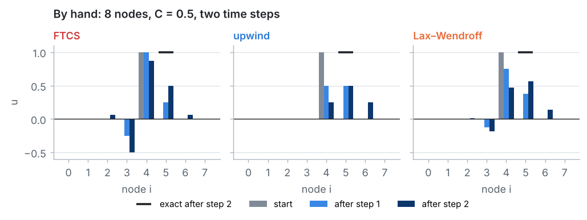

All three keep $\sum u_i = 1$, but the **sum of squares** tells them apart: it grows for FTCS (1 → 1.125 → 1.273: unstable) and falls for upwind (1 → 0.5 → 0.375: strong damping) and Lax–Wendroff (1 → 0.719 → 0.591).

## Step 7 · Post-processing and verification

**Upwind: the modified equation.** Taylor-expanding $u_i^{n+1}$ and $u_{i-1}^n$ about $(x_i, t^n)$ and using $u_{tt} = c^2 u_{xx}$ shows that the upwind scheme actually solves

$$u_t + c\,u_x = D_{num}\,u_{xx}, \qquad D_{num} = \frac{c\,\Delta x}{2}\,(1 - C),$$

up to higher-order terms. This is the false diffusion of Problem 5, $u\,\Delta x/2$, times $(1 - C)$: in an unsteady calculation the error of the forward time step cancels part of it, all of it at $C = 1$. (For FTCS the same expansion gives $D_{num} = -\tfrac12 c^2\,\Delta t < 0$: a negative diffusion, another way to see its instability.)

A Gaussian that diffuses with $D$ for a time $t$ keeps its area and widens to $\sigma_t^2 = \sigma^2 + 2Dt$, so its peak falls to $\sigma/\sigma_t$. This **predicts** the upwind peak without running the scheme:

{{code:modified}}

{{out:modified}}

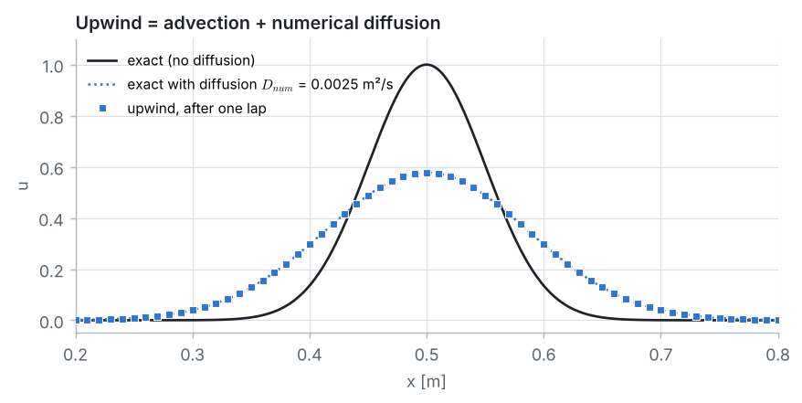

The prediction matches the computed peak to within 0.0005. $D_{num} = 0.0025$ m²/s is 2.5 million times the real diffusion of the dye. And on a fixed grid a **smaller** time step makes upwind **worse** ($C = 0.25$: peak 0.50).

**Lax–Wendroff** instead solves $u_t + c\,u_x = -\tfrac16 c\,\Delta x^2\,(1 - C^2)\,u_{xxx} + \dots$: the leading error is a third derivative, which changes the speed of the waves (dispersion) instead of damping them.

**Conservation.** All three schemes have the form "new = old − (flux out − flux in)", so the amount of dye $\sum u_i\,\Delta x$ is kept exactly:

{{code:conservation}}

{{out:conservation}}

**Error study.** Gaussian pulse, $C = 0.5$, one lap, $N = 25$ to $1600$; the observed order between two grids is $p = \log(e_{coarse}/e_{fine})/\log 2$:

{{code:error-study}}

{{out:error-study}}

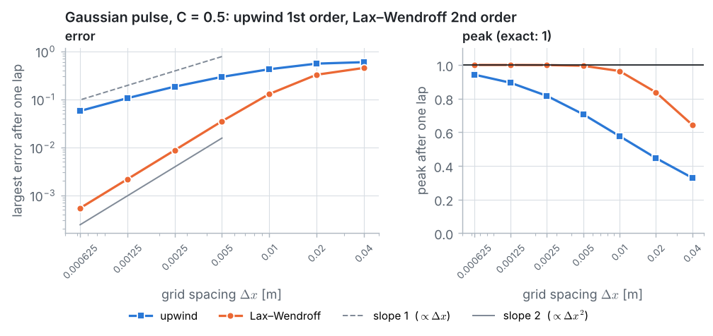

- **Lax–Wendroff** converges at **2nd order** (observed 2.0 from $N = 200$ on) and keeps 99.9 % of the peak on 400 intervals.
- **Upwind** converges at only **1st order**, and reaches it slowly (0.88 between $N = 800$ and 1600), because its error is the peak loss of the modified equation, which is proportional to $\Delta x$ only once $D_{num}\,t \ll \sigma^2$. On 1600 intervals it keeps 94 % of the peak: less than Lax–Wendroff on 100 intervals, with 256 times less work.

**What this means for CFD codes.** Every unsteady flow calculation has an advection term and faces the same choice: first-order upwinding is bounded but smears fronts and vortices; second-order schemes are accurate but wiggle at sharp changes. Practical codes use high-resolution (TVD, flux-limited) schemes or controlled stabilisation, and the time integrator matters too: the implicit BDF methods used by default in COMSOL are stable for any time step, but they damp waves, like upwinding.

::: answer
**Result** ($N = 100$, one lap). FTCS blows up at every Courant number. At $C = 0.5$ upwind returns the Gaussian with peak **0.577** (predicted by the modified equation: 0.577) and the square pulse with peak 0.86, smooth and positive; Lax–Wendroff returns the Gaussian with peak **0.964** and the square pulse with wiggles between $-0.22$ and 1.22 behind its edges. At $C = 1$ both are exact; at $C = 1.1$ both blow up. On refined grids Lax–Wendroff converges at **2nd order**, upwind at **1st order**.
:::

## Key ideas

- The advection equation is **hyperbolic**: $u$ is carried unchanged along the characteristics $x - ct = \text{const}$.
- The **Courant number** $C = c\,\Delta t/\Delta x$ is the distance the flow moves in one step, in grid intervals; explicit three-point schemes need $C \le 1$ (**CFL condition**).
- **Von Neumann analysis**: FTCS is unconditionally unstable; upwind and Lax–Wendroff are stable for $C \le 1$, exact at $C = 1$.
- Upwind adds **numerical diffusion** $D_{num} = \tfrac12 c\,\Delta x\,(1 - C)$ (1st order, bounded, smeared); Lax–Wendroff is **dispersive** (2nd order, wiggles behind sharp fronts).
- A scheme can conserve the dye exactly and still be badly wrong.
