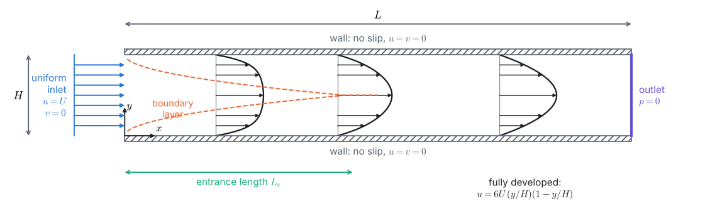
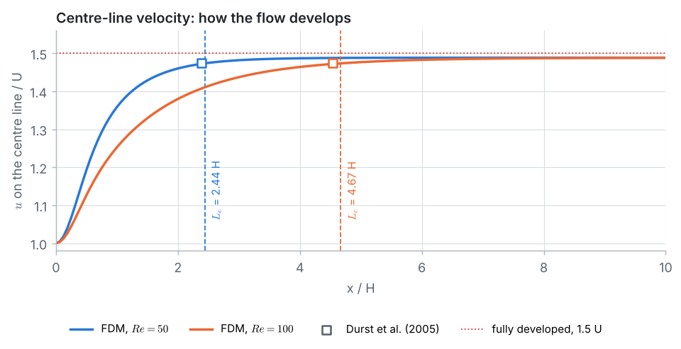

<p align="center">
  
</p>

# Problem 10 · Developing laminar flow in a channel

**2D · steady (marched in time) · Navier–Stokes in primitive variables u, v, p · staggered (MAC) grid · projection method · pressure Poisson equation · inlet and outlet conditions**

> A fluid enters the gap between two parallel plates with a uniform velocity $`U`$ and leaves at $`p = 0`$. Find the developing velocity field, the entrance length and the pressure drop at $`Re = \rho U H/\mu = 50`$ and $`100`$ with the Finite Difference Method, and compare with the exact fully developed (Poiseuille) solution and the entrance-length correlation of Durst et al. (2005).

## 📦 What's in this folder

| File | What's inside |
|---|---|
| 📄 [`01_problem_statement.pdf`](01_problem_statement.pdf) | the problem, equations, exact fully developed solution, entrance-length correlation, data, a box with everything a simulation package needs, and the tasks |
| 📘 [`02_solution.pdf`](02_solution.pdf) | the step-by-step solution: staggered grid and the checkerboard, the projection method, inlet/wall/outlet conditions in the pressure equation, SOR with a block correction, entrance length, mass conservation, pressure drop, grid study |
| 💻 [`03_fdm_solver.ipynb`](03_fdm_solver.ipynb) | the complete solver in **plain Python**, explained cell by cell, with plots |
| 🧮 [`04_whiteboard_guide.pdf`](04_whiteboard_guide.pdf) | **for instructors:** one complete projection step by hand on 2 × 3 cells (predictor, pressure equation, correction, divergence check), with every intermediate number |
| 🎨 [`plots.py`](plots.py) | drawing helpers used by the notebook (matplotlib only, no numerics) |
| 🛠️ [`docs/`](docs) | Markdown sources of the PDFs and their figures |

## 🎯 What you will learn

- How to solve the Navier–Stokes equations for the **primitive variables** $`u`$, $`v`$, $`p`$, and why the pressure is "whatever keeps the velocity divergence-free".
- The **projection (fractional-step) method** of Chorin: a predictor without pressure, a **pressure Poisson equation**, and a correction that makes the velocity divergence-free.
- Why storing $`u`$, $`v`$ and $`p`$ at the same points allows a **checkerboard pressure**, and how the **staggered (MAC) grid** prevents it, demonstrated with numbers.
- How to set **inlet and outlet conditions**: where the velocity is given the pressure is free, and where the pressure is given the velocity is free.
- How a **block correction** with the Thomas algorithm speeds up SOR on a long domain, and what the **entrance length** and the **extra pressure drop** of a developing flow are.

## 📊 Result

<p align="center">
  
</p>

| | entrance length $`L_e/H`$ | $`dp/dx`$ downstream | extra pressure drop $`/\rho U^2`$ | flow rate at every $`x`$ |
|---|:-:|:-:|:-:|:-:|
| $`Re = 50`$, FDM 160 × 16 | 2.438 | −0.2381 | 0.233 | 1.00000000 |
| $`Re = 50`$, Richardson ($`h = H/16`$ and $`H/32`$) | 2.431 | −0.2402 | 0.220 | |
| $`Re = 50`$, exact / Durst et al. (2005) | 2.391 | −0.24 | | 1 |
| $`Re = 100`$, FDM 160 × 16 | 4.669 | −0.1191 | 0.271 | 1.00000000 |
| $`Re = 100`$, exact / Durst et al. (2005) | 4.542 | −0.12 | | 1 |

Downstream the flow becomes plane Poiseuille flow ($`u_{max} = 1.5\,U`$, $`dp/dx = -12\mu U/H^2`$), with second-order convergence. The entrance lengths agree with the correlation of Durst et al. to 2–3 % (1.6 % for the grid-independent value at $`Re = 50`$), and mass is conserved to eight decimals.

## ▶️ Run it

```bash
pip install -r ../../requirements.txt
jupyter lab 03_fdm_solver.ipynb
```

The whole notebook takes about two and a half minutes in plain Python; the finest grid of the grid study ($`h = H/32`$) takes about 75 seconds of that.

---

<p align="center"><a href="../../README.md#-course-problems">⬅ Back to the course home page</a></p>
