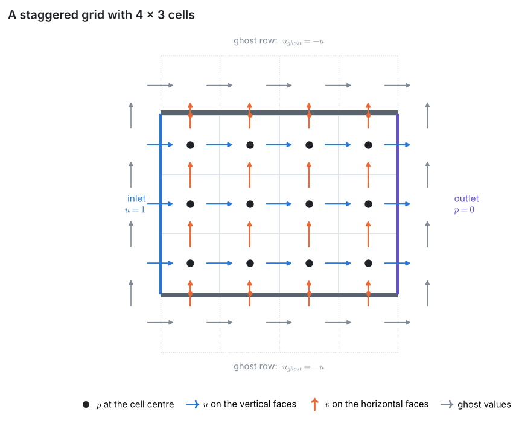
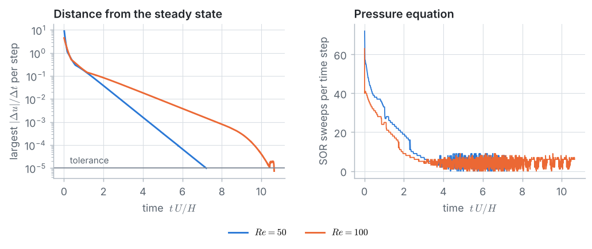
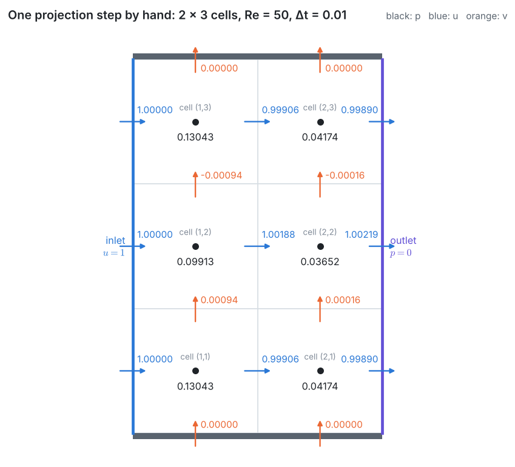
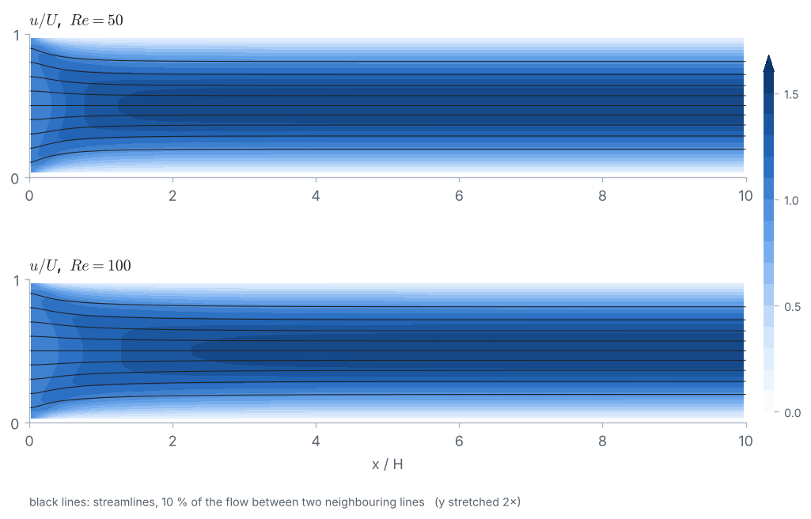
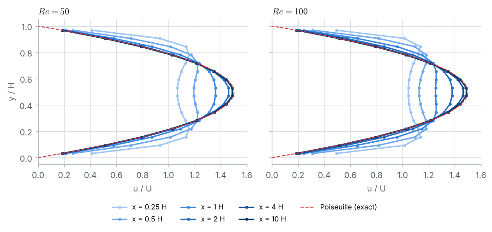
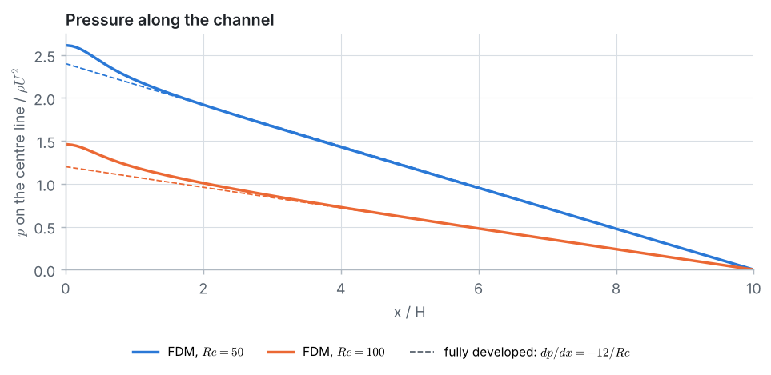
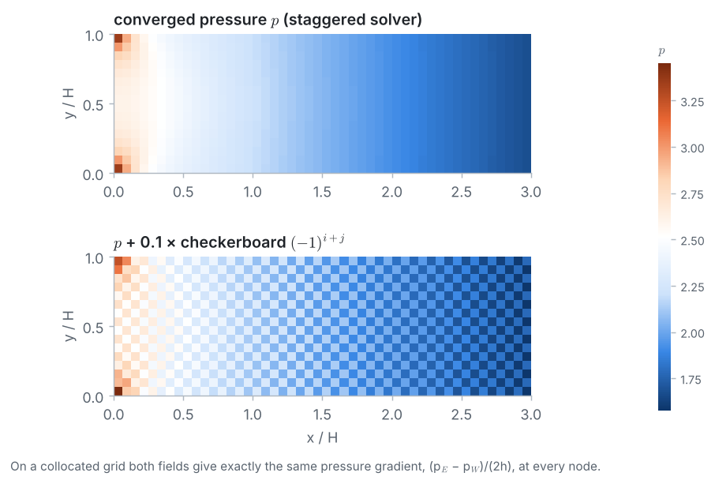
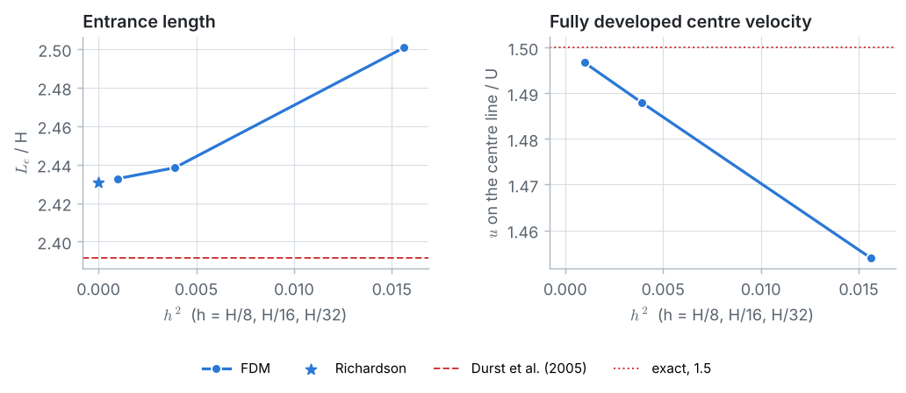

::: goal
**Plan.** We follow the 7 pillars of CFD: geometry → grid → physics → numerical scheme → solution setup → compute → post-processing. All code below is plain Python (lists and loops only; `math` and `time` from Python itself). It is the code of the notebook `03_fdm_solver.ipynb`, where it can be run cell by cell.
:::

## Step 1 · Geometry and data

Two parallel plates a distance $H$ apart; the fluid enters at $x = 0$ with a uniform velocity $U$ and leaves at $x = L = 10\,H$ into a space at $p = 0$. Boundary layers grow on both plates, the core accelerates, and after the **entrance length** $L_e$ the profile is the parabola of Poiseuille flow.

In dimensionless form (lengths in $H$, velocities in $U$, time in $H/U$, pressure in $\rho U^2$) only the **Reynolds number** $Re = \rho U H/\mu$ remains.

{{code:data}}

{{out:data}}

## Step 2 · The grid: why staggered?

Square cells of side $h = H/16$: 160 along the channel, 16 across.

On a **collocated** grid ($u$, $v$, $p$ at the same nodes) the pressure gradient at a node is $(p_E - p_W)/(2h)$, which skips the node itself. A pressure that alternates from node to node (a **checkerboard**) then has zero gradient everywhere: the momentum equations cannot see it and nothing removes it. On the **staggered (MAC) grid** of Harlow and Welch (1965), $p$ sits at the cell centres, $u$ on the vertical faces and $v$ on the horizontal faces. The pressure difference that drives the flow through a face uses the two cells on either side, $(p_E - p_P)/h$, and the mass leaving a cell is what crosses its four faces.

In the code, `p[j][i]` is the pressure of cell $(i, j)$, `u[j][i]` the velocity on its **right** face (`u[j][0]` is the inlet, `u[j][nx]` the outlet) and `v[j][i]` the velocity on its **top** face (`v[0][i]` and `v[ny][i]` lie on the walls).

{{code:grid}}

{{out:grid}}

## Step 3 · Physics

$$\nabla\cdot\mathbf u = 0, \qquad \frac{\partial\mathbf u}{\partial t} + (\mathbf u\cdot\nabla)\,\mathbf u = -\nabla p + \frac{1}{Re}\,\nabla^2\mathbf u.$$

The stream function–vorticity method of Problems 6 and 7 removes the pressure. Here we **want** the pressure (the pressure drop), and the inlet and outlet would need extra conditions for $\psi$ and $\omega$; so we solve for the **primitive variables** $u$, $v$, $p$. The pressure has no equation of its own: it is whatever keeps the velocity divergence-free.

| Boundary | Velocity | Pressure |
|---|---|---|
| inlet | $u = 1$, $v = 0$ | free: $\partial p/\partial x = 0$ |
| walls | $u = v = 0$ | free: $\partial p/\partial y = 0$ |
| outlet | free: $\partial u/\partial x = \partial v/\partial x = 0$ | $p = 0$ |

**Where the velocity is given, the pressure is free, and where the pressure is given, the velocity is free.**

**Fully developed flow.** With $v = 0$ and $\partial/\partial x = 0$, the $x$-momentum equation is $dp/dx = (1/Re)\,d^2u/dy^2$ = constant. With $u(0) = u(1) = 0$ and $\int_0^1 u\,dy = 1$: $u = 6y(1 - y)$, $u_{max} = 1.5$, $dp/dx = -12/Re$.

**Entrance length.** Durst et al. (2005) fitted $L_e/H = [0.631^{1.6} + (0.0442\,Re)^{1.6}]^{1/1.6}$ to their computations of channels with a uniform inlet ($L_e$: centre-line velocity at 99 % of its fully developed value).

{{code:benchmark-data}}

{{out:benchmark-data}}

## Step 4 · Numerical scheme: the projection method

Each time step has three parts (Chorin, 1968):

1. **Predictor:** march the momentum equations without the pressure: $\mathbf u^* = \mathbf u^n + \Delta t\,[\nabla^2\mathbf u^n/Re - (\mathbf u^n\cdot\nabla)\mathbf u^n]$ (FTCS, central differences).
2. **Pressure:** we want $\mathbf u^{n+1} = \mathbf u^* - \Delta t\,\nabla p$ to be divergence-free. Taking the divergence gives the **pressure Poisson equation** $\nabla^2 p = \nabla\cdot\mathbf u^*/\Delta t$.
3. **Correction:** $\mathbf u^{n+1} = \mathbf u^* - \Delta t\,\nabla p$.

**Predictor for $u$** on a vertical face ($\bar v$ is the average of the four $v$ around the face):

$$u^*_{j,i} = u_{j,i} + \Delta t\left[\frac{u_{j,i+1} + u_{j,i-1} + u_{j+1,i} + u_{j-1,i} - 4u_{j,i}}{Re\,h^2} - u_{j,i}\,\frac{u_{j,i+1} - u_{j,i-1}}{2h} - \bar v\,\frac{u_{j+1,i} - u_{j-1,i}}{2h}\right],$$

and the same for $v$ with $\bar u$. **Ghost values** give the boundary conditions: $u_{ghost} = -u_{inside}$ beyond each wall (so that their average, the wall velocity, is zero), $v_{ghost} = -v_{inside}$ before the inlet ($v = 0$ there), $v_{ghost} = v_{inside}$ beyond the outlet. The outlet $u^*$ is copied from its neighbour ($\partial u/\partial x = 0$).

{{code:fields}}

{{code:predictor}}

**Pressure equation** of cell $P$, multiplied by $h^2$:

$$a_E\,(p_E - p_P) + a_W\,(p_W - p_P) + a_N\,(p_N - p_P) + a_S\,(p_S - p_P) = b_P = \frac{h}{\Delta t}\left(u^*_E - u^*_W + v^*_N - v^*_S\right),$$

where $u^*_E, u^*_W, v^*_N, v^*_S$ are the velocities on the four faces of the cell. All coefficients are 1 except at the boundary: **$a = 0$** towards the inlet and the walls (the velocity there is given and must not be corrected, so $\partial p/\partial n = 0$), and **$a_E = 2$, $p_E = 0$** at the outlet (the face with $p = 0$ is only half a cell away).

**Correction:** $u_{j,i} = u^*_{j,i} - \Delta t\,(p_{j,i+1} - p_{j,i})/h$, at the outlet face $u = u^* + \Delta t\,p_{j,n_x}/(h/2)$, and $v_{j,i} = v^*_{j,i} - \Delta t\,(p_{j+1,i} - p_{j,i})/h$.

{{code:correct}}

## Step 5 · Solution setup

**Time step.** The FTCS predictor is stable if $\Delta t \le Re\,h^2/4$ (diffusion in 2D), $\Delta t \le 2/(Re\,u_{max}^2)$ (central convection, Problem 5) and $u_{max}\Delta t/h \le 1$ (CFL). We use $u_{max} = 1.5$ and a factor 0.8:

{{code:timestep}}

{{out:timestep}}

**Pressure equation: SOR plus a block correction.** We solve it with SOR ($\omega = 1.7$), starting from the previous pressure. On a channel ten times longer than high, plain SOR is very slow: an error that shifts the pressure of a whole cross-section must be passed column by column to the outlet. Before each SOR sweep we therefore add a constant $c_i$ to every cell of column $i$, chosen so that each column's equations **added up** are satisfied. The wall terms cancel in the sum, and what remains is one tridiagonal system,

$$n_y\,a_W\,(c_{i-1} - c_i) + n_y\,a_E\,(c_{i+1} - c_i) = R_i = \sum_{\text{column } i} r_P, \qquad r_P = b_P - \sum a\,(p_{nb} - p_P),$$

solved with the **Thomas algorithm** of Problem 1. After the correction the divergence of a cell is $\Delta t\,r_P/h^2$, so we stop when all residuals are small enough for $|\nabla\cdot\mathbf u| < 10^{-6}$.

{{code:pressure}}

The first pressure equation (plug flow suddenly meeting the walls) on the coarse grid $h = H/8$, with and without the block correction:

{{code:block-demo}}

{{out:block-demo}}

**The solver.** Start from plug flow ($u = 1$, $v = 0$, $p = 0$) and march until the largest $|\Delta u|/\Delta t$ in a step is below $10^{-5}$: then $\partial u/\partial t = 0$, and $u$, $v$, $p$ satisfy the steady equations.

{{code:solver}}

## Step 6 · Compute

{{code:run}}

{{out:run}}

The start-up disturbance is carried out through the outlet within about one flow-through time ($t \approx L/U$). At $Re = 100$ it is damped less on the way and its last part leaves at $t \approx 10$, where the curve drops sharply.

**The whiteboard numbers.** The whiteboard guide does one projection step by hand on 2 × 3 cells ($h = 1/3$, $Re = 50$, $\Delta t = 0.01$). The same step with the notebook's functions:

{{code:hand}}

{{out:hand}}

## Step 7 · Post-processing and verification

**Outlet profile.** The fully developed flow **on our grid** solves $(u_{j+1} - 2u_j + u_{j-1})/h^2 = Re\,dp/dx$ with the wall ghosts and a flow rate of 1, a tridiagonal system (Thomas again):

{{code:outlet}}

{{out:outlet}}

The outlet agrees with the grid's own fully developed flow, so the outlet is far enough downstream; the 0.4 % difference from the exact parabola is the discretization error of the grid, mostly from the ghost-value wall condition.

**Entrance length.** $L_e$ is where the centre-line velocity reaches 99 % of the centre velocity of the grid's fully developed flow (so that the grid's error in the parabola itself does not count, and the outlet position does not matter):

{{code:entrance}}

{{out:entrance}}

**Mass conservation.** The flow rate $Q = \sum_j u_{j,i}\,h$ at several cross-sections, and the largest divergence of any cell:

{{code:mass}}

{{out:mass}}

**Pressure drop.** We extrapolate the centre-line pressure to $x = 0$ and split it into the drop of fully developed flow over the whole length, $|dp/dx|\,L$ (gradient computed at the outlet), and the **extra drop** of the entrance region, $K\,\tfrac12\rho U^2$:

{{code:pressure-drop}}

{{out:pressure-drop}}

**The checkerboard, with numbers.** We add a checkerboard of $\pm 0.1$ to the converged pressure and compare the pressure gradients the momentum equations would see:

{{code:checkerboard}}

{{out:checkerboard}}

On the collocated grid the checkerboard changes nothing (round-off); on the staggered grid it changes the gradient by $2 \times 0.1/h = 3.2$ and would be pushed away at once.

**Grid study** for $Re = 50$, on a channel $5\,H$ long (twice $L_e$; the check in the last line shows that the length does not matter):

{{code:refine}}

{{out:refine}}

**Richardson extrapolation**, $f \approx f_{h/2} + (f_{h/2} - f_h)/3$, and the observed order $p = \log_2[(f_8 - f_{16})/(f_{16} - f_{32})]$:

{{code:richardson}}

{{out:richardson}}

- The fully developed velocity and pressure gradient converge with order close to 2 and extrapolate to the exact $1.5$ and $-0.24$.
- The entrance length converges to $2.43\,H$, 1.6 % above the correlation of Durst et al.; its observed order is irregular because $L_e$ is found by interpolating where a curve crosses the 99 % line.
- The extra pressure drop converges only at first order, towards about $0.22\,\rho U^2$: the pressure is singular at the inlet corners.

::: answer
**Result.** On the main grid ($h = H/16$) the flow becomes fully developed after $L_e = 2.44\,H$ at $Re = 50$ and $4.67\,H$ at $Re = 100$ (Durst et al.: $2.39\,H$ and $4.54\,H$; grid-independent FDM value at $Re = 50$: $2.43\,H$). Downstream the profile is the Poiseuille parabola with $dp/dx = -12\mu U/H^2$ (FDM: $-0.2381$ and $-0.1191$ against $-0.24$ and $-0.12$, converging at second order). The flow rate is conserved to eight decimals. The entrance region costs an extra pressure drop of about $0.23\,\rho U^2$ ($Re = 50$) and $0.27\,\rho U^2$ ($Re = 100$) on top of the fully developed drop.
:::

## Key ideas

- With inlets and outlets, solve for the **primitive variables** $u$, $v$, $p$; the pressure is what keeps the velocity divergence-free.
- **Projection method:** predictor without pressure → pressure Poisson equation → correction; march to the steady state.
- The **staggered grid** couples neighbouring pressures, so no checkerboard can hide; a collocated grid with central differences cannot see one.
- **Boundary conditions:** velocity given (inlet, walls) → $\partial p/\partial n = 0$; pressure given (outlet) → $\partial u/\partial n = 0$.
- On a long domain, SOR needs help: a **block correction** with the Thomas algorithm removes the slow, column-wide errors.
